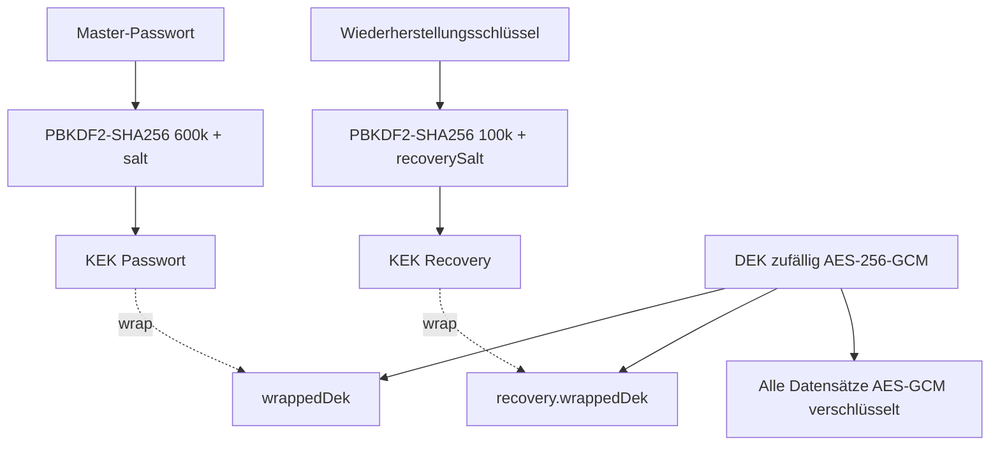

# 00 – Architektur & verbindliche Konventionen

> Dieses Dokument ist **verbindlich**. Der Code-Mode trifft keine eigenen Architektur-, Bibliotheks- oder Namensentscheidungen. Fehlt eine Angabe, wird das als Frage im TODO notiert. Es wird nichts erfunden.

## 1. Rahmen
- **Zielgerät:** iPhone mit aktuellem iOS und Safari. Die App wird als PWA über „Zum Home-Bildschirm“ installiert.
- **Ohne Backend:** Die App macht keinerlei Netzwerkaufrufe außer zum eigenen Host, um die eigenen Assets zu laden.
- **Sprache:** Die UI ist komplett **deutsch**. Code, Bezeichner und Dateinamen sind **englisch**.
- **Hosting:** GitHub Pages aus einem öffentlichen Repo (kostenlos). Im Repo liegt nur Code, niemals Daten.

## 2. Tech-Stack (fest, keine weiteren Abhängigkeiten)
| Paket | Zweck | Art |
|---|---|---|
| `svelte` (v5) | UI | dev |
| `@sveltejs/vite-plugin-svelte` | Build | dev |
| `vite` | Build/Dev-Server | dev |
| `typescript`, `svelte-check`, `tslib` | Typprüfung | dev |
| `vite-plugin-pwa` | Manifest + Service Worker (Workbox) | dev |
| `@vite-pwa/assets-generator` | Icons aus SVG erzeugen | dev |
| `vitest` | Unit-Tests | dev |
| `fake-indexeddb` | IndexedDB in Tests | dev |
| `dexie` (v4) | IndexedDB-Wrapper | dep |
| `tesseract.js`, `@tesseract.js-data/deu` | erst Phase 4 | dep/dev |

Diagramme werden **selbst als SVG gebaut**, ohne Chart-Bibliothek. Kryptographie läuft ausschließlich über die **WebCrypto API** (`crypto.subtle`). Ein Router ist **selbst gebaut** und hash-basiert.

**Projekt anlegen:** `npm create vite@latest . -- --template svelte-ts` im Workspace-Root, danach die Pakete installieren.

`package.json`-Scripts:
```json
{
  "dev": "vite",
  "build": "vite build",
  "preview": "vite preview",
  "check": "svelte-check --tsconfig ./tsconfig.app.json",
  "test": "vitest run",
  "icons": "pwa-assets-generator --preset minimal-2023 public/logo.svg"
}
```
Falls die Vite-Vorlage nur eine `tsconfig.json` erzeugt, wird diese im `check`-Script verwendet.

**Definition of Done für JEDES TODO:** `npm run check`, `npm test` und `npm run build` laufen ohne Fehler und ohne Warnungen.

## 3. Svelte-5-Regeln (wichtig für den Code-Mode)
- Komponenten-Props: `let { foo, bar = 1 }: Props = $props();`. Es gibt **kein** `export let`.
- Lokaler Zustand läuft über `$state(...)`, abgeleitete Werte über `$derived(...)` bzw. `$derived.by(() => ...)`, Seiteneffekte über `$effect(...)` (sparsam einsetzen).
- Events schreiben sich `onclick={...}`, `oninput={...}`, `onsubmit={...}`. Es gibt **kein** `on:click`.
- Callbacks zwischen Komponenten werden als Props übergeben (`onchange`, `onselect`). Es gibt **kein** `createEventDispatcher`.
- **Globaler Zustand** liegt in `svelte/store` (`writable`, `derived`) in `src/lib/state/*.ts`. In Komponenten wird er über `$storeName` gelesen.
- Ein `<form onsubmit={(e) => { e.preventDefault(); ... }}>` braucht immer `preventDefault()`.

## 4. Allgemeine Code-Konventionen
- TypeScript läuft im `strict`-Modus. **Kein `any`.** Unbekannte Daten sind `unknown` und werden validiert.
- **Geld wird immer als Integer in Cent gespeichert** (`amountCents`, immer > 0). Das Vorzeichen ergibt sich aus `type`. Für Geldbeträge gibt es niemals Float-Arithmetik.
- **Datumswerte** sind Strings `YYYY-MM-DD` in lokaler Zeit. Ein Monatsschlüssel hat die Form `YYYY-MM`. Für „heute“ wird **niemals** `toISOString()` verwendet, weil das einen UTC-Fehler verursacht. Stattdessen kommt `todayIso()` aus `dates.ts` zum Einsatz.
- **Zeitstempel** wie `createdAt` oder `updatedAt` sind ISO-Strings über `new Date().toISOString()`.
- **IDs** werden mit `crypto.randomUUID()` erzeugt. Standardkategorien haben feste IDs (siehe [01-phase1-mvp.md](01-phase1-mvp.md)).
- Reine Logik liegt in `src/lib/**` als **pure functions** mit Tests (`*.test.ts` direkt daneben). UI-Komponenten enthalten keine Geschäftslogik.
- Es wird nichts geloggt, was Nutzerdaten enthält. `console.log` mit Daten ist verboten.
- Bestätigungen laufen über natives `confirm()`. Meldungen laufen über den Toast-Store.

## 5. Ordnerstruktur (verbindlich)
```
index.html
vite.config.ts
public/
  logo.svg                     # Quelle für Icons
  (generierte Icons)
scripts/
  copy-tesseract.mjs           # erst Phase 4
src/
  main.ts
  App.svelte                   # Session-Gate + Router-Switch + TabBar
  app.css                      # globale Styles, CSS-Variablen, Dark Mode
  lib/
    types.ts                   # ALLE Domain-Typen
    money.ts(+test)            # parseAmountToCents, formatCents
    dates.ts(+test)            # todayIso, monthKey, addMonths, monthLabel, ...
    merchant.ts(+test)         # normalizeMerchant, suggestCategory, learnRule
    router.ts                  # Hash-Router
    crypto/
      encoding.ts(+test)       # base64, base32
      crypto.ts(+test)         # KDF, Wrap/Unwrap, encryptJson/decryptJson
      vault.ts(+test)          # createVault, unlock, changePassword, Recovery
    db/
      db.ts                    # Dexie-Schema
      encryptedTable.ts(+test) # generische verschlüsselte Tabelle
      defaults.ts              # Standardkategorien, -regeln, -settings
    state/
      session.ts               # Status, DEK im RAM, Lock/Unlock, Auto-Lock
      data.ts                  # Stores + CRUD-Funktionen
      toast.ts
    stats/
      month.ts(+test)
      year.ts(+test)           # Phase 2
    backup/
      format.ts                # Typen Backup-Datei
      validate.ts(+test)       # Validierung importierter Daten
      backup.ts(+test)         # create/restore
      csv.ts(+test)
    import/                    # Phase 3/4
      dkbParser.ts(+test)
      genericParser.ts(+test)
      parse.ts
      duplicates.ts(+test)
      ocr.ts
    recurring.ts(+test)        # Phase 2
  components/
    TabBar.svelte
    MonthSwitcher.svelte
    YearSwitcher.svelte        # Phase 2
    AmountText.svelte
    CategoryIcon.svelte
    TransactionRow.svelte
    DonutChart.svelte
    BarChart.svelte            # Phase 2
    PasswordField.svelte
    Toast.svelte
    UpdateBanner.svelte
  routes/
    Setup.svelte
    Lock.svelte
    Recover.svelte
    Overview.svelte
    Transactions.svelte
    TransactionForm.svelte
    Settings.svelte
    Categories.svelte
    CategoryForm.svelte
    Backup.svelte
    Stats.svelte               # Phase 2
    Recurring.svelte           # Phase 2
    Rules.svelte               # Phase 2
    Import.svelte              # Phase 3
```

## 6. Domain-Typen (`src/lib/types.ts`, wörtlich so)
```ts
export type TxType = 'expense' | 'income';
export type TxSource = 'manual' | 'text' | 'ocr' | 'recurring';

export interface Transaction {
  id: string;
  type: TxType;
  amountCents: number;      // Integer > 0
  date: string;             // YYYY-MM-DD
  categoryId: string;
  merchant: string;         // "Händler / Name", darf leer sein
  city: string;             // darf leer sein
  note: string;             // darf leer sein
  source: TxSource;
  recurringId: string | null;
  createdAt: string;
  updatedAt: string;
}

export interface Category {
  id: string;
  name: string;
  type: TxType;
  icon: string;             // ein Emoji
  color: string;            // #RRGGBB
  archived: boolean;
  sortOrder: number;
  monthlyBudgetCents: number | null;
  updatedAt: string;
}

export interface MerchantRule {
  id: string;
  pattern: string;          // Ergebnis von normalizeMerchant()
  categoryId: string;
  source: 'default' | 'learned' | 'manual';
  updatedAt: string;
}

export interface RecurringTemplate {      // Phase 2, Typ aber jetzt schon anlegen
  id: string;
  type: TxType;
  amountCents: number;
  categoryId: string;
  merchant: string;
  note: string;
  dayOfMonth: number;       // 1..31, bei kürzeren Monaten letzter Tag
  startMonth: string;       // YYYY-MM
  endMonth: string | null;  // YYYY-MM inklusiv
  lastGeneratedMonth: string | null;
  active: boolean;
  updatedAt: string;
}

export interface Settings {
  id: 'settings';
  schemaVersion: number;    // aktuell 1
  autoLockMinutes: 0 | 1 | 5 | 15;
  backupReminderDays: 0 | 7 | 14 | 30;   // 0 = aus
  lastBackupAt: string | null;
  updatedAt: string;
}

export interface AppData {
  transactions: Transaction[];
  categories: Category[];
  merchantRules: MerchantRule[];
  recurring: RecurringTemplate[];
  settings: Settings;
}
```

## 7. Sicherheitsarchitektur

### 7.1 Schlüsselhierarchie (Envelope Encryption)

- Der **DEK** (Data Encryption Key) wird einmal bei der Einrichtung zufällig erzeugt und verschlüsselt alle Daten.
- Der DEK wird zweimal „eingepackt“: einmal mit dem Passwort-KEK und einmal mit dem Recovery-KEK.
- Bei einer Passwortänderung wird **nur der DEK neu eingepackt**. Die Daten werden nicht neu verschlüsselt.
- Ein falsches Passwort erkennt man daran, dass `unwrapKey` eine Exception wirft (der AES-GCM-Auth-Tag schlägt fehl).
- Der DEK liegt **nur im RAM** (in einer Modulvariablen in `session.ts`, **nicht** in einem Store). Beim Sperren wird er auf `null` gesetzt und alle Daten-Stores werden geleert.

### 7.2 `src/lib/crypto/crypto.ts` (Referenzimplementierung, so umsetzen)
```ts
const enc = new TextEncoder();
const dec = new TextDecoder();

export const PBKDF2_ITERATIONS = 600_000;
export const RECOVERY_ITERATIONS = 100_000;

export interface WrappedKey { iv: Uint8Array; data: Uint8Array }
export interface EncryptedBlob { iv: Uint8Array; ct: Uint8Array }

export function randomBytes(n: number): Uint8Array {
  return crypto.getRandomValues(new Uint8Array(n));
}

export async function deriveKek(secret: string, salt: Uint8Array, iterations: number): Promise<CryptoKey> {
  const base = await crypto.subtle.importKey('raw', enc.encode(secret.normalize('NFC')), 'PBKDF2', false, ['deriveKey']);
  return crypto.subtle.deriveKey(
    { name: 'PBKDF2', hash: 'SHA-256', salt, iterations },
    base,
    { name: 'AES-GCM', length: 256 },
    false,
    ['wrapKey', 'unwrapKey'],
  );
}

export function generateDek(): Promise<CryptoKey> {
  return crypto.subtle.generateKey({ name: 'AES-GCM', length: 256 }, true, ['encrypt', 'decrypt']);
}

export async function wrapDek(dek: CryptoKey, kek: CryptoKey): Promise<WrappedKey> {
  const iv = randomBytes(12);
  const data = new Uint8Array(await crypto.subtle.wrapKey('raw', dek, kek, { name: 'AES-GCM', iv }));
  return { iv, data };
}

/** Wirft bei falschem Schlüssel. */
export function unwrapDek(w: WrappedKey, kek: CryptoKey, extractable: boolean): Promise<CryptoKey> {
  return crypto.subtle.unwrapKey('raw', w.data, kek, { name: 'AES-GCM', iv: w.iv },
    { name: 'AES-GCM', length: 256 }, extractable, ['encrypt', 'decrypt']);
}

export async function encryptJson(dek: CryptoKey, value: unknown): Promise<EncryptedBlob> {
  const iv = randomBytes(12);
  const ct = new Uint8Array(await crypto.subtle.encrypt({ name: 'AES-GCM', iv }, dek, enc.encode(JSON.stringify(value))));
  return { iv, ct };
}

export async function decryptJson<T>(dek: CryptoKey, blob: EncryptedBlob): Promise<T> {
  const pt = await crypto.subtle.decrypt({ name: 'AES-GCM', iv: blob.iv }, dek, blob.ct);
  return JSON.parse(dec.decode(pt)) as T;
}
```
> **TS-Hinweis:** Meldet TypeScript, dass `Uint8Array<ArrayBufferLike>` nicht zu `BufferSource` passt, wird an der Aufrufstelle `new Uint8Array(x)` verwendet, um eine Kopie zu erzeugen. Typchecks werden **nicht** mit `as any` unterdrückt.
>
> **IV-Regel:** Jede Verschlüsselung bekommt eine **neue** zufällige 12-Byte-IV. Eine IV wird niemals wiederverwendet.

### 7.3 `src/lib/crypto/encoding.ts`
- `toBase64(bytes: Uint8Array): string` und `fromBase64(s: string): Uint8Array` laufen über `btoa`/`atob`, und zwar in Schleifen mit Chunks zu 0x8000 Bytes.
- `toBase32(bytes: Uint8Array): string` nutzt das Alphabet RFC 4648 `ABCDEFGHIJKLMNOPQRSTUVWXYZ234567` ohne Padding.
- `formatRecoveryKey(raw: string): string` erzeugt Gruppen zu 4 Zeichen, getrennt durch `-`.
- `normalizeRecoveryKey(input: string): string` macht alles groß und entfernt alles außer `A-Z2-7`.
- Tests: Base64-Roundtrip mit 0, 1, 2, 3 und 100.000 Bytes. Base32 von `[0xff,0xff,0xff,0xff,0xff]` ergibt `"77777777"`.

### 7.4 `src/lib/crypto/vault.ts`
```ts
export interface VaultMeta {
  id: 'vault';
  version: 1;
  kdf: { iterations: number; salt: Uint8Array };          // salt 16 Byte
  wrappedDek: WrappedKey;
  recovery: { iterations: number; salt: Uint8Array; wrappedDek: WrappedKey };
  createdAt: string;
}

export const MIN_PASSWORD_LENGTH = 10;

// Erzeugt DEK, Salts und Wiederherstellungsschlüssel (20 Zufallsbytes -> base32 -> 32 Zeichen -> formatiert).
export async function createVault(password: string): Promise<{ meta: VaultMeta; dek: CryptoKey; recoveryKey: string }>;
// DEK non-extractable. Wirft WrongSecretError bei falschem Passwort.
export async function unlockWithPassword(meta: VaultMeta, password: string): Promise<CryptoKey>;
// Liefert extractable DEK (für Re-Wrap).
export async function unlockWithRecovery(meta: VaultMeta, recoveryKey: string): Promise<CryptoKey>;
// Prüft oldPassword (unwrap extractable), wrapt mit neuem Salt + neuem Passwort. recovery bleibt unverändert.
export async function changePassword(meta: VaultMeta, oldPassword: string, newPassword: string): Promise<VaultMeta>;
// Recovery-Flow: unwrap via Recovery, neues Passwort setzen. Liefert neue Meta + DEK.
export async function resetPasswordWithRecovery(meta: VaultMeta, recoveryKey: string, newPassword: string): Promise<{ meta: VaultMeta; dek: CryptoKey }>;
// Neuer Wiederherstellungsschlüssel (alter wird ungültig). Erfordert Passwort.
export async function regenerateRecoveryKey(meta: VaultMeta, password: string): Promise<{ meta: VaultMeta; recoveryKey: string }>;

export class WrongSecretError extends Error {}
```
Für den Wiederherstellungsschlüssel wird vor `deriveKek` immer `normalizeRecoveryKey()` angewendet.

Tests in `vault.test.ts` (Node 20+ hat `crypto.subtle` global): Erstellen und Entsperren mit richtigem Passwort klappt. Ein falsches Passwort wirft `WrongSecretError`. Nach einer Passwortänderung funktioniert das alte Passwort nicht mehr und das neue schon, und mit dem DEK verschlüsselte Daten lassen sich weiterhin entschlüsseln. Der Recovery-Flow funktioniert auch, wenn der Schlüssel klein geschrieben und ohne Bindestriche eingegeben wird. **In Tests werden die Iterationen auf 1.000 gesetzt**. Dafür bekommen die Funktionen einen optionalen letzten Parameter `iterations?: { password: number; recovery: number }` mit den Konstanten als Default.

### 7.5 Content-Security-Policy & Netzwerk
Die CSP wird **nur im Production-Build** als `<meta http-equiv="Content-Security-Policy">` in `index.html` injiziert. Das geschieht über ein kleines Vite-Plugin in `vite.config.ts` mit `apply: 'build'` und `transformIndexHtml`, weil der Dev-Server Inline-Skripte für HMR braucht.
```
default-src 'self'; script-src 'self' 'wasm-unsafe-eval'; style-src 'self' 'unsafe-inline'; img-src 'self' data: blob:; connect-src 'self'; worker-src 'self' blob:; object-src 'none'; base-uri 'self'; form-action 'none'
```
- Es gibt keine externen Fonts, CDNs oder Analytics. Verwendet wird der System-Font-Stack.
- Der Service Worker nutzt `registerType: 'prompt'`. Ein Update wird **nur nach Bestätigung durch den Nutzer** aktiviert (über `UpdateBanner.svelte` mit „Neue Version verfügbar – Aktualisieren“). So kann ein Update nicht unbemerkt Code austauschen.

### 7.6 Bekannte Grenzen (bewusst akzeptiert und in der README dokumentiert)
- Die Anzahl der Datensätze und die UUIDs sind unverschlüsselt sichtbar. Inhalte sind es nicht.
- Wer das Passwort **und** den Wiederherstellungsschlüssel verliert, verliert die Daten.
- Wenn jemand das GitHub-Konto übernimmt, könnte er bösartigen Code ausliefern. Gegenmaßnahmen sind 2FA auf GitHub und Updates nur nach Bestätigung.
- iOS: Daten in Safari und Daten in der Home-Bildschirm-App sind **getrennt**. Wird die App vom Home-Bildschirm gelöscht, sind **auch die Daten gelöscht**. Deshalb braucht es Backups.

## 8. Speicherung (Dexie)

### 8.1 `src/lib/db/db.ts`
```ts
import Dexie, { type Table } from 'dexie';
import type { VaultMeta } from '../crypto/vault';

export interface EncryptedRow { id: string; iv: Uint8Array; ct: Uint8Array }

export class MoneyDb extends Dexie {
  meta!: Table<VaultMeta, string>;
  transactions!: Table<EncryptedRow, string>;
  categories!: Table<EncryptedRow, string>;
  merchantRules!: Table<EncryptedRow, string>;
  recurring!: Table<EncryptedRow, string>;
  settings!: Table<EncryptedRow, string>;
  constructor(name = 'money-tracker') {
    super(name);
    this.version(1).stores({
      meta: 'id', transactions: 'id', categories: 'id',
      merchantRules: 'id', recurring: 'id', settings: 'id',
    });
  }
}
export const db = new MoneyDb();
```
Nur `meta` ist unverschlüsselt. Es enthält ausschließlich Salts und eingepackte Schlüssel.

### 8.2 `src/lib/db/encryptedTable.ts`
```ts
export class EncryptedTable<T extends { id: string }> {
  constructor(private table: Table<EncryptedRow, string>, private getKey: () => CryptoKey) {}
  async getAll(): Promise<T[]>;           // alle Rows entschlüsseln
  async put(item: T): Promise<void>;      // encryptJson -> {id: item.id, iv, ct}
  async bulkPut(items: T[]): Promise<void>;
  async delete(id: string): Promise<void>;
  async clear(): Promise<void>;
}
```
Tests nutzen `import 'fake-indexeddb/auto'` und eine eigene DB-Instanz `new MoneyDb('test-' + crypto.randomUUID())`. Geprüft wird: ein Roundtrip funktioniert, die Rohdaten in der Tabelle enthalten den Klartext **nicht**, und das Entschlüsseln mit einem falschen Schlüssel wirft.

### 8.3 Laden & Halten
Die Datenmengen sind klein (Tausende Buchungen). Deshalb werden beim Entsperren **alle Daten entschlüsselt und in Stores im RAM gehalten**. Jede Änderung schreibt zuerst in die DB und aktualisiert danach den Store. Auswertungen laufen rein auf den Stores.

## 9. Session & Auto-Lock (`src/lib/state/session.ts`)
```ts
export type SessionStatus = 'loading' | 'setup' | 'locked' | 'unlocked';
export const status: Writable<SessionStatus>;
export function getDek(): CryptoKey;             // wirft, wenn gesperrt
export async function initSession(): Promise<void>;  // meta lesen -> 'setup' oder 'locked'
export async function setupVault(password: string): Promise<string>; // gibt recoveryKey zurück; legt Defaults an; ruft navigator.storage?.persist()
export async function unlock(password: string): Promise<void>;       // -> loadAll(); recurring generieren (Phase 2); status 'unlocked'
export async function recover(recoveryKey: string, newPassword: string): Promise<void>;
export function lock(): void;                    // dek=null; clearAll(); status 'locked'; location.hash = '#/'
```
**Auto-Lock-Regeln:**
1. Bei `visibilitychange` auf `hidden`: Ist `autoLockMinutes === 0`, wird sofort `lock()` aufgerufen. Sonst wird `hiddenAt = Date.now()` gemerkt.
2. Bei `visibilitychange` auf `visible`: Gilt `hiddenAt && Date.now() - hiddenAt >= autoLockMinutes * 60_000`, wird `lock()` aufgerufen.
3. Bei Inaktivität im Vordergrund: Nach 5 Minuten ohne `pointerdown`/`keydown` wird `lock()` aufgerufen. Das wird über einen Timestamp-Vergleich in einem `setInterval` alle 15 Sekunden geprüft.

Der Standardwert für `autoLockMinutes` ist `1`.

## 10. Router (`src/lib/router.ts`)
- Hash-basiert, damit GitHub Pages keine 404-Fehler liefert.
- Format: `#/pfad?key=value&key2=value2`.
- `route: Readable<{ path: string; params: Record<string,string>; query: URLSearchParams }>` wird bei `hashchange` aktualisiert.
- `navigate(path: string)` setzt `location.hash`. `back()` ruft `history.back()` auf.
- Routen-Matching in `App.svelte` über eine Tabelle `{ pattern: '/edit/:id', component }`. Der Matcher ist eine einfache Funktion in `router.ts` mit Tests, die Segmente vergleicht und `:param` extrahiert.

| Route | Komponente | Phase |
|---|---|---|
| `/` | Overview | 1 |
| `/transactions` | Transactions (Query: `month`, `year`, `category`, `type`) | 1 |
| `/add` | TransactionForm (Query `type=income` optional) | 1 |
| `/edit/:id` | TransactionForm | 1 |
| `/settings` | Settings | 1 |
| `/settings/categories` | Categories | 1 |
| `/settings/categories/new` | CategoryForm | 1 |
| `/settings/categories/:id` | CategoryForm | 1 |
| `/backup` | Backup | 1 |
| `/stats` | Stats (Query `year`) | 2 |
| `/settings/recurring` | Recurring | 2 |
| `/settings/rules` | Rules | 2 |
| `/import` | Import | 3 |

Unbekannte Routen führen zu `/`. Ist `status !== 'unlocked'`, rendert `App.svelte` je nach Status `Setup`, `Lock` oder `Recover` (Recover über einen lokalen Zustand in Lock) und zeigt **keine** TabBar.

## 11. UI-Grundlagen (`app.css`)
- Mobile-first, `max-width: 600px; margin: 0 auto`.
- Font: `-apple-system, BlinkMacSystemFont, system-ui, sans-serif`. **Eingabefelder haben mindestens `font-size: 16px`**, damit iOS nicht hineinzoomt.
- Safe Areas: `padding-top: env(safe-area-inset-top)` und eine TabBar mit `padding-bottom: env(safe-area-inset-bottom)`.
- CSS-Variablen: `--bg`, `--surface`, `--text`, `--muted`, `--border`, `--primary: #0f766e`, `--income: #15803d`, `--expense: #b91c1c`, `--radius: 12px`. Dark Mode wird über `@media (prefers-color-scheme: dark)` umgesetzt, indem die Variablen überschrieben werden.
- Touch-Ziele sind mindestens 44×44 px.
- **TabBar** (fixiert unten, 5 Einträge): `Übersicht 🏠` (`/`), `Buchungen 📋` (`/transactions`), mittig ein großer runder Button `＋` (`/add`), `Statistik 📊` (`/stats`, in Phase 1 ausgeblendet), `Einstellungen ⚙️` (`/settings`). Der aktive Tab ist mit `--primary` hervorgehoben.

### `index.html` (Head-Pflichtangaben)
```html
<meta name="viewport" content="width=device-width, initial-scale=1, viewport-fit=cover" />
<meta name="apple-mobile-web-app-capable" content="yes" />
<meta name="mobile-web-app-capable" content="yes" />
<meta name="apple-mobile-web-app-status-bar-style" content="default" />
<meta name="apple-mobile-web-app-title" content="Money" />
<meta name="referrer" content="no-referrer" />
<meta name="theme-color" content="#0f766e" />
<link rel="apple-touch-icon" href="apple-touch-icon-180x180.png" />
<title>Money Tracker</title>
```

## 12. `vite.config.ts` (Vorgabe)
```ts
import { defineConfig, type Plugin } from 'vite';
import { svelte } from '@sveltejs/vite-plugin-svelte';
import { VitePWA } from 'vite-plugin-pwa';

const CSP = "default-src 'self'; script-src 'self' 'wasm-unsafe-eval'; style-src 'self' 'unsafe-inline'; img-src 'self' data: blob:; connect-src 'self'; worker-src 'self' blob:; object-src 'none'; base-uri 'self'; form-action 'none'";

const cspPlugin = (): Plugin => ({
  name: 'inject-csp',
  apply: 'build',
  transformIndexHtml: (html) =>
    html.replace('<head>', `<head>\n    <meta http-equiv="Content-Security-Policy" content="${CSP}" />`),
});

export default defineConfig({
  base: '/money-tracker/',
  plugins: [
    svelte(),
    cspPlugin(),
    VitePWA({
      registerType: 'prompt',
      injectRegister: false,
      includeAssets: ['apple-touch-icon-180x180.png', 'favicon.ico', 'logo.svg'],
      manifest: {
        name: 'Money Tracker',
        short_name: 'Money',
        lang: 'de',
        start_url: './',
        scope: './',
        display: 'standalone',
        background_color: '#ffffff',
        theme_color: '#0f766e',
        icons: [
          { src: 'pwa-192x192.png', sizes: '192x192', type: 'image/png' },
          { src: 'pwa-512x512.png', sizes: '512x512', type: 'image/png' },
          { src: 'maskable-icon-512x512.png', sizes: '512x512', type: 'image/png', purpose: 'maskable' },
        ],
      },
      workbox: { globPatterns: ['**/*.{js,css,html,svg,png,ico,webmanifest}'] },
    }),
  ],
  test: { environment: 'node' },
});
```
- Heißt das Repo anders als `money-tracker`, wird `base` entsprechend angepasst.
- Die SW-Registrierung erfolgt in `UpdateBanner.svelte` über `import { useRegisterSW } from 'virtual:pwa-register/svelte'`. In `src/vite-env.d.ts` wird dazu `/// <reference types="vite-plugin-pwa/svelte" />` ergänzt.
- Falls `test` in `defineConfig` einen Typfehler erzeugt, wird zusätzlich `/// <reference types="vitest/config" />` an den Dateianfang gesetzt.
