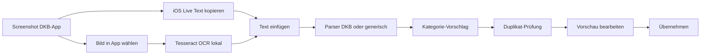

# 03 – Phase 3 & 4: Text-Import (DKB) und Screenshot-OCR

> Voraussetzung: Phase 1 ist fertig. Phase 2 ist **nicht** zwingend nötig.

## Ablauf


## Schritt 3.1 – Typ (`src/lib/import/parse.ts`)
```ts
export interface ParsedRow {
  date: string;            // YYYY-MM-DD
  type: TxType;
  amountCents: number;
  merchant: string;
  city: string;
  bankType: string;        // z.B. 'Kartenzahlung', '' wenn unbekannt
  raw: string;             // Originalzeilen, für Anzeige bei Problemen
}
export interface ParseResult { rows: ParsedRow[]; unparsedLines: string[] }
export function parseBankText(text: string): ParseResult; // DKB-Parser; wenn 0 rows -> genericParser
```

## Schritt 3.2 – DKB-Parser (`src/lib/import/dkbParser.ts`, pure + Tests)

**Referenz-Eingabe** (echter Text aus der DKB-App per Live Text, enthält Tabs und einen OCR-Tippfehler):
```
Girokonto
Oktober		
	Lidl
21.10.26 • Kartenzahlung	-42,15 €
	Vodafone GmbH
21.10.26 • Lastschrift	- 29,99 €
	Spotify
20.10.26 • Kartenzahlung	-10,99 €
	DM
19.10.26 • Kartenzahlung	-4,35 €
	Spotify
19.10.26 • Kartenzahlung	-2,99 €
	Fashion.Outlet.Center/
Musterstadt
16.10.26 • Kartenzahlung	-55,40 €
	Parken.City.Garage/ Beispielstadt
16.10.26 • Kartenzahlung	-6,50 €
	Kantine...Nord.Gastronomie.Gmb/ Beispielort
16.10.26 • Gutschrift	+2,50 €
	BAECKEREI.SONNE/ MUSTERHAUSEN
16.10.26 • Kartenzahluna	-7,20 €
```
Die Datei wird als Fixture `src/lib/import/__fixtures__/dkb-oktober.txt` abgelegt, und zwar exakt mit den Tabs.

**Struktur:** Jede Buchung besteht aus 1 oder mehr Händler-Zeilen, gefolgt von **einer** Buchungszeile „Datum • Art  Betrag“.

**Algorithmus:**
1. Den Text in Zeilen aufteilen (`/\r?\n/`). Jede Zeile wird getrimmt und Tabs werden durch ein Leerzeichen ersetzt.
2. Regex für die Buchungszeile:
   ```ts
   const BOOKING = /^(\d{1,2}\.\d{1,2}\.\d{2,4})\s*[•·*]?\s*(.*?)\s*([+\-−–])\s*(\d{1,3}(?:\.\d{3})*,\d{2})\s*€?$/;
   const BOOKING_NO_AMOUNT = /^(\d{1,2}\.\d{1,2}\.\d{2,4})\s*[•·*]?\s*(.*)$/;
   const AMOUNT_ONLY = /^([+\-−–])\s*(\d{1,3}(?:\.\d{3})*,\d{2})\s*€?$/;
   ```
3. **Ignorierte Zeilen** werden niemals Teil des Händlers:
   - Leerzeilen
   - Zeilen, die exakt einem `MONTH_NAMES`-Eintrag entsprechen, optional mit Jahr (`/^(Januar|…|Dezember)(\s+\d{4})?$/i`)
   - `Girokonto`, `Kreditkarte`, `Tagesgeld`, `Umsätze`, `Heute`, `Gestern`, `Vorgemerkt`, `Gebucht` (case-insensitive, exakter Vergleich)
   - Zeilen, die auf `/^[+\-−–]?\s*[\d.]+,\d{2}\s*€$/` passen und **nicht** direkt einer `BOOKING_NO_AMOUNT`-Zeile folgen (z. B. ein Kontostand)
4. Schleife über die Zeilen mit einem Puffer `pending: string[]`:
   - Ignorierte Zeile: überspringen.
   - Die Zeile passt auf `BOOKING`: Eine Buchung aus `pending` und dem Match erzeugen, danach `pending = []`.
   - Die Zeile passt auf `BOOKING_NO_AMOUNT` **und** die nächste nicht ignorierte Zeile passt auf `AMOUNT_ONLY`: wie oben, die nächste Zeile wird verbraucht.
   - Sonst: `pending.push(line)`.
   - Ist `pending` beim Erzeugen einer Buchung leer, wird `merchant = ''` gesetzt.
   - Am Ende landen übrige `pending`-Zeilen in `unparsedLines`.
5. Eine Buchung wird so erzeugt:
   - `date = parseGermanDate(m[1])`. Ist das Ergebnis `null`, wandert die Zeile nach `unparsedLines` und `pending` wird geleert.
   - `bankType = m[2].trim()`
   - `type = m[3] === '+' ? 'income' : 'expense'`
   - `amountCents = parseAmountToCents(m[4])`. Ist das Ergebnis `null`, wird die Zeile wie oben behandelt.
   - `{ merchant, city } = splitMerchant(pending.join(' '))`
6. `splitMerchant(s)`:
   1. Enthält `s` ein `/`, ist `merchant` der Teil vor dem **letzten** `/` und `city` der getrimmte Teil danach.
   2. `cleanMerchant(x)`: Enthält `x` **kein Leerzeichen**, aber `.`, wird `/\.+/g` durch ein Leerzeichen ersetzt. Danach Mehrfach-Leerzeichen zusammenfassen und trimmen.
   3. `city` in Title-Case umwandeln, wenn es komplett großgeschrieben ist (`MUSTERHAUSEN` wird zu `Musterhausen`).

**Erwartetes Ergebnis für die Fixture** (genau dieser Test ist Pflicht):
| # | date | type | cents | merchant | city | bankType |
|---|---|---|---|---|---|---|
| 0 | 2026-10-21 | expense | 4215 | Lidl | | Kartenzahlung |
| 1 | 2026-10-21 | expense | 2999 | Vodafone GmbH | | Lastschrift |
| 2 | 2026-10-20 | expense | 1099 | Spotify | | Kartenzahlung |
| 3 | 2026-10-19 | expense | 435 | DM | | Kartenzahlung |
| 4 | 2026-10-19 | expense | 299 | Spotify | | Kartenzahlung |
| 5 | 2026-10-16 | expense | 5540 | Fashion Outlet Center | Musterstadt | Kartenzahlung |
| 6 | 2026-10-16 | expense | 650 | Parken City Garage | Beispielstadt | Kartenzahlung |
| 7 | 2026-10-16 | income | 250 | Kantine Nord Gastronomie Gmb | Beispielort | Gutschrift |
| 8 | 2026-10-16 | expense | 720 | BAECKEREI SONNE | Musterhausen | Kartenzahluna |

`unparsedLines` ist leer. Weitere Tests:
- Der Betrag steht in einer eigenen Zeile nach der Datumszeile.
- Ein Betrag mit Tausenderpunkt („-1.234,56 €“).
- Ein 4-stelliges Jahr.
- Eine Händlerzeile ohne folgende Buchungszeile landet in `unparsedLines`.
- Leerer Text ergibt 0 rows.

## Schritt 3.3 – Generischer Fallback (`genericParser.ts`, pure + Tests)
Pro Zeile wird ein Datum (`\d{1,2}\.\d{1,2}\.\d{2,4}`) **und** ein Betrag (`[+\-−–]?\s*\d{1,3}(?:\.\d{3})*,\d{2}`, der letzte Treffer in der Zeile) gesucht.
- Der Händler ist der Rest der Zeile ohne Datum, Betrag und `€`, getrimmt.
- Ohne explizites `+` ist die Buchung eine Ausgabe.
- Zeilen ohne beides landen in `unparsedLines`.

## Schritt 3.4 – Duplikate (`duplicates.ts`, pure + Tests)
```ts
export function markDuplicates(rows: ParsedRow[], existing: Transaction[]): boolean[];
```
- Schlüssel: `date|type|amountCents`.
- Ein Treffer gilt als Duplikat, wenn außerdem die normalisierten Händler gleich sind, einer den anderen enthält, oder einer von beiden leer ist.
- **Multiset-Logik:** Jede bestehende Buchung kann höchstens **eine** Import-Zeile als Duplikat markieren. Zwei identische Zeilen im Import bei einer bestehenden Buchung ergeben `[true, false]`.

## Schritt 3.5 – Kategorie-Vorschlag für Import-Zeilen
Funktion `suggestForRow(row, txs, rules, cats): string` in `parse.ts`. Die Reihenfolge:
1. Die Kategorie der letzten Buchung mit gleichem normalisierten Händler und gleichem Typ (nicht archiviert).
2. `suggestCategory(row.merchant, row.type, ...)`
3. Bei Einnahmen:
   - `bankType` passt auf `/gutschrift|erstattung|rückzahlung/i`: `cat-refund`
   - passt auf `/gehalt|lohn|bezüge/i`: `cat-salary`
4. Sonst die Fallback-Kategorie des Typs.

Die Hilfsfunktion „Kategorie der letzten Buchung mit gleichem Händler“ wird in `merchant.ts` als `lastCategoryForMerchant(merchant, type, txs, cats)` ausgelagert. TransactionForm aus Phase 1 wird so umgebaut, dass es sie ebenfalls nutzt.

## Schritt 3.6 – `Import.svelte` (Route `/import`)
Erreichbar über einen Button „📥 Importieren“ im Header der Buchungsliste und über die Übersicht (der leere Zustand bekommt einen zusätzlichen Button).

**Schritt A – Eingabe:**
- Eine Anleitungsbox: „1. Screenshot der Umsätze in der DKB-App machen. 2. Screenshot öffnen, Text lange drücken → ‚Alles auswählen‘ → ‚Kopieren‘. 3. Hier einfügen.“
- Ein `<textarea rows=10>` mit dem Placeholder „Text hier einfügen…“ und ein Button [📋 Aus Zwischenablage einfügen] (`navigator.clipboard.readText()`; bei einem Fehler der Toast „Bitte manuell einfügen“).
- (Phase 4) Ein Button [🖼️ Screenshot auswählen].
- [Erkennen] ruft `parseBankText` auf. Bei 0 rows erscheint „Keine Buchungen erkannt“ und der Rohtext bleibt erhalten.

**Schritt B – Vorschau** (lokaler Zustand `items: { row, categoryId, selected, duplicate, editing }[]`):
- Oben: „{n} Buchungen erkannt · {d} mögliche Duplikate“, ein Button [Alle auswählen/abwählen] und ggf. ein aufklappbarer Hinweis „{k} Zeilen nicht erkannt“ mit den Rohzeilen.
- Pro Zeile:
  - Checkbox, `formatDate`, Händler (fett), Ort (klein), Betrag mit `AmountText`.
  - Ein Kategorie-Select mit den nicht archivierten Kategorien des Typs, vorbelegt über `suggestForRow`.
  - Duplikate bekommen das gelbe Badge „Bereits vorhanden?“ und sind standardmäßig **abgewählt**.
  - Ein Tipp auf ✏️ öffnet die Inline-Bearbeitung von Händler, Datum, Betrag und Typ. Eine Änderung von Händler oder Typ berechnet die Kategorie nur dann neu, wenn der Nutzer sie nicht manuell gewählt hat.
- Unten:
  - [{m} Buchungen übernehmen] erzeugt `addTransactions` mit `source: 'text'` bzw. `'ocr'` und `note: ''`, danach für jede übernommene Zeile `rememberMerchant`. Toast „{m} Buchungen importiert“, danach `navigate('/transactions?month=' + monthKey(neuestes Datum))`.
  - [Abbrechen] führt zurück zu Schritt A.

---

## Schritt 4.1 – OCR einbinden (Phase 4)
Pakete: `npm i tesseract.js` und `npm i -D @tesseract.js-data/deu`. Die Version von `tesseract.js-core` ergibt sich als Abhängigkeit von tesseract.js.

**Offline/CSP:** Kein CDN. Die Dateien liegen unter dem eigenen Pfad `tesseract/`:
- `scripts/copy-tesseract.mjs` (Node, ohne Abhängigkeiten) kopiert:
  - `node_modules/tesseract.js/dist/worker.min.js` nach `public/tesseract/worker.min.js`
  - alle Dateien `tesseract-core*.wasm.js` und `tesseract-core*.wasm` aus `node_modules/tesseract.js-core/` nach `public/tesseract/core/`
  - die Datei `deu.traineddata.gz` aus `node_modules/@tesseract.js-data/deu/`. Das Skript sucht sie rekursiv und bevorzugt einen Pfad, der `best_int` enthält, sonst `fast`. Ziel ist `public/tesseract/lang/deu.traineddata.gz`.
  - Wird eine Datei nicht gefunden, beendet sich das Skript mit `process.exit(1)` und einer klaren Meldung.
- Das Script `"postinstall": "node scripts/copy-tesseract.mjs"` in `package.json` eintragen und `public/tesseract/` in `.gitignore` aufnehmen.

**`src/lib/import/ocr.ts`:**
```ts
export async function recognizeImage(file: File, onProgress: (p: number) => void): Promise<string>;
```
- Tesseract wird dynamisch importiert (`await import('tesseract.js')`), damit es nicht im Haupt-Bundle landet.
- Der Worker wird so erzeugt:
  ```ts
  const base = import.meta.env.BASE_URL + 'tesseract/';
  createWorker('deu', 1, {
    workerPath: base + 'worker.min.js', corePath: base + 'core', langPath: base + 'lang',
    gzip: true, workerBlobURL: false, logger: m => m.status === 'recognizing text' && onProgress(m.progress),
  })
  ```
- **Vorverarbeitung** auf einem Canvas:
  - Ist die Breite unter 1500 px, wird das Bild auf das Doppelte skaliert.
  - Graustufen berechnen.
  - Liegt die mittlere Helligkeit unter 110 (Dark Mode), wird das Bild invertiert.
  - Danach `canvas.toBlob` an `worker.recognize` übergeben.
- Am Ende wird `worker.terminate()` aufgerufen und `data.text` zurückgegeben. Das Bild wird nicht gespeichert, die Object-URL wird freigegeben.

**Service Worker:** Die Dateien unter `tesseract/` kommen **nicht** in den Precache, damit die Installation leicht bleibt. Dafür sorgt `globIgnores: ['**/tesseract/**']`. Stattdessen gibt es ein Runtime-Caching:
```ts
runtimeCaching: [{ urlPattern: ({ url }) => url.pathname.includes('/tesseract/'), handler: 'CacheFirst',
  options: { cacheName: 'tesseract', expiration: { maxEntries: 20 } } }]
```
Hinweis in der UI: „Beim ersten Mal werden die Texterkennungs-Daten (~15 MB) einmalig vom eigenen Server geladen.“

**UI in `Import.svelte`:**
- `<input type="file" accept="image/*">`. Nach der Auswahl erscheint ein Fortschrittsbalken „Texterkennung… 45 %“.
- Das Ergebnis wird **in die Textarea geschrieben**, damit der Nutzer es prüfen und korrigieren kann. Danach startet automatisch „Erkennen“ mit `source = 'ocr'`.

**Test:** Im Repo liegt ein synthetisches Testbild, das nicht von der echten Bank stammt. Es wird unter `src/lib/import/__fixtures__/` abgelegt und nur manuell geprüft. Für OCR gibt es keine Unit-Tests, die Parser-Tests decken die Logik ab.
