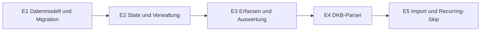

# 04 – Erweiterungen: Unterkategorien, Umbuchungen, Konten, Umbenennen, robuster DKB-Import

> **Verbindlich.** Basis ist Commit `a6769d2` mit 432 Tests auf `main`. Der Code-Mode setzt **genau einen Schritt pro Auftrag** um (E1 … E5), und zwar in dieser Reihenfolge. Es gelten alle Regeln aus [00-architektur.md](00-architektur.md) und [README.md](README.md): Svelte-5-Runes, kein `any`, Cents als Integer, Datum nur über `dates.ts`, erst DB dann Store, Epochen-Guards, keine Nutzerdaten in Logs.
>
> **Datenschutz (zwingend):** In Code, Defaults, Fixtures und Tests stehen **nur erfundene Namen** wie „Max Mustermann“ oder „Erika und Hans Muster“. Es werden keine Namen aus echten Nutzerbeispielen übernommen.
>
> **Ende jedes Schritts:** `npm run check`, `npm test` und `npm run build` laufen ohne Fehler und ohne Warnungen. Danach folgt ein lokaler Commit `git commit -m "Schritt E<n>: <Titel>"`. **Kein `git push`.** Den Push übernimmt der Orchestrator nach E5, das OK des Nutzers liegt vor.
>
> Ist etwas unklar, wird nicht geraten: `// PLAN-FRAGE: …` in den Code schreiben und die Frage im Abschlussbericht nennen.

## 0. Überblick

| Schritt | Titel | Schwerpunkt |
|---|---|---|
| E1 | Datenmodell v2, Migration, Validierung, Backup, Konten-Persistenz | `types`, `defaults`, `categoryTree`, `migrate`, `validate`, `backup`, `db`, `data` (Grundlage), `session` |
| E2 | State-Operationen und Verwaltungs-UI | Unterkategorien und Konten verwalten, eigene Namen, Regeln mit „Anzeigen als“ |
| E3 | Erfassen, Liste, Übersicht, Statistik | Transfers, Unterkategorien-Drilldown, Rücklagen, Kreditkarten-Abgleich, „Geplant diesen Monat“ |
| E4 | DKB-Parser robuster und neue Fixture | Überschriften, Vorgemerkt, Tab-Störtext, mehrzeilige Händler |
| E5 | Import und Recurring-Skip | Kontoauswahl, Umbenennen und merken, Heuristik für eigene Namen, unscharfe Duplikate |



## 1. Zentrale Designentscheidungen (gelten für alle Schritte)

1. **Transfer-Modell.** `TxType = 'expense' | 'income' | 'transfer'`. Zusätzlich gibt es das Feld `direction: 'in' | 'out' | null` an `Transaction` und `RecurringTemplate`. Bei `type === 'transfer'` ist es Pflicht (`'in'` oder `'out'`), sonst immer `null`. `amountCents` bleibt immer > 0.
   - Der Kontosaldo (`signedCents`, `sumBalance`, `groupByDay`) berücksichtigt Transfers: `out` zählt negativ, `in` positiv.
   - Einnahmen, Ausgaben, Saldo und Sparquote (`summarizeTransactions`) filtern weiterhin nach `type === 'expense'` bzw. `'income'`. Transfers sind dadurch automatisch ausgeschlossen.
   - Kategorien haben ebenfalls `type: TxType`. Eine Transfer-Buchung braucht eine Transfer-Kategorie und umgekehrt.
2. **Regel-Aktion ohne Extrafeld.** `MerchantRule` bekommt nur `displayName: string | null`. Ein eigenes Feld `transferKind` gibt es **nicht**. Zeigt `categoryId` auf eine Kategorie mit `type === 'transfer'`, macht die Regel beim Import aus der Zeile eine Umbuchung. Die Richtung ergibt sich aus dem Vorzeichen: Eingang → `in`, Abgang → `out`.
3. **Unterkategorien.** `Category.parentId: string | null`. Es gibt genau eine Ebene. Die Unterkategorie hat denselben Typ wie die Hauptkategorie. Buchungen, Vorlagen und Regeln dürfen auf beide verweisen. Auswertungen fassen über `rootCategoryId` zusammen.
4. **Konten.** Es gibt die neue Entität `Account` mit eigener verschlüsselter Tabelle (Dexie-Version 2). `Transaction.accountId` und `RecurringTemplate.accountId` sind Pflicht.
5. **Migration v1 → v2.** Die pure Funktion `migrateToV2(input: unknown, now: string): AppData` in `src/lib/db/migrate.ts` ist idempotent und gibt validierte Daten zurück.
   - **Session:** Nach `loadAll` wird bei `settings.schemaVersion < 2` die Funktion `migrateIfNeeded()` aufgerufen. Sie führt `migrateToV2` aus und danach `replaceAllData`.
   - **Backup:** `MIGRATIONS[1]` ruft dieselbe Funktion auf. `CURRENT_SCHEMA_VERSION = 2`.
6. **Duplikat-Priorität.** Die Reihenfolge ist `exact` vor `recurring` vor `likely`. Es gibt drei globale Durchläufe über alle Zeilen. Jede bestehende Buchung wird höchstens einmal zugeordnet (Multiset). Verglichen wird der **vorzeichenbehaftete Betrag** (`signedCents`). Dadurch gelten „Ausgabe“ und „Umbuchung out“ als dieselbe Geldbewegung. Das ist robust, falls der Nutzer eine Zeile beim ersten Import umklassifiziert hat.
7. **Reihenfolge der Kategorie-Bestimmung beim Import** (`classifyRow`, E5):
   1. Nutzerregel (`source` ist `'manual'` oder `'learned'`)
   2. Heuristik für eigene Namen und Kreditkarten-Stichworte (nur auf Konten der Art `checking`)
   3. Historie (`lastCategoryForMerchant`)
   4. Default-Regel
   5. Einnahme-Heuristik (Erstattung/Gehalt)
   6. Fallback

   Die Umbenennung (`displayName`) kommt immer von der besten passenden Regel, unabhängig davon, welche Stufe die Kategorie bestimmt.
8. **Kreditkarten-Abgleich, Zeitraum.** Abbuchungen im Zeitraum P werden mit den Kartenbuchungen im **selben** Zeitraum P verglichen (Monat `YYYY-MM` oder Jahr `YYYY`). Das ist eine **Näherung**, weil Abrechnungszyklen der Karte nicht am Monatsende liegen müssen. Das wird in der UI als Hinweis angezeigt.
9. **„STADTWERKE → Strom“** ist eine bewusste Vereinfachung. Stadtwerke rechnen oft auch Gas und Wasser ab. Der Nutzer kann die Regel in „Regeln“ ändern.
10. **Händler-Erkennung mit `displayName`** bedeutet: Text- und OCR-Import. Im manuellen Formular wird nichts umbenannt.

---

## 2. Gemeinsame Referenz: Typen und Defaults (umgesetzt in E1)

### 2.1 `src/lib/types.ts` (vollständig ersetzen, wörtlich)
```ts
export type TxType = 'expense' | 'income' | 'transfer';
export type TxDirection = 'in' | 'out';
export type TxSource = 'manual' | 'text' | 'ocr' | 'recurring';
export type AccountKind = 'checking' | 'credit_card' | 'savings' | 'other';

export interface Transaction {
  id: string;
  type: TxType;
  amountCents: number;      // Integer > 0
  date: string;             // YYYY-MM-DD
  categoryId: string;       // Haupt- oder Unterkategorie, Typ passt zu type
  accountId: string;        // verweist auf Account.id
  direction: TxDirection | null; // nur bei type 'transfer' gesetzt, sonst null
  merchant: string;         // Anzeige-Händler, darf leer sein
  originalText: string;     // Händlertext aus dem Import vor Umbenennung; '' bei manueller Erfassung
  city: string;
  note: string;
  source: TxSource;
  recurringId: string | null;
  createdAt: string;
  updatedAt: string;
}

/** Eingabedaten für eine neue Buchung (id und Zeitstempel werden beim Speichern vergeben). */
export type TxInput = Omit<Transaction, 'id' | 'createdAt' | 'updatedAt'>;

export interface Category {
  id: string;
  name: string;
  type: TxType;
  parentId: string | null;  // null = Hauptkategorie; sonst id einer Hauptkategorie gleichen Typs
  icon: string;
  color: string;
  archived: boolean;
  sortOrder: number;        // Reihenfolge unter Geschwistern (gleicher Typ, gleicher parentId)
  monthlyBudgetCents: number | null; // nur bei Hauptkategorien vom Typ expense sinnvoll
  updatedAt: string;
}

export interface MerchantRule {
  id: string;
  pattern: string;          // Ergebnis von normalizeMerchant()
  categoryId: string;       // darf auf Unter- und Transfer-Kategorien zeigen
  displayName: string | null; // Anzeige-Händler beim Import; null = Originaltext behalten
  source: 'default' | 'learned' | 'manual';
  updatedAt: string;
}

export interface RecurringTemplate {
  id: string;
  type: TxType;
  amountCents: number;
  categoryId: string;
  accountId: string;
  direction: TxDirection | null;
  merchant: string;
  note: string;
  dayOfMonth: number;
  startMonth: string;
  endMonth: string | null;
  lastGeneratedMonth: string | null;
  active: boolean;
  updatedAt: string;
}

export interface Account {
  id: string;
  name: string;
  kind: AccountKind;
  icon: string;
  archived: boolean;
  sortOrder: number;
  updatedAt: string;
}

export interface Settings {
  id: 'settings';
  schemaVersion: number;    // aktuell 2
  autoLockMinutes: 0 | 1 | 5 | 15;
  backupReminderDays: 0 | 7 | 14 | 30;
  lastBackupAt: string | null;
  ownNames: string[];       // „Eigene Namen“ für die Umbuchungs-Heuristik
  updatedAt: string;
}

export interface AppData {
  transactions: Transaction[];
  categories: Category[];
  merchantRules: MerchantRule[];
  recurring: RecurringTemplate[];
  accounts: Account[];
  settings: Settings;
}
```

### 2.2 `src/lib/db/defaults.ts` (Inhalt nach E1)
Exporte:
```ts
export const CURRENT_SCHEMA_VERSION = 2;
export const FALLBACK_EXPENSE_CATEGORY = 'cat-other-expense';
export const FALLBACK_INCOME_CATEGORY = 'cat-other-income';
export const FALLBACK_TRANSFER_CATEGORY = 'cat-transfer-own';
export const TRANSFER_SAVINGS_CATEGORY = 'cat-transfer-savings';
export const TRANSFER_INVEST_CATEGORY = 'cat-transfer-invest';
export const TRANSFER_CREDIT_CARD_CATEGORY = 'cat-transfer-credit-card';
export const REMOVED_GIFTS_CATEGORY = 'cat-gifts';
export const DEFAULT_ACCOUNT_ID = 'acc-checking';
export const CREDIT_CARD_ACCOUNT_ID = 'acc-credit-card';

/** expense -> FALLBACK_EXPENSE_CATEGORY, income -> FALLBACK_INCOME_CATEGORY, transfer -> FALLBACK_TRANSFER_CATEGORY */
export function fallbackCategoryFor(type: TxType): string;
export function defaultCategories(now: string): Category[];
export function defaultRules(now: string): MerchantRule[];
export function defaultAccounts(now: string): Account[];
export function defaultSettings(now: string): Settings;
```

`interface CategoryDef { id: string; name: string; type: TxType; parentId: string | null; icon: string; color: string }`

**`CATEGORY_DEFS` in genau dieser Reihenfolge** (`cat-gifts` entfällt):

| # | id | name | type | parentId | icon | color |
|---|---|---|---|---|---|---|
| 1 | cat-groceries | Lebensmittel | expense | null | 🛒 | #16a34a |
| 2 | cat-restaurant | Restaurant & Essen | expense | null | 🍽️ | #ea580c |
| 3 | cat-cafe | Café & Snacks | expense | null | ☕ | #a16207 |
| 4 | cat-clothing | Kleidung | expense | null | 👕 | #db2777 |
| 5 | cat-drugstore | Drogerie & Haushalt | expense | null | 🧴 | #0891b2 |
| 6 | cat-housing | Wohnen & Nebenkosten | expense | null | 🏠 | #4f46e5 |
| 7 | cat-telecom | Handy & Internet | expense | null | 📱 | #0284c7 |
| 8 | cat-subscriptions | Abos & Digitales | expense | null | 💳 | #7c3aed |
| 9 | cat-mobility | Mobilität & Parken | expense | null | 🚗 | #475569 |
| 10 | cat-travel | Urlaub & Reisen | expense | null | ✈️ | #0d9488 |
| 11 | cat-leisure | Freizeit & Hobby | expense | null | 🎉 | #c026d3 |
| 12 | cat-health | Gesundheit | expense | null | 💊 | #dc2626 |
| 13 | cat-memberships | Mitgliedschaften | expense | null | 🏋️ | #9333ea |
| 14 | cat-insurance | Versicherungen | expense | null | 🛡️ | #334155 |
| 15 | cat-other-expense | Sonstiges | expense | null | 📦 | #6b7280 |
| 16 | cat-groceries-supermarket | Supermarkt / Wocheneinkauf | expense | cat-groceries | 🛒 | #16a34a |
| 17 | cat-groceries-bakery | Bäckerei | expense | cat-groceries | 🥐 | #16a34a |
| 18 | cat-telecom-mobile | Handyvertrag | expense | cat-telecom | 📱 | #0284c7 |
| 19 | cat-telecom-internet | Internet / Festnetz | expense | cat-telecom | 🌐 | #0284c7 |
| 20 | cat-housing-rent | Miete | expense | cat-housing | 🔑 | #4f46e5 |
| 21 | cat-housing-electricity | Strom | expense | cat-housing | 💡 | #4f46e5 |
| 22 | cat-housing-heating | Heizung & Wasser | expense | cat-housing | 🔥 | #4f46e5 |
| 23 | cat-housing-broadcast | Rundfunkbeitrag | expense | cat-housing | 📺 | #4f46e5 |
| 24 | cat-housing-other | Sonstige Nebenkosten | expense | cat-housing | 🧾 | #4f46e5 |
| 25 | cat-salary | Gehalt | income | null | 💼 | #15803d |
| 26 | cat-refund | Erstattung & Gutschrift | income | null | ↩️ | #0f766e |
| 27 | cat-sale | Verkauf | income | null | 🏷️ | #65a30d |
| 28 | cat-gift-income | Geschenk erhalten | income | null | 🎁 | #ca8a04 |
| 29 | cat-other-income | Sonstige Einnahmen | income | null | 💰 | #6b7280 |
| 30 | cat-transfer-savings | Tagesgeld / Rücklagen | transfer | null | 🏦 | #0369a1 |
| 31 | cat-transfer-invest | Sparen & Anlegen | transfer | null | 📈 | #047857 |
| 32 | cat-transfer-credit-card | Kreditkarte | transfer | null | 💳 | #be185d |
| 33 | cat-transfer-own | Eigene Konten | transfer | null | 🔁 | #6b7280 |

**`defaultCategories(now)`:** Die Reihenfolge der Rückgabe entspricht der Tabelle. Es gilt `sortOrder = counters[key]++` mit `key = type + '|' + (parentId ?? '')`. Daraus folgen diese Werte: Ausgaben-Hauptkategorien 0–14 (Sonstiges = 14), Kinder von Lebensmittel 0–1, Kinder von Handy 0–1, Kinder von Wohnen 0–4, Einnahmen 0–4, Transfers 0–3. `archived` ist `false`, `monthlyBudgetCents` ist `null`, `updatedAt` ist `now`.

**`RULE_DEFS` in dieser Reihenfolge.** Die id ist wie bisher `'rule-' + pattern.toLowerCase().replace(/ /g, '-')`, `displayName` ist `null`, `source` ist `'default'`.

| categoryId | patterns |
|---|---|
| cat-groceries-supermarket | ALDI, LIDL, REWE, EDEKA, PENNY, NETTO, KAUFLAND, NORMA, TEGUT |
| cat-groceries-bakery | BAECKEREI, BAECKER, BROTHAUS, BACKHAUS, KAMPS |
| cat-drugstore | ROSSMANN, DM, MUELLER |
| cat-telecom | TELEKOM, VODAFONE, O2 |
| cat-subscriptions | APPLE, NETFLIX, SPOTIFY, AMAZON PRIME, DISNEY |
| cat-mobility | PARKEN, SHELL, ARAL, ESSO, MVG, MVV |
| cat-travel | LUFTHANSA, RYANAIR, EUROWINGS, DB VERTRIEB, BOOKING, AIRBNB |
| cat-cafe | STARBUCKS |
| cat-restaurant | MCDONALDS, BURGER KING, LIEFERANDO, GASTRONOMIE |
| cat-clothing | ZALANDO, H M, ZARA, PRIMARK, OUTLET |
| cat-memberships | FITNESS, GYM, TENNIS, VEREIN, MCFIT, CLEVERFIT, URBAN SPORTS |
| cat-insurance | ARAG, ALLIANZ, HUK, ERGO, AXA, DEVK, VERSICHERUNG, HANSEMERKUR |
| cat-housing-broadcast | GEZ, RUNDFUNK |
| cat-housing-electricity | STADTWERKE |

Das sind **65 Regeln**. Prüfung der wortweisen Logik aus `suggestCategory`, das intern `' ' + normalizeMerchant(m) + ' '` und `' ' + pattern + ' '` vergleicht:
- `CITYfit Fitness- und Gesund-heitsclub Musterstadt GmbH` wird normalisiert zu `CITYFIT FITNESS UND GESUND HEITSCLUB MUSTERSTADT GMBH`. Darin steckt das Wort `FITNESS`, also ergibt sich `cat-memberships`.
- `BAECKEREI SONNE` passt auf `BAECKEREI`. `BAECKER` allein passt dort **nicht**, deshalb gibt es beide Muster.
- `BrotHaus` wird zu `BROTHAUS`.
- VODAFONE, O2 und TELEKOM bleiben auf der Hauptkategorie `cat-telecom`, weil sie nicht eindeutig sind.

**`defaultAccounts(now)`:**
```ts
[
  { id: 'acc-checking', name: 'Girokonto', kind: 'checking', icon: '🏦', archived: false, sortOrder: 0, updatedAt: now },
  { id: 'acc-credit-card', name: 'Kreditkarte', kind: 'credit_card', icon: '💳', archived: false, sortOrder: 1, updatedAt: now },
]
```
**`defaultSettings(now)`:** wie bisher, dazu `schemaVersion: CURRENT_SCHEMA_VERSION` (= 2) und `ownNames: []`.

---

## E1 – Datenmodell v2, Migration, Validierung, Backup, Konten-Persistenz

**Ziel:** Neues Datenmodell, Defaults, Migration in Session und Backup. Dazu die Konten-Tabelle mit Store. An der UI wird **nur** das Kompilier-Minimum geändert (Abschnitt E1.9), es gibt keine neuen UI-Funktionen.

### E1.1 `src/lib/types.ts`
Siehe 2.1.

### E1.2 `src/lib/db/defaults.ts`
Siehe 2.2. `defaultCategories` verwendet `Record<string, number>` als Zähler mit dem Schlüssel `type|parentId`.

### E1.3 Neue Datei `src/lib/categoryTree.ts` (+ `categoryTree.test.ts`)
```ts
import type { Category, TxType } from './types';

/** parentId der Kategorie, wenn gesetzt; sonst id. Unbekannte id -> id selbst. */
export function rootCategoryId(id: string, cats: ReadonlyMap<string, Category>): string;

/** Kinder von parentId, sortiert nach sortOrder, dann id. Archivierte nur bei includeArchived. */
export function childrenOf(parentId: string, cats: readonly Category[], includeArchived?: boolean): Category[];

/** Hauptkategorien (parentId null) des Typs, sortiert nach sortOrder, dann id. Archivierte nur bei includeArchived. */
export function rootsOf(type: TxType, cats: readonly Category[], includeArchived?: boolean): Category[];

export interface CategoryOption { id: string; label: string; isChild: boolean }

/**
 * Flache Optionsliste für <select>: Jede aktive Hauptkategorie des Typs (Label `${icon} ${name}`),
 * direkt gefolgt von ihren aktiven Kindern (Label `${icon} ${root.name} › ${child.name}`, isChild true).
 * Kinder archivierter Hauptkategorien erscheinen nicht.
 * keepId: Existiert die Kategorie, steht aber nicht in der Liste (archiviert), wird sie am Ende angehängt,
 * mit Label wie oben plus ' (archiviert)'.
 */
export function categoryOptions(cats: readonly Category[], type: TxType, keepId?: string | null): CategoryOption[];

/** 'Lebensmittel › Bäckerei' für Kinder, sonst der Name; unbekannt -> 'Unbekannt'. */
export function categoryLabel(id: string, cats: ReadonlyMap<string, Category>): string;
```
Das Trennzeichen `›` ist U+203A, davor und dahinter steht je ein Leerzeichen.

**Tests** (`cats = defaultCategories('2026-01-01T00:00:00.000Z')`, `map = new Map(cats.map(c => [c.id, c]))`):

| Aufruf | Erwartung |
|---|---|
| `rootCategoryId('cat-groceries-bakery', map)` | `'cat-groceries'` |
| `rootCategoryId('cat-groceries', map)` | `'cat-groceries'` |
| `rootCategoryId('unbekannt', map)` | `'unbekannt'` |
| `childrenOf('cat-housing', cats).map(c=>c.id)` | `['cat-housing-rent','cat-housing-electricity','cat-housing-heating','cat-housing-broadcast','cat-housing-other']` |
| wie oben, aber `cat-housing-heating` archiviert | ohne heating; mit `includeArchived=true` wieder alle 5 |
| `rootsOf('transfer', cats).map(c=>c.id)` | `['cat-transfer-savings','cat-transfer-invest','cat-transfer-credit-card','cat-transfer-own']` |
| `rootsOf('expense', cats).length` | `15` |
| `categoryOptions(cats,'expense').slice(0,4)` | `[{id:'cat-groceries',label:'🛒 Lebensmittel',isChild:false},{id:'cat-groceries-supermarket',label:'🛒 Lebensmittel › Supermarkt / Wocheneinkauf',isChild:true},{id:'cat-groceries-bakery',label:'🥐 Lebensmittel › Bäckerei',isChild:true},{id:'cat-restaurant',label:'🍽️ Restaurant & Essen',isChild:false}]` |
| `categoryOptions(cats,'expense').length` | `24` |
| `cat-cafe` archiviert, `categoryOptions(c,'expense','cat-cafe')` | letztes Element `{id:'cat-cafe',label:'☕ Café & Snacks (archiviert)',isChild:false}`, Länge 24 |
| `categoryLabel('cat-groceries-bakery', map)` | `'Lebensmittel › Bäckerei'` |
| `categoryLabel('cat-cafe', map)` / `categoryLabel('x', map)` | `'Café & Snacks'` / `'Unbekannt'` |

### E1.4 `src/lib/money.ts`
```ts
/** expense negativ, income positiv, transfer: out negativ, in positiv. */
export function signedCents(tx: { type: TxType; amountCents: number; direction?: TxDirection | null }): number;
```
Implementierung: `if (tx.type === 'expense') return -tx.amountCents; if (tx.type === 'income') return tx.amountCents; return tx.direction === 'in' ? tx.amountCents : -tx.amountCents;`

Tests ergänzen: `{type:'transfer',amountCents:500,direction:'in'}` → 500, `{…,direction:'out'}` → −500.

### E1.5 Neue Datei `src/lib/db/migrate.ts` (+ `migrate.test.ts`)
```ts
import type { AppData } from '../types';
/**
 * Überführt Daten im Schema v1 (oder bereits v2) in Schema v2. Pure, idempotent, verändert input nicht.
 * Wirft ValidationError, wenn das Ergebnis ungültig ist (Validierung über validateAppData am Ende).
 */
export function migrateToV2(input: unknown, now: string): AppData;
```
**Algorithmus** (exakt in dieser Reihenfolge, auf flachen Kopien arbeiten, `input` nie verändern):

0. Ist `input` kein Objekt (`typeof === 'object'`, nicht `null`, kein Array), wird `throw new ValidationError('data ungültig')` geworfen. Danach `d = { ...input }`. Für jede Liste `transactions`, `categories`, `merchantRules`, `recurring` gilt: Ist sie ein Array, wird sie zu `list.map(x => (isObj(x) ? { ...x } : x))`. Sonst bleibt der Wert unverändert, und die Validierung am Ende wirft.
1. **Feld-Defaults.** Ein Feld wird nur gesetzt, wenn es `=== undefined` ist.
   - `transactions[*]`: `accountId = 'acc-checking'`, `direction = null`, `originalText = ''`
   - `recurring[*]`: `accountId = 'acc-checking'`, `direction = null`
   - `categories[*]`: `parentId = null`
   - `merchantRules[*]`: `displayName = null`
   - `accounts`: Ist der Wert kein Array oder ein leeres Array, wird er zu `defaultAccounts(now)`. Sonst bleibt die Liste unverändert (Elemente kopieren).
   - `settings`: Ist es ein Objekt, wird es kopiert. `ownNames = []`, falls `undefined`.
2. **`cat-gifts`.** Existiert eine Kategorie mit `id === 'cat-gifts'`, gilt sie als *benutzt*, wenn mindestens eine Buchung oder Vorlage `categoryId === 'cat-gifts'` hat oder eine Kategorie `parentId === 'cat-gifts'` hat.
   - Unbenutzt: Die Kategorie wird entfernt, ebenso alle Regeln mit `categoryId === 'cat-gifts'`.
   - Benutzt: Ist `archived === false`, wird `archived = true` und `updatedAt = now` gesetzt. Ist sie schon archiviert, ändert sich nichts.
3. **Fehlende Default-Kategorien** werden in der Reihenfolge von `defaultCategories(now)` ergänzt. Für jede Default-Kategorie `def` gilt:
   - Gibt es schon eine Kategorie mit `id === def.id`, wird sie übersprungen. Bestehende Kategorien werden **nie** verändert.
   - Gibt es eine Kategorie mit anderer id, aber gleichem `type`, gleichem `parentId` (`?? null`) und gleichem Namen (`trim().toLowerCase()`), wird `def` übersprungen. Das ist eine eigene Nutzer-Kategorie gleichen Namens.
   - Ist `def.parentId !== null` und gibt es in der aktuellen Liste keine Kategorie mit dieser id, wird `def` übersprungen.
   - Sonst wird `{ ...def, sortOrder }` angehängt. Dabei ist `sortOrder = 1 + max(sortOrder aller Kategorien mit gleichem type und gleichem parentId)` bzw. `0`, wenn es keine gibt. Die Berechnung erfolgt fortlaufend, also inklusive der gerade ergänzten Kategorien.
4. **Default-Regeln.** Für jede Regel `def` aus `defaultRules(now)`:
   - Ihre Zielkategorie muss in der Liste existieren und darf nicht archiviert sein. Sonst wird `def` übersprungen.
   - Gibt es eine Regel mit `id === def.id`: Ist deren `source === 'default'` und `categoryId !== def.categoryId`, wird `categoryId = def.categoryId` und `updatedAt = now` gesetzt. Das ist die Umstellung der Supermärkte. Sonst ändert sich nichts.
   - Gibt es sonst eine Regel mit `pattern === def.pattern`, ändert sich nichts. Nutzerregeln haben Vorrang.
   - Sonst wird `def` angehängt.
5. **settings:** Ist `schemaVersion` eine Zahl `< 2`, wird `schemaVersion = 2` und `updatedAt = now` gesetzt.
6. `return validateAppData(d)`

**Hinweis im Code-Kommentar:** Die Funktion wird nur bei `schemaVersion < 2` aufgerufen (Session und Backup). Bei v2-Daten würde sie gelöschte Default-Kategorien wieder ergänzen. Deshalb wird sie nicht auf v2-Daten angewendet.

**Test-Helfer** in `migrate.test.ts`:
- `NOW = '2026-11-01T12:00:00.000Z'`, `OLD = '2026-01-01T00:00:00.000Z'`
- `V1_EXPENSE = ['cat-groceries','cat-restaurant','cat-cafe','cat-clothing','cat-drugstore','cat-housing','cat-telecom','cat-subscriptions','cat-mobility','cat-travel','cat-leisure','cat-health','cat-gifts','cat-other-expense']`. Der Index ist die `sortOrder`.
- `V1_INCOME = ['cat-salary','cat-refund','cat-sale','cat-gift-income','cat-other-income']`. Der Index ist die `sortOrder`.
- `v1Categories()`: Für jede id werden name, type, icon und color aus `defaultCategories(OLD)` übernommen, **ohne** `parentId`. `cat-gifts` ist ein Literal `{ id:'cat-gifts', name:'Geschenke', type:'expense', icon:'🎁', color:'#e11d48' }`. Außerdem gelten `archived:false`, `monthlyBudgetCents:null`, `updatedAt:OLD`.
- `v1Rules()`: die alten 42 Regeln ohne `displayName`. Das sind die Gruppen aus 2.2 bis einschließlich `cat-clothing`, aber mit `categoryId 'cat-groceries'` statt `cat-groceries-supermarket` für die Supermärkte und ohne die Bäckerei-Zeile. Es gelten `source 'default'`, die gleiche id-Bildung und `updatedAt OLD`.
- `v1Data(extra?)`: `{ transactions: [], categories: v1Categories(), merchantRules: v1Rules(), recurring: [], settings: { id:'settings', schemaVersion:1, autoLockMinutes:1, backupReminderDays:14, lastBackupAt:null, updatedAt:OLD } }`. Dieses Objekt hat **kein** `accounts`.
- `v1Tx(over)`: eine v1-Buchung ohne `accountId`, `direction` und `originalText`. Default ist `{ id:'t1', type:'expense', amountCents:1000, date:'2026-10-01', categoryId:'cat-groceries', merchant:'Lidl', city:'', note:'', source:'manual', recurringId:null, createdAt:OLD, updatedAt:OLD }`.

**Testfälle:**

| # | Eingabe | Erwartung |
|---|---|---|
| M1 | `v1Data()` | 33 Kategorien, und es gibt keine `cat-gifts`. `cat-memberships.sortOrder === 14`, `cat-insurance.sortOrder === 15`, `cat-other-expense.sortOrder === 13` (unverändert). Die 4 Transfer-Kategorien haben die sortOrder 0–3. Es gibt 65 Regeln, und `rule-aldi.categoryId === 'cat-groceries-supermarket'` mit `updatedAt === NOW`. `rule-vodafone.categoryId === 'cat-telecom'`, und dort gilt weiterhin `updatedAt === OLD`. `accounts` ist gleich `defaultAccounts(NOW)`. `settings.schemaVersion === 2`, `settings.ownNames` ist `[]`. |
| M2 | `v1Data` mit Buchung `v1Tx({categoryId:'cat-gifts'})` | `cat-gifts` bleibt erhalten mit `archived: true` und `updatedAt: NOW`. Es gibt 34 Kategorien. |
| M3 | `v1Data` mit einer Vorlage in `cat-gifts` (v1-Vorlage ohne `accountId`/`direction`) | `cat-gifts` ist archiviert. Die Vorlage hat `accountId 'acc-checking'` und `direction null`. |
| M4 | `cat-groceries` ist umbenannt in „Essen“, mit Farbe `#000000` und Budget 30000 | Diese Kategorie ist nach der Migration bis auf das ergänzte `parentId: null` identisch. Die Unterkategorien von Lebensmittel werden trotzdem ergänzt. |
| M5 | `rule-aldi` mit `source:'manual'` und `categoryId:'cat-restaurant'`, dazu eine Nutzerregel `{id:'u-fit', pattern:'FITNESS', categoryId:'cat-leisure', source:'learned'}` | `rule-aldi` ist unverändert (bis auf `displayName: null`). `rule-fitness` fehlt. Es gibt 65 Regeln: 42 alte, 1 eigene und 22 neue (23 neue Default-Regeln abzüglich FITNESS). |
| M6 | eigene Hauptkategorie `{id:'u-ins', name:'versicherungen ', type:'expense', …}` | `cat-insurance` fehlt, und die 8 Versicherungsregeln fehlen ebenfalls. Es gibt 33 Kategorien (19 − 1 + 1 + 14) und 57 Regeln. |
| M7 | `v1Tx()` | Die Buchung hat `accountId 'acc-checking'`, `direction null` und `originalText ''`. |
| M8 | Idempotenz | `migrateToV2(migrateToV2(v1Data(), NOW), NOW)` ist `toEqual` zu `migrateToV2(v1Data(), NOW)`. |
| M9 | frische v2-Daten aus den Defaults (`accounts = defaultAccounts`) | `toEqual` zur Eingabe. |
| M10 | Eingabe nicht verändert | `JSON.stringify(input)` ist vorher und nachher gleich. |
| M11 | `null`, `[]`, `'x'` | wirft `ValidationError` |
| M12 | `v1Data` ohne `cat-groceries` und ohne die 9 Supermarkt-Regeln | Fehlende Default-Kategorien werden ergänzt: `cat-groceries` und seine Kinder kommen dazu. Es gibt 33 Kategorien und, da die Default-Regeln auf die nun vorhandenen Zielkategorien zeigen, **65** Regeln. Bestehende Nutzerdaten bleiben unverändert. |

> Rechenweg: Die alte Basis hat 42 Regeln (9 Supermarkt-Regeln + 33 weitere). `defaultRules` liefert 65 Regeln, davon sind 23 neu: Bäckerei 5, Mitgliedschaften 7, Versicherungen 8, Rundfunk 2, Stadtwerke 1.
> - M5: 42 alte + 1 Nutzerregel + 22 neue (ohne FITNESS) = 65.
> - M6: 42 + 23 − 8 (Versicherungen) = 57.
> - M12: 33 alte Regeln (42 minus die 9 Supermarkt-Regeln, deren Zielkategorie `cat-groceries` fehlt) + 32 ergänzte Default-Regeln = 65. Fehlende Defaults werden in `addMissingDefaultCategories` und `applyDefaultRules` ergänzt.

### E1.6 `src/lib/backup/validate.ts`
Änderungen:
- `TX_TYPES = ['expense','income','transfer']`, `DIRECTIONS: readonly TxDirection[] = ['in','out']`, `ACCOUNT_KINDS: readonly AccountKind[] = ['checking','credit_card','savings','other']`.
- Neuer Helfer `strArray(o, key, path, maxItems): string[]`. Ein Nicht-Array, ein Element, das kein String ist, oder `length > maxItems` führen zu `fail(path.key)`.
- `readTransaction`: Die neuen Felder werden in dieser Reihenfolge eingefügt: nach `categoryId` die Felder `accountId: str(...)` und `direction: nullable(o,'direction',p,(o,k,pp)=>oneOf(o,k,pp,DIRECTIONS))`, nach `merchant` das Feld `originalText: str(...)`.
- `readCategory`: nach `type` das Feld `parentId: nullable(o,'parentId',p,str)`
- `readRule`: nach `categoryId` das Feld `displayName: nullable(o,'displayName',p,str)`
- `readRecurring`: nach `categoryId` die Felder `accountId` und `direction` wie oben
- neu `readAccount(o,p): Account` mit `id`, `name`, `kind` (oneOf `ACCOUNT_KINDS`), `icon`, `archived`, `sortOrder` (int −1e6..1e6), `updatedAt`
- `readSettings`: vor `updatedAt` das Feld `ownNames: strArray(x,'ownNames',p,50)`
- `validateAppData`: Es kommt `const accounts = readList(x.accounts, 'accounts', readAccount);` hinzu. Die Rückgabe enthält `accounts`.
- **Kreuzprüfungen** (nach den bestehenden `checkCategoryRefs`) mit exakt diesen Meldungen:

| Prüfung | Meldung |
|---|---|
| `categories[i].parentId !== null` und keine Kategorie mit dieser id | `categories[i].parentId verweist auf unbekannte Kategorie` |
| Die Elternkategorie hat selbst `parentId !== null` (das schließt `parentId === id` ein) | `categories[i].parentId: nur eine Ebene erlaubt` |
| Die Elternkategorie hat einen anderen Typ | `categories[i].parentId: Typ passt nicht zur Hauptkategorie` |
| `transactions[i].accountId` ist unbekannt (dasselbe für `recurring`) | `transactions[i].accountId verweist auf unbekanntes Konto` |
| `(tx.type === 'transfer') !== (Kategorie.type === 'transfer')` (dasselbe für `recurring`) | `transactions[i].categoryId passt nicht zum Typ` |
| `tx.type === 'transfer'` und `direction === null`, oder `tx.type !== 'transfer'` und `direction !== null` (dasselbe für `recurring`) | `transactions[i].direction ungültig` |

`i` ist dabei der Index. Für `recurring` steht der Name `recurring` am Anfang der Meldung.

**Zusätzliche Tests in `validate.test.ts`.** Basis ist ein gültiges v2-Objekt aus den Defaults mit einer gültigen Buchung. Jede Zeile ist ein eigener Test, der mit `toThrow(<Meldung>)` prüft:

| Mutation | erwartete Meldung |
|---|---|
| `categories` bekommt `{…, id:'x', parentId:'nope'}` | `categories[33].parentId verweist auf unbekannte Kategorie` |
| Kind von `cat-groceries-bakery` | `… nur eine Ebene erlaubt` |
| `{…, type:'income', parentId:'cat-groceries'}` | `… Typ passt nicht zur Hauptkategorie` |
| Buchung `accountId:'acc-x'` | `transactions[0].accountId verweist auf unbekanntes Konto` |
| Buchung `type:'transfer', direction:'out', categoryId:'cat-groceries'` | `transactions[0].categoryId passt nicht zum Typ` |
| Buchung `type:'expense', categoryId:'cat-transfer-own', direction:null` | `transactions[0].categoryId passt nicht zum Typ` |
| Buchung `type:'transfer', categoryId:'cat-transfer-own', direction:null` | `transactions[0].direction ungültig` |
| Buchung `type:'expense', direction:'in'` | `transactions[0].direction ungültig` |
| Buchung `direction:'up'` | `transactions[0].direction ungültig` |
| `settings.ownNames = ['a', 1]` | `settings.ownNames ungültig` |
| `accounts[0].kind = 'bank'` | `accounts[0].kind ungültig` |
| `accounts` fehlt | `accounts ungültig` |
| gültige Transfer-Buchung `{type:'transfer', direction:'in', categoryId:'cat-transfer-savings'}` | wirft nicht |
| Regel auf `cat-transfer-invest` mit `displayName:'Depot'` | wirft nicht |

> Die Kategorie-Indizes beziehen sich auf die angehängte Kategorie. Bei 33 Defaults ist das Index 33.

### E1.7 `src/lib/backup/backup.ts`
- `import { migrateToV2 } from '../db/migrate';`
- `const MIGRATIONS: Record<number, (d: unknown) => unknown> = { 1: (d) => migrateToV2(d, new Date().toISOString()) };`
- `mergeData` bekommt zusätzlich `accounts: mergeList(current.accounts, incoming.accounts)`.
- `createBackup` schreibt automatisch `schemaVersion: 2`, weil die Konstante sich ändert.

**Tests (`backup.test.ts`):** Bestehende Tests, die bei `schemaVersion 1` „Daten unverändert“ oder „MIGRATIONS leer“ erwarten, werden ersetzt durch:
1. `migratePayload({schemaVersion:1, data: v1Data})`. Das Ergebnis wird mit `validateAppData` geprüft und hat `settings.schemaVersion === 2` und 2 Konten. Für `v1Data` wird ein lokaler Mini-Helfer im Test verwendet: eine Kategorie `cat-other-expense` (ohne `parentId`) und eine v1-Buchung.
2. `migratePayload({schemaVersion:3, data:{}})` wirft `InvalidBackupError('Backup stammt aus einer neueren App-Version')`. Das ist zugleich die Meldung, die eine v1-App bei einem v2-Backup zeigt.
3. Roundtrip `createBackup` → `readBackupFile` → `decryptBackup` mit v2-Daten inklusive Konto, Transfer-Buchung und Unterkategorie liefert `toEqual` zu den Eingabedaten.
4. `mergeData` vereinigt die Konten nach `id` und `updatedAt`.

### E1.8 `src/lib/db/db.ts`
```ts
accounts!: Table<EncryptedRow, string>;
// im Konstruktor nach version(1):
this.version(2).stores({
  meta: 'id', transactions: 'id', categories: 'id',
  merchantRules: 'id', recurring: 'id', settings: 'id', accounts: 'id',
});
```
`version(1)` bleibt unverändert stehen.

### E1.9 `src/lib/state/data.ts` (Grundlage) und `session.ts`
**data.ts:**
- `const accountTable = new EncryptedTable<Account>(db.accounts, getDek);`
- `export const accounts: Writable<Account[]> = writable([]);`
- `export const accountMap: Readable<Map<string, Account>> = derived(accounts, ($a) => new Map($a.map((a) => [a.id, a])));`
- `function sortAccountsList(list: Account[]): Account[]` sortiert nach `sortOrder`, dann `cmpStr(name)`.
- `loadAll`: liest zusätzlich `accountTable.getAll()` und setzt `accounts.set(sortAccountsList(acc))`.
- `clearAll`: `accounts.set([])`
- `seedDefaults`: `const accs = defaultAccounts(now); await accountTable.bulkPut(accs);`, und nach dem Epochen-Check `accounts.set(accs)`.
- `buildAppData`: ergänzt `accounts: get(accounts)`.
- `replaceAllData`: verschlüsselt zusätzlich `accountTable.encryptRows(data.accounts)`. In der Transaktion kommen `db.accounts` in die Tabellenliste, `db.accounts.clear()` und `db.accounts.bulkPut(accountRows)` dazu.
- **`sortCategories` neu** (mit Typ-Rang und Gruppierung unter der Hauptkategorie):
```ts
const TYPE_RANK: Record<TxType, number> = { expense: 0, income: 1, transfer: 2 };
export function sortCategories(list: Category[]): Category[] {
  const byId = new Map(list.map((c) => [c.id, c]));
  // Truthy-Prüfung statt `!== null`: Vor der Migration fehlt parentId bei Altdaten (undefined).
  const rootOf = (c: Category): Category => (c.parentId ? byId.get(c.parentId) ?? c : c);
  const childRank = (c: Category): number => (c.parentId ? 1 : 0);
  return [...list].sort((a, b) => {
    const ra = rootOf(a);
    const rb = rootOf(b);
    return (
      TYPE_RANK[a.type] - TYPE_RANK[b.type] ||
      ra.sortOrder - rb.sortOrder ||
      cmpStr(ra.id, rb.id) ||
      childRank(a) - childRank(b) ||
      a.sortOrder - b.sortOrder ||
      cmpStr(a.id, b.id)
    );
  });
}
```
- **Neu:**
```ts
/** Führt migrateToV2 aus, wenn settings.schemaVersion < CURRENT_SCHEMA_VERSION. true = migriert. */
export async function migrateIfNeeded(): Promise<boolean> {
  const s = get(settings);
  if (!s || s.schemaVersion >= CURRENT_SCHEMA_VERSION) return false;
  const e = epoch;
  const migrated = migrateToV2(buildAppData(), new Date().toISOString());
  if (e !== epoch) return false;
  await replaceAllData(migrated);
  return true;
}
```
- `runRecurring` bleibt in E1 unverändert. Die neuen Pflichtfelder setzt `generateDue` (E1.10).

**session.ts:** In `enterUnlocked` wird direkt nach `await loadAll(); if (gen !== generation) return;` Folgendes eingefügt:
```ts
await runMigration();
if (gen !== generation) return;
```
mit
```ts
async function runMigration(): Promise<void> {
  try {
    if (await migrateIfNeeded()) showToast('Daten wurden auf die neue Version aktualisiert');
  } catch {
    showToast('Datenaktualisierung fehlgeschlagen – bitte ein Backup erstellen', 'error');
  }
}
```
`wipeEverything`: Werden dort Tabellen einzeln geleert, kommt `db.accounts` dazu. Wird die DB gelöscht, ist nichts zu tun.

### E1.10 Kompilier-Minimum in bestehendem Code (keine neuen Funktionen)
| Datei | Änderung |
|---|---|
| `src/lib/merchant.ts` `learnRule` | Eine neue Regel bekommt `displayName: null`. Eine bestehende behält ihr `displayName` über den Spread. |
| `src/lib/recurring.ts` `generateDue` | Jedes `newTx` bekommt `accountId: t.accountId`, `direction: t.direction`, `originalText: ''`. |
| `src/lib/import/importItems.ts` `itemsToTxInputs` | `accountId: DEFAULT_ACCOUNT_ID`, `direction: null`, `originalText: item.row.merchant` |
| `src/routes/TransactionForm.svelte` | Das Objekt für `addTransaction`/`updateTransaction` bekommt `accountId: existing?.accountId ?? DEFAULT_ACCOUNT_ID`, `direction: null`, `originalText: existing?.originalText ?? ''`. Eine dort angelegte Vorlage bekommt `accountId: DEFAULT_ACCOUNT_ID`, `direction: null`. |
| `src/routes/Recurring.svelte` | Die Vorlage bekommt `accountId: editing?.accountId ?? DEFAULT_ACCOUNT_ID`, `direction: editing?.direction ?? null`. |
| `src/routes/CategoryForm.svelte` | Eine neue Kategorie bekommt `parentId: existing?.parentId ?? null`. |
| alle übrigen Stellen, die `npm run check` meldet | analog: Felder mit neutralen Defaults ergänzen (siehe nächste Zeile) |
| **Tests** (alle `*.test.ts`) | Test-Fabriken ergänzen: Transaction `accountId:'acc-checking', direction:null, originalText:''`. Category `parentId:null`. MerchantRule `displayName:null`. RecurringTemplate `accountId:'acc-checking', direction:null`. Settings `ownNames:[]`. AppData `accounts: defaultAccounts(now)`. Erwartete `TxInput`-Objekte von `generateDue` bekommen `accountId:'acc-checking', direction:null, originalText:''`. Erwartete `itemsToTxInputs`-Objekte bekommen `accountId:'acc-checking', direction:null, originalText:<row.merchant>`. |

**Bestehende Tests, die sich fachlich ändern:**
- `defaults.test.ts`:
  - Die Zählung wird zu `24` Ausgaben, `5` Einnahmen und `4` Transfer-Kategorien.
  - Es gibt `65` Regeln.
  - Tests zur sortOrder-Folge gruppieren nach `type|parentId`.
  - Ein Test, dass `cat-gifts` fehlt und `cat-gift-income` existiert, kommt dazu.
  - Ein Test, dass jedes `parentId` auf eine Hauptkategorie gleichen Typs zeigt, kommt dazu.
  - `defaultAccounts` und `defaultSettings(...).ownNames` werden geprüft.
- `data.test.ts`:
  - In den moveCategory-Tests (Helfer `expenseIds` und die Filter in den Tests „moveCategory …“) wird `c.type === 'expense'` durch `c.type === 'expense' && c.parentId === null` ersetzt.
  - Im Seed-Test wird die Prüfung „expense vor income“ ersetzt durch: Die Folge `list.map(c => TYPE_RANK)` ist nicht absteigend, wobei die Ränge lokal `{expense:0,income:1,transfer:2}` sind.
  - Der Test `replaceAllData` enthält `accounts`.
  - **Neu:** `migrateIfNeeded`:
    1. `replaceAllData(v1 as unknown as AppData)` mit `accounts: []`, `settings.schemaVersion: 1` und einer v1-Buchung (ohne `accountId`).
    2. Ergebnis: `await migrateIfNeeded()` ist `true`, `get(settings)?.schemaVersion === 2`, `get(accounts).length === 2`, `get(transactions)[0].accountId === 'acc-checking'`.
    3. Ein zweiter Aufruf liefert `false`.
    4. Nach `clearAll()` und `loadAll()` ist `get(accounts).length === 2`.
- Tests in `merchant.test.ts`/`parse.test.ts`, die für ALDI/LIDL/… mit `defaultRules` den Wert `cat-groceries` erwarten, erwarten jetzt `cat-groceries-supermarket`.

**Abnahme E1:** check, test und build sind grün, Commit `Schritt E1: Datenmodell v2, Migration, Validierung, Konten-Persistenz`.

---

## E2 – State-Operationen und Verwaltungs-UI

### E2.1 `src/lib/categoryRules.ts`
```ts
/** Geschwister = gleicher type und gleicher parentId. Neuer letzter Parameter, Default null. */
export function validateCategoryName(name: string, type: TxType, cats: Category[], ownId?: string, parentId?: string | null): string | null;
/** Fallbacks: FALLBACK_EXPENSE_CATEGORY, FALLBACK_INCOME_CATEGORY, FALLBACK_TRANSFER_CATEGORY. */
export function isFallbackCategory(id: string): boolean;
/** null = gültig, sonst Fehlermeldung (Reihenfolge der Prüfungen wie Tabelle). */
export function validateParent(cat: { id: string | null; type: TxType }, parentId: string | null, cats: Category[]): string | null;
```
- `validateCategoryName`: Die Doppelt-Prüfung vergleicht nur Kategorien mit `c.type === type && (c.parentId ?? null) === (parentId ?? null)`. Die Meldungen bleiben wie bisher.
- `CATEGORY_ICONS`: Am Ende des Strings wird `' 🛡️ 🥐 🌐 🔑 🔥 📺 🔁'` angehängt. Prüft ein Test die Länge, wird er um 7 erhöht.

`validateParent` (`cat.id` ist `null` bei einer neuen Kategorie). Ist `parentId === null`, ist das Ergebnis `null`. Sonst gilt in dieser Reihenfolge:

| Bedingung | Meldung |
|---|---|
| `cat.id !== null && isFallbackCategory(cat.id)` | `Standardkategorie kann nicht verschoben werden` |
| `parentId === cat.id` | `Kategorie kann nicht ihre eigene Hauptkategorie sein` |
| Die Elternkategorie existiert nicht oder ist archiviert | `Hauptkategorie nicht gefunden` |
| Die Elternkategorie hat `parentId !== null` | `Nur eine Ebene erlaubt` |
| Die Elternkategorie hat einen anderen Typ | `Typ passt nicht zur Hauptkategorie` |
| `cat.id !== null` und es gibt eine Kategorie mit `parentId === cat.id` | `Kategorie hat Unterkategorien und kann nicht verschoben werden` |

Die Tests decken jede Zeile ab, dazu einen gültigen Fall (`{id:null,type:'expense'}` mit `'cat-groceries'` ergibt `null`) und einen Sibling-Namenstest: „Miete“ unter `cat-housing` ist doppelt, „Miete“ als Hauptkategorie ist erlaubt.

### E2.2 Neue Datei `src/lib/accounts.ts` (+ Test)
```ts
export const ACCOUNT_KIND_LABELS: Record<AccountKind, string> = {
  checking: 'Girokonto', credit_card: 'Kreditkarte', savings: 'Sparkonto / Tagesgeld', other: 'Sonstiges',
};
export const ACCOUNT_ICONS: string[] = ['🏦', '💳', '🐷', '👛', '💶'];
export const MAX_ACCOUNT_NAME_LENGTH = 30;
/** trim; '' -> 'Bitte einen Namen eingeben'; > 30 -> 'Name ist zu lang (max. 30 Zeichen)'; gleicher Name (case-insensitive) bei anderem Konto -> 'Name bereits vergeben'; sonst null. */
export function validateAccountName(name: string, accounts: Account[], ownId?: string): string | null;
/** Nicht archivierte Konten, sortiert nach sortOrder, dann name; keepId wird angehängt, falls archiviert. */
export function selectableAccounts(accounts: Account[], keepId?: string | null): Account[];
```

### E2.3 `src/lib/merchant.ts` (Erweiterungen + Tests)
```ts
/** Jedes Wort von normalizeMerchant(name) kommt als Wort in normalizeMerchant(merchant) vor (Reihenfolge egal). Namen, die normalisiert leer sind, werden ignoriert. */
export function matchesOwnName(merchant: string, ownNames: readonly string[]): boolean;

/** trim; '' -> 'Bitte einen Namen eingeben'; > 60 -> 'Name ist zu lang (max. 60 Zeichen)'; normalizeMerchant leer -> 'Bitte einen Namen eingeben'; normalisiert schon vorhanden -> 'Name bereits vorhanden'; existing.length >= 10 -> 'Höchstens 10 Namen'; sonst null. */
export function validateOwnName(name: string, existing: readonly string[]): string | null;

export interface RuleMatch { rule: MerchantRule; category: Category }
/**
 * Beste Regel für den Import: Muster wortweise enthalten (wie suggestCategory), Kategorie existiert,
 * nicht archiviert und (category.type === type || category.type === 'transfer'). Bewertung mit compareRules.
 */
export function matchRule(merchant: string, type: 'expense' | 'income', rules: MerchantRule[], categories: Category[]): RuleMatch | null;

/**
 * Regel für „Für künftige Importe merken“: pattern = normalizeMerchant(originalMerchant) ('' -> null).
 * displayName = displayName.trim(); '' oder gleich originalMerchant.trim() -> null.
 * Existiert eine Regel mit gleichem pattern: { ...existing, categoryId, displayName, source: 'manual', updatedAt: now }.
 * Sonst neue Regel { id: crypto.randomUUID(), pattern, categoryId, displayName, source: 'manual', updatedAt: now }.
 */
export function upsertRenameRule(rules: MerchantRule[], originalMerchant: string, displayName: string, categoryId: string, now: string): MerchantRule | null;
```
Tests:

| Aufruf | Erwartung |
|---|---|
| `matchesOwnName('Max Mustermann', ['Max Mustermann'])` | true |
| `matchesOwnName('MAX LEON MUSTERMANN', ['Max Mustermann'])` | true |
| `matchesOwnName('Maxi Mustermann', ['Max Mustermann'])` | false |
| `matchesOwnName('Max Mustermann', ['  ', '!!'])` | false |
| `matchesOwnName('Erika und Hans Muster', ['Max Mustermann'])` | false |
| `validateOwnName('max mustermann', ['Max Mustermann'])` | `'Name bereits vorhanden'` |
| `validateOwnName('A', zehn Namen)` | `'Höchstens 10 Namen'` |
| `matchRule('Trade Republic', 'expense', [manuell TRADE REPUBLIC→cat-transfer-invest], defaults)` | `category.id === 'cat-transfer-invest'` |
| `matchRule('Gehalt GmbH', 'expense', [GEHALT→cat-salary], defaults)` | null (Typ passt nicht) |
| `matchRule('ALDI SUED', 'expense', defaultRules, defaults)` | `rule.id === 'rule-aldi'` |
| `upsertRenameRule([], 'ERIKA UND HANS MUSTER', ' Miete Wohnung ', 'cat-housing-rent', NOW)` | `pattern 'ERIKA UND HANS MUSTER', displayName 'Miete Wohnung', source 'manual'` |
| wie oben, aber eine Regel mit gleichem Pattern existiert (`learned`, `cat-other-expense`) | gleiche id, `categoryId 'cat-housing-rent'`, `source 'manual'` |
| `upsertRenameRule([], 'Lidl', 'Lidl', 'cat-groceries', NOW)` | `displayName null` |
| `upsertRenameRule([], '  ', 'X', 'c', NOW)` | null |
| `learnRule` auf eine Regel mit `displayName 'X'` und neuer Kategorie | `displayName` bleibt `'X'` |

### E2.4 `src/lib/state/data.ts` (Operationen + Tests)
```ts
/** Insert oder Update, setzt updatedAt. Wirft 'Standardkonto kann nicht archiviert werden', wenn id === DEFAULT_ACCOUNT_ID && archived. */
export async function saveAccount(a: Account): Promise<void>;

export function categoryUsage(id: string): { transactions: number; rules: number; recurring: number; children: number };

// deleteCategory: zusätzlich (vor der Nutzungsprüfung) 
//   isFallbackCategory(id) -> throw new Error('Standardkategorie kann nicht gelöscht werden')
//   children > 0 (auch archivierte) -> throw new Error('Kategorie hat Unterkategorien')

// moveCategory: peers = gleicher type UND gleicher parentId UND nicht archiviert.

/** Legt per upsertRenameRule eine Regel an bzw. aktualisiert sie. */
export async function rememberRename(originalMerchant: string, displayName: string, categoryId: string): Promise<void>;

// rememberMerchant: Erste Zeile neu:
//   if (matchesOwnName(merchant, get(settings)?.ownNames ?? [])) return;
```
Neue Tests in `data.test.ts`:
1. `moveCategory('cat-housing-electricity', -1)` tauscht nur mit `cat-housing-rent`. Die Hauptkategorien sind unverändert.
2. `deleteCategory('cat-housing')` wirft `'Kategorie hat Unterkategorien'`.
3. `saveAccount({...acc-checking, archived:true})` wirft. `saveAccount` eines neuen Kontos bleibt nach `clearAll()` und `loadAll()` erhalten.
4. `updateSettings({ownNames:['Max Mustermann']})`, danach `rememberMerchant('Max Mustermann','cat-salary')`. Es entsteht keine neue Regel.
5. `rememberRename('ERIKA UND HANS MUSTER','Miete Wohnung','cat-housing-rent')` legt eine Regel mit `displayName` an.

### E2.5 UI

**Router (`App.svelte`)**: neue Routen
| Route | Komponente |
|---|---|
| `/settings/accounts` | `Accounts.svelte` (neu) |
| `/settings/import` | `ImportSettings.svelte` (neu) |
| `/category/:id` | `CategoryDrilldown.svelte` (neu in E3; in E2 noch **nicht** eintragen) |

**`Settings.svelte`**: Neben dem Eintrag „Kategorien“ kommen zwei Listeneinträge im gleichen Stil dazu: `🏦 Konten` → `/settings/accounts` und `📥 Import` → `/settings/import`.

**`Categories.svelte`**:
- Es gibt drei Abschnitte mit den Überschriften „Ausgaben“, „Einnahmen“ und „Umbuchungen“. Jeder enthält `rootsOf(type, $categories)`.
- Unter jeder Hauptkategorie stehen eingerückt (`padding-left: 32px`) die aktiven Kinder (`childrenOf`) mit den Buttons ↑/↓ (`moveCategory`), wie bei den Hauptkategorien.
- Jede Hauptkategorie bekommt einen zusätzlichen Button `＋` (`aria-label="Unterkategorie hinzufügen"`) → `navigate('/settings/categories/new?parent=' + encodeURIComponent(id))`.
- Den Button „Neue Kategorie“ gibt es weiterhin.
- Der Abschnitt „Archiviert“ zeigt alle archivierten Kategorien. Für Kinder lautet das Label `categoryLabel(id, $categoryMap)`.
- Die Typ-Beschriftung zeigt `Ausgabe` / `Einnahme` / `Umbuchung`.

**`CategoryForm.svelte`**:
- Bei einer neuen Kategorie wird `parent` aus der Route-Query gelesen (`$route.query.get('parent')`). Ist es eine aktive Hauptkategorie, gilt: `parentId = parent`, `type = parent.type`, und der Typ-Schalter wird ausgeblendet. Er wird ersetzt durch den Text `Unterkategorie von {icon} {name}`.
- Der Typ-Schalter hat drei Buttons: `Ausgabe` | `Einnahme` | `Umbuchung`.
- Das neue Feld „Hauptkategorie“ (`<select>`, Label `Hauptkategorie`) hat diese Optionen: `— keine (ist Hauptkategorie) —` (Wert `''`) plus `rootsOf(type, $categories)` ohne die eigene id, jeweils als `{icon} {name}`.
  - Es wird ausgeblendet, wenn `isFallbackCategory(id)` gilt.
  - Es ist deaktiviert mit dem Hinweis `Hat Unterkategorien – kann nicht verschoben werden`, wenn die Kategorie Kinder hat.
  - Ein Typwechsel setzt `parentId` auf `null`.
- Beim Speichern wird `validateParent({id: existing?.id ?? null, type}, parentId, $categories)` aufgerufen. Bei einem Fehler erscheint die Meldung unter dem Feld.
  - `validateCategoryName(..., existing?.id, parentId)`.
  - Hat sich `parentId` gegenüber `existing` geändert (oder es ist eine neue Kategorie), gilt `sortOrder = 1 + max(sortOrder der Geschwister)` bzw. `0`.
  - Für Kinder und Nicht-Ausgaben wird `monthlyBudgetCents = null` gesetzt.
- Das Budget-Feld wird nur angezeigt, wenn `type === 'expense' && parentId === null`.
- Archivieren einer Hauptkategorie mit aktiven Kindern ist blockiert, mit der Meldung `Zuerst die Unterkategorien archivieren oder verschieben`.
- Wiederherstellen eines Kindes, dessen Hauptkategorie archiviert ist, ist blockiert, mit der Meldung `Zuerst die Hauptkategorie wiederherstellen`.
- Löschen ist blockiert, wenn `usage.children > 0`, mit dem Text `Unterkategorien vorhanden (auch archivierte) – zuerst löschen oder verschieben`.

**`Accounts.svelte`** (neu), Titel `Konten`, mit dem üblichen Header und `‹ Zurück`:
- Liste `selectableAccounts` plus darunter, abgesetzt, die archivierten Konten (Überschrift `Archiviert`). Jede Zeile ist ein Button `{icon} {name}`, rechts gedämpft `ACCOUNT_KIND_LABELS[kind]`. Ein Klick klappt das Inline-Formular auf.
- Das Inline-Formular (auch für `＋ Konto hinzufügen`) hat diese Felder:
  - `Name` (Text)
  - `Art` (Select mit den 4 Labels)
  - `Symbol` (Buttons aus `ACCOUNT_ICONS`)
  - Checkbox `Archiviert`. Sie ist bei `acc-checking` deaktiviert, mit dem Hinweis `Das Standardkonto kann nicht archiviert werden`.
  - Buttons `Speichern` / `Abbrechen`.
- Validierung über `validateAccountName`. Ein neues Konto bekommt `id = crypto.randomUUID()` und `sortOrder = max + 1`.
- Toast `Gespeichert`. Ein Löschen gibt es nicht.

**`ImportSettings.svelte`** (neu), Titel `Import`:
- Abschnitt `Eigene Namen` mit dem Hinweistext:
  > Unter diesen Namen erscheinen Überweisungen zwischen deinen eigenen Konten (z. B. „Max Mustermann“). Beim Import aus dem Girokonto werden solche Buchungen als Umbuchung vorgeschlagen: Eingänge als „Tagesgeld / Rücklagen“, Lastschriften zwischen dem 25. und dem 5. als „Kreditkarte“, sonstige Abgänge als „Eigene Konten“. Die Namen werden verschlüsselt gespeichert.
- Darunter steht die Liste der Namen. Jeder Name hat einen Button `✕` (`aria-label="Entfernen"`), der `updateSettings({ownNames: …ohne})` aufruft.
- Dann folgen ein Eingabefeld (Placeholder `Vor- und Nachname`) und der Button `Hinzufügen`. Der Fehler aus `validateOwnName` erscheint unter dem Feld. Bei Erfolg: `updateSettings({ ownNames: [...alt, name.trim()] })`, das Feld wird geleert, Toast `Gespeichert`.

**`Rules.svelte`**:
- Jede Regelzeile zeigt die Kategorie über `categoryLabel`. Ist `displayName !== null`, steht darunter gedämpft `Anzeigen als: {displayName}`.
- Das Edit-Formular bekommt zusätzlich das Feld `Anzeigen als` (Placeholder `Originaltext beibehalten`) mit dem Hinweis `Ersetzt beim Import den Händlernamen. Der Originaltext bleibt gespeichert.`
- Das Kategorie-Select bekommt drei `<optgroup>` mit den Labels `Ausgaben`, `Einnahmen` und `Umbuchungen`. Die Optionen kommen jeweils aus `categoryOptions($categories, type, r.categoryId)`. Die `keepId`-Option erscheint nur in der Gruppe ihres Typs.
- Speichern: `putRule({ ...r, categoryId, displayName: draft.trim() === '' ? null : draft.trim(), source: 'manual', updatedAt: now })`.

**Abnahme E2:** check, test und build sind grün, Commit `Schritt E2: Unterkategorien, Konten, eigene Namen, Umbenennungs-Regeln verwalten`.

---

## E3 – Erfassen, Liste, Übersicht, Statistik

### E3.1 Statistik-Logik

**`src/lib/stats/month.ts`**
```ts
export function summarizeTransactions(txs: Transaction[], cats?: ReadonlyMap<string, Category>): Omit<MonthSummary, 'month'>;
export function summarizeMonth(txs: Transaction[], month: string, cats?: ReadonlyMap<string, Category>): MonthSummary;
/** Aufteilung einer Hauptkategorie nach Unterkategorien. Berücksichtigt txs mit rootCategoryId === rootId und type !== 'transfer'
 *  bzw. bei Transfer-Hauptkategorie type === 'transfer'. Einträge: categoryId = Kind-id oder rootId („Ohne Unterkategorie“).
 *  share bezogen auf die Summe dieser Hauptkategorie. Sortierung wie expenseByCategory. */
export function subcategoryBreakdown(txs: Transaction[], rootId: string, cats: ReadonlyMap<string, Category>): CategoryTotal[];
```
- `cats` hat den Default `new Map()`. `totalsByCategory` gruppiert nach `rootCategoryId(tx.categoryId, cats)`.
- `count` bleibt `txs.length` und schließt Transfers ein. So ist ein Monat mit nur Umbuchungen nicht „leer“.
- Für `subcategoryBreakdown` gilt: Hat die Hauptkategorie `type` T, zählen die Buchungen mit `tx.type === T`.

**`src/lib/stats/year.ts`**: `summarizeYear(txs, year, cats?: ReadonlyMap<string, Category>)` reicht `cats` an alle `summarizeTransactions`-Aufrufe weiter.

**`src/lib/stats/budget.ts`**: `budgetStatus(txs, cats, month)` summiert `spent` nach `rootCategoryId(tx.categoryId, map)` mit `map = new Map(cats.map(…))`. `budgeted` filtert zusätzlich nach `c.parentId === null`.

**Neue Datei `src/lib/stats/transfers.ts`**
```ts
export interface TransferFlows {
  toReservesCents: number;    // out, Hauptkategorie cat-transfer-savings
  fromReservesCents: number;  // in, Hauptkategorie cat-transfer-savings
  netReservesCents: number;   // to - from
  investedOutCents: number;   // out, Hauptkategorie cat-transfer-invest
  investedInCents: number;    // in, Hauptkategorie cat-transfer-invest
  investedNetCents: number;   // out - in
}
/** period: 'YYYY-MM' oder 'YYYY'; Buchung gehört dazu, wenn tx.date.startsWith(period + '-'). Nur type 'transfer'. */
export function transferFlows(txs: Transaction[], period: string, cats: ReadonlyMap<string, Category>): TransferFlows;
```

**Neue Datei `src/lib/stats/creditCard.ts`**
```ts
export interface CreditCardReconciliation {
  settledCents: number;   // Transfers out, Hauptkategorie cat-transfer-credit-card, auf Konten kind 'checking'
  cardSpentCents: number; // Konten kind 'credit_card': Summe expense minus Summe income (Transfers ignoriert)
  diffCents: number;      // settledCents - cardSpentCents
  hasData: boolean;       // settledCents > 0 || mindestens eine Buchung auf einem credit_card-Konto im Zeitraum
}
/** Näherung: Abbuchungen und Kartenbuchungen desselben Zeitraums (Monat 'YYYY-MM' oder Jahr 'YYYY'). */
export function creditCardReconciliation(txs: Transaction[], accounts: Account[], period: string, cats: ReadonlyMap<string, Category>): CreditCardReconciliation;
```

**Tests.** `cats` = Map der Defaults, `accs = defaultAccounts(NOW)`. Die Buchungen liegen im Oktober 2026 (`acc` ist `acc-checking`, wenn nicht anders angegeben):

| id | type | dir | cents | date | categoryId | accountId |
|---|---|---|---|---|---|---|
| a | expense | – | 1000 | 2026-10-03 | cat-groceries | |
| b | expense | – | 500 | 2026-10-04 | cat-groceries-bakery | |
| c | expense | – | 300 | 2026-10-05 | cat-restaurant | |
| d | income | – | 5000 | 2026-10-01 | cat-salary | |
| e | transfer | out | 2000 | 2026-10-02 | cat-transfer-savings | |
| f | transfer | in | 700 | 2026-10-20 | cat-transfer-savings | |
| g | transfer | out | 1500 | 2026-10-02 | cat-transfer-invest | |
| h | transfer | in | 200 | 2026-10-25 | cat-transfer-invest | |
| i | transfer | out | 9000 | 2026-10-02 | cat-transfer-credit-card | |
| j | expense | – | 5000 | 2026-10-05 | cat-restaurant | acc-credit-card |
| k | expense | – | 4500 | 2026-10-20 | cat-clothing | acc-credit-card |
| l | income | – | 300 | 2026-10-21 | cat-refund | acc-credit-card |
| m | transfer | in | 9000 | 2026-10-03 | cat-transfer-credit-card | acc-credit-card |

| Aufruf | Erwartung |
|---|---|
| `summarizeMonth([a..m], '2026-10', cats)` | `incomeCents 5300`, `expenseCents 11300`, `balanceCents −6000`, `savingsRate −6000/5300`, `count 13`. `expenseByCategory` ist `[restaurant 5300 (2), clothing 4500 (1), groceries 1500 (2)]` |
| `summarizeMonth([a,b,c,d], '2026-10')` ohne cats | `expenseByCategory` ids sind `['cat-groceries','cat-groceries-bakery','cat-restaurant']` |
| `summarizeMonth([a,b,c,d], '2026-10', cats)` | `expenseCents 1800`, `savingsRate 0.64`, `expenseByCategory[0] = {categoryId:'cat-groceries', totalCents:1500, count:2, share:1500/1800}` |
| `subcategoryBreakdown([a..m], 'cat-groceries', cats)` | `[{cat-groceries,1000,1,2/3},{cat-groceries-bakery,500,1,1/3}]` |
| `transferFlows([a..m], '2026-10', cats)` | `{2000,700,1300,1500,200,1300}` |
| `transferFlows([a..m], '2026', cats)` | dasselbe |
| `transferFlows([a..m], '2026-09', cats)` | alles 0 |
| `creditCardReconciliation([a..m], accs, '2026-10', cats)` | `{settledCents:9000, cardSpentCents:9200, diffCents:−200, hasData:true}` |
| wie oben mit `'2026-09'` | `{0,0,0,false}` |
| `i` mit `accountId` eines `savings`-Kontos (Zusatzkonto) | `settledCents 0` |
| `budgetStatus([a,b], cats mit cat-groceries.monthlyBudgetCents=2000, '2026-10')` | `[{categoryId:'cat-groceries', spentCents:1500, ratio:0.75, level:'ok'}]` |
| wie oben, zusätzlich `cat-groceries-bakery.monthlyBudgetCents=100` | Das Kind erscheint nicht. |
| `summarizeYear([a..m], 2026, cats).expenseByCategory` | gleich dem Monatsergebnis |

### E3.2 `src/lib/recurring.ts`: geplante Buchungen
```ts
export interface PlannedItem {
  templateId: string; date: string; type: TxType; direction: TxDirection | null;
  amountCents: number; categoryId: string; accountId: string; merchant: string; note: string;
}
/** Aktive Vorlagen, deren Termin im Monat von today noch in der Zukunft liegt (date > today), die für diesen Monat noch nicht erzeugt wurden
 *  (lastGeneratedMonth === null || lastGeneratedMonth < month) und deren Zeitraum den Monat umfasst. Sortiert nach date, dann merchant. */
export function plannedThisMonth(templates: RecurringTemplate[], today: string): PlannedItem[];
```
Der Termin ist `month + '-' + pad2(Math.min(dayOfMonth, daysInMonth(y, m)))`, also dieselbe Formel wie in `generateDue`.

Tests mit `today = '2026-10-15'`:

| Vorlage | Erwartung |
|---|---|
| t1: day 20, start 2026-01, last 2026-09, aktiv | gelistet, `date '2026-10-20'` |
| t2: day 10, last 2026-09 | nicht gelistet (liegt nicht in der Zukunft) |
| t3: day 20, inaktiv | nicht gelistet |
| t4: day 20, endMonth 2026-09 | nicht gelistet |
| t5: day 20, startMonth 2026-11 | nicht gelistet |
| t6: day 31, last 2026-09 | gelistet, `date '2026-10-31'` |
| t7: day 20, last 2026-10 | nicht gelistet |
| Reihenfolge `[t6, t1]` als Eingabe | Ausgabe `[t1, t6]` |

### E3.3 `src/lib/filter.ts`
```ts
export interface TxFilter {
  year: number | null;
  month: string | null;
  type: 'all' | TxType;
  categoryId: string | null;
  /** false: categoryId passt auch auf Unterkategorien (rootCategoryId). true: nur exakt. */
  categoryExact: boolean;
  accountId: string | null;
  search: string;
}
```
- Die Kategorie-Prüfung lautet `tx.categoryId === f.categoryId || (!f.categoryExact && rootCategoryId(tx.categoryId, cats) === f.categoryId)`.
- Konto: `f.accountId === null || tx.accountId === f.accountId`.
- Bestehende Tests bekommen `categoryExact:false, accountId:null`.

Neue Tests: Buchungen `a` (groceries, checking), `b` (bakery, checking), `e` (transfer), `j` (restaurant, credit card) aus E3.1:

| Filter | Ergebnis |
|---|---|
| `type:'transfer'` | `[e]` |
| `categoryId:'cat-groceries'` | `[a,b]` |
| `categoryId:'cat-groceries', categoryExact:true` | `[a]` |
| `accountId:'acc-credit-card'` | `[j]` |
| `sumBalance([d,e,f])` | `5000 − 2000 + 700 = 3700` |

### E3.4 `src/lib/backup/csv.ts`
- Typ-Text: `expense` → `Ausgabe`, `income` → `Einnahme`, `transfer` → `Umbuchung`.
- `amountField`: `const s = signedCents(tx); return (s < 0 ? '-' : '') + centsToInput(Math.abs(s));`
- Tests: Ein Transfer `out` mit 2000 ergibt eine Zeile, die `;Umbuchung;-20,00;` enthält. Ein Transfer `in` mit 700 ergibt `;Umbuchung;7,00;`.

### E3.5 Komponenten
**`AmountText.svelte`**:
- Props: `{ cents: number; type: TxType | 'balance'; direction?: TxDirection | null; size?: 'sm'|'md'|'lg' }`
- Bei `type === 'transfer'` gilt `text = formatCents(direction === 'in' ? Math.abs(cents) : -Math.abs(cents), { sign: 'always' })` und `colorClass = 'transfer'`.
- CSS: `.transfer { color: var(--muted); }`

**`TransactionRow.svelte`**:
- Neue optionale Prop `account?: Account`.
- Bei `tx.type === 'transfer'` wird dem Titel `🔁 ` vorangestellt, und die `AmountText` bekommt `direction={tx.direction}`.
- Ist `account` gesetzt und `account.id !== DEFAULT_ACCOUNT_ID`, erscheint hinter der Unterzeile ein Abzeichen `<span class="account-badge">{account.icon} {account.name}</span>`.
- CSS: `font-size: 12px; padding: 1px 6px; border-radius: 8px; background: var(--border); color: var(--text)`.
- Alle Aufrufer (`Overview`, `Transactions`) übergeben `account={$accountMap.get(tx.accountId)}`.

### E3.6 `TransactionForm.svelte`
- Die Query `type=income` und `type=transfer` wird übernommen.
- Neue Zustände: `direction = $state<TxDirection>(existing?.direction ?? 'out')` und `accountId = $state(existing?.accountId ?? DEFAULT_ACCOUNT_ID)`.
- Der Typ-Schalter (`aria-label="Typ"`) hat die Buttons `Ausgabe` | `Einnahme` | `Umbuchung`. `setType('transfer')` setzt die Kategorie wie bei den anderen Typen auf Vorschlag oder Fallback, hier also `FALLBACK_TRANSFER_CATEGORY`.
- Nur bei `type === 'transfer'` gibt es direkt darunter einen zweiten Segment-Schalter (`aria-label="Richtung"`) mit `Abgang vom Konto` (out) und `Zugang aufs Konto` (in).
- **Kategorie-Auswahl in zwei Stufen:**
  - Reihe 1 zeigt die Chips von `rootsOf(type, $categories)`. Ist die gewählte Hauptkategorie archiviert, wird sie zusätzlich angezeigt. `selectedRoot = rootCategoryId(categoryId, $categoryMap)`. Ein Klick auf einen Chip setzt `categoryId = root.id`.
  - Reihe 2 erscheint nur, wenn `childrenOf(selectedRoot, $categories).length > 0`. Sie hat die Überschrift `Unterkategorie` (klein, gedämpft) und die Chips `Allgemein` (setzt `categoryId = selectedRoot`, aktiv bei `categoryId === selectedRoot`) plus die Kinder. Ein archiviertes, gewähltes Kind wird zusätzlich angezeigt.
- Das neue Feld `Konto` ist ein `<select>` mit `selectableAccounts($accounts, accountId)`. Die Optionen lauten `{icon} {name}`, archivierte mit dem Zusatz ` (archiviert)`.
- Gespeichert werden `accountId`, `direction: type === 'transfer' ? direction : null` und `originalText: existing?.originalText ?? ''`.
- Eine Vorlage aus dem Formular bekommt ebenfalls `accountId` und `direction`.

### E3.7 `Recurring.svelte`
- Der Typ-Schalter hat drei Werte, wie in E3.6. Der Richtungsschalter erscheint bei Umbuchung.
- Das Kategorie-Select nutzt `categoryOptions($categories, type, editing?.categoryId)`.
- Es gibt ein Select `Konto` wie in E3.6.
- Die Listenzeile zeigt den Betrag über `AmountText` mit `direction`.
- Der Fallback beim Typwechsel ist `fallbackCategoryFor(type)`.

### E3.8 `Transactions.svelte`
- `TYPE_OPTIONS` lautet: `Alle`, `Ausgaben`, `Einnahmen`, `Umbuchungen` (`'transfer'`). Die Query `type=transfer` wird akzeptiert.
- Ein Konto-Filter `<select aria-label="Konto">` hat die Option `Alle Konten` (Wert `''`) plus `selectableAccounts($accounts)`. Die Query heißt `account`.
- Die Query `exact=1` setzt `categoryExact = true`.
- Das Label des aktiven Kategorie-Filters ist `categoryLabel(categoryId, $categoryMap)`. Bei `exact` kommt der Zusatz ` (ohne Unterkategorie)` dazu.

### E3.9 Neue Route `CategoryDrilldown.svelte` (`/category/:id`, Prop `id`)
- Die Query ist `month=YYYY-MM` oder `year=YYYY`. Ohne beides gilt `$selectedMonth`.
- Header: `‹ Zurück`, Titel `{icon} {name}`, darunter gedämpft `monthLabel(month)` bzw. `Jahr {year}`.
- `periodTx` sind die Buchungen mit `date.startsWith(period + '-')`. `rows = subcategoryBreakdown(periodTx, id, $categoryMap)`. `total` ist die Summe der Zeilen und erscheint als `AmountText` (Typ der Kategorie).
- Jede Zeile ist ein Button mit Icon, Name und Betrag. Ist `categoryId === id`, lautet der Name `Ohne Unterkategorie` mit dem Icon der Hauptkategorie. Rechts stehen `formatCents` und der Anteil in %.
  - Ein Klick führt zu `/transactions?month=…&category=<rowId>` (bei Jahr `year=…`). Bei `rowId === id` kommt zusätzlich `&exact=1` dazu.
- Der Button `Alle Buchungen anzeigen` führt zu `/transactions?…&category=<id>`.
- Leer: `Keine Buchungen in diesem Zeitraum`.
- Route in `App.svelte` eintragen.

### E3.10 `Overview.svelte`
- `summary = summarizeMonth($transactions, $selectedMonth, $categoryMap)`
- `flows = transferFlows($transactions, $selectedMonth, $categoryMap)`
- `cc = creditCardReconciliation($transactions, $accounts, $selectedMonth, $categoryMap)`
- `planned = $selectedMonth === currentMonthKey() ? plannedThisMonth($recurring, todayIso()) : []`
- Saldo-Kachel: Unter der Sparquote steht bei `flows.investedNetCents !== 0` die Zeile `<span class="muted small">davon angelegt {formatCents(flows.investedNetCents)}</span>`.
- Legenden-Klick (`openCategory`): Gilt `childrenOf(id, $categories, true).length > 0`, wird zu `navigate('/category/' + encodeURIComponent(id) + '?month=' + $selectedMonth)` navigiert. Sonst bleibt das bisherige Verhalten.
- Diese Abschnitte kommen **nach** „Einnahmen nach Kategorie“ und **vor** „Letzte Buchungen“:
  1. **`Rücklagen`** erscheint, wenn eines von `toReservesCents`, `fromReservesCents`, `investedOutCents`, `investedInCents` ungleich 0 ist. Es ist eine Card mit den Zeilen (links Text, rechts Betrag):
     - `An Rücklagen` (`formatCents(to)`)
     - `Aus Rücklagen` (`formatCents(from)`)
     - `Netto` (`formatCents(net, {sign:'always'})`)
     - eine Trennlinie
     - `Gespart & angelegt` (`formatCents(investedNet, {sign:'always'})`)
  2. **`Kreditkarten-Abgleich`** erscheint, wenn `cc.hasData`. Die Zeilen sind `Abgebucht vom Girokonto` (settled), `Kartenumsätze` (cardSpent) und `Differenz` (`formatCents(diff, {sign:'always'})`). Darunter steht gedämpft:
     > Näherung: Abbuchungen und Kartenumsätze desselben Monats. Format der Kreditkarten-App ggf. später anpassen.
  3. **`Geplant diesen Monat`** erscheint, wenn `planned.length > 0`. Jede Zeile hat links `formatDate(date)` (gedämpft), in der Mitte den Namen (`merchant || note || categoryLabel(categoryId, $categoryMap)`) und rechts `AmountText` mit `type` und `direction`. Die Zeilen sind nicht klickbar.
- Hinweis: Diese Abschnitte stehen innerhalb des `{:else}`-Zweigs (`summary.count > 0`). „Geplant“ steht **außerhalb** und erscheint auch bei einem leeren Monat, und zwar unter der Leer-Card.

### E3.11 `Stats.svelte`
- `summarizeYear(…, $categoryMap)`
- Nach der Kachel mit Sparquote: `davon angelegt …` analog zu E3.10, mit `transferFlows($transactions, String(year), $categoryMap)`.
- Die Abschnitte `Rücklagen {year}` und `Kreditkarten-Abgleich {year}` sind identisch zu E3.10, mit `period = String(year)`. Der Hinweistext enthält „desselben Jahres“ statt „desselben Monats“.
- Ein Kategorie-Klick führt bei vorhandenen Kindern zu `/category/<id>?year=<year>`, sonst bleibt das bisherige Verhalten.

**Abnahme E3:** check, test und build sind grün, Commit `Schritt E3: Umbuchungen, Unterkategorien-Auswertung, Rücklagen, Kreditkarten-Abgleich`.

---

## E4 – DKB-Parser robuster und neue Fixture

### E4.1 `src/lib/import/parse.ts`
`ParsedRow` bekommt nach `bankType` das Feld `pending: boolean; // true bei 'Vorgemerkt'`. Der `genericParser` setzt `pending: false`. Alle Stellen, die ParsedRow-Objekte bauen (auch Tests), bekommen `pending: false`.

### E4.2 `src/lib/import/dkbParser.ts`
Neue Konstanten:
```ts
const DATE_ANYWHERE = /\d{1,2}\.\d{1,2}\.\d{2,4}/;
const PENDING_PREFIX = /^(?:[•·*+]\s*)?vorgemerkt\s*[•·*]\s*/i;
const COUNTRY_LINE = /^[A-Z]{1,2}( [A-Z]{2})?$/;
const CITY_LINE = /^[A-ZÄÖÜ][A-ZÄÖÜ\- ]{1,29}$/;
const LAST_DAYS_LINE = /^letzte \d{1,3} tage$/i;
```
`IGNORED_WORDS` bekommt zusätzlich `'anstehende umsätze'` und `'anstehend'`. `isIgnoredLabel` wird ergänzt um `|| LAST_DAYS_LINE.test(line)`. Monatsnamen mit oder ohne Jahr deckt `MONTH_LINE` bereits ab.

**Zeilen-Vorbereitung (ersetzt `map((l) => l.trim().replace(/\t/g, ' '))`):**
```ts
/** Trim; entfernt Störtext vor dem letzten Tab in Händlerzeilen („Den Matt⇥REWE“ -> „REWE“). Tabs sonst -> Leerzeichen. */
export function prepareLine(raw: string): string {
  const t = raw.trim();
  const spaced = t.replace(/\t/g, ' ');
  if (!t.includes('\t') || t.length > MAX_LINE_LENGTH) return spaced;
  if (DATE_ANYWHERE.test(spaced) || AMOUNT_ONLY.test(spaced) || BALANCE_LINE.test(spaced)) return spaced;
  const idx = t.lastIndexOf('\t');
  const prefix = t.slice(0, idx).trim();
  const rest = t.slice(idx + 1).trim();
  if (prefix === '' || rest === '') return spaced;
  return rest;
}
```
Wichtig ist die Reihenfolge: Die Tab-Regel arbeitet auf dem Original nach `trim()`, **bevor** Tabs ersetzt werden. Führende Tabs wie in `⇥REWE` entfernt bereits `trim()`.

**Händler und Ort aus mehreren Zeilen:**
```ts
/** Genau 2 Zeilen, erste ohne '/', zweite passt auf CITY_LINE -> Händler = erste, Ort = zweite (Title-Case). Sonst splitMerchant(lines.join(' ')). */
export function splitMerchantLines(lines: string[]): { merchant: string; city: string };
```
Das bricht den Fall `Fashion.Outlet.Center/` + `Musterstadt` nicht. Die erste Zeile enthält `/`, und `Musterstadt` ist nicht in Großbuchstaben geschrieben.

**Schleife `parseDkb`** (die Variable `pending: string[]` heißt jetzt `merchantLines`):
1. `const lines = text.split(/\r?\n/).map(prepareLine);`
2. Jede Zeile wird geprüft: Gilt `isIgnoredLabel || '€' || BALANCE_LINE`, folgt `continue`. Bei einer zu langen Zeile passiert dasselbe wie bisher.
3. `let line = lines[i]; let isPending = false; const pm = PENDING_PREFIX.exec(line); if (pm) { isPending = true; line = line.slice(pm[0].length); }`
4. `BOOKING.exec(line)` ruft bei einem Treffer `buildRow(full[1], isPending ? 'Vorgemerkt' : full[2], full[3], full[4], merchantLines, raw, isPending)` auf. `raw` ist `[...merchantLines, lines[i]].join('\n')`.
5. Der Zweig `BOOKING_NO_AMOUNT.exec(line)` funktioniert wie bisher, ebenfalls mit `isPending`.
6. Gibt es keinen Buchungstreffer: Gilt `merchantLines.length > 0 && COUNTRY_LINE.test(lines[i])`, folgt `continue`, die Zeile wird also verworfen. Sonst folgt `merchantLines.push(lines[i])`. Gepusht wird die **unveränderte** vorbereitete Zeile, nicht die ohne Vorgemerkt-Präfix.
7. `buildRow(dateText, bankType, sign, amountText, merchantLines, raw, pending)` nutzt `splitMerchantLines(merchantLines)` und setzt `pending`.

Das Vorzeichen kommt ausschließlich aus der Betragsgruppe von `BOOKING`. Das `+` vor „Vorgemerkt“ wird durch `PENDING_PREFIX` entfernt.

Die Regexe sind linear. Der Performance-Test (`dkbParser.perf.test.ts`) muss grün bleiben.

### E4.3 Neue Fixture `src/lib/import/__fixtures__/dkb-november.txt`
`⇥` steht für **ein echtes Tab-Zeichen (U+0009)**. In die Datei kommt kein `⇥`. Die Datei endet mit einem Zeilenumbruch, das Encoding ist UTF-8 ohne BOM. `.gitattributes` darf Tabs nicht verändern. Prüfen, dass `dkb-oktober.txt` genauso behandelt wird.
```
Girokonto
Anstehende Umsätze
⇥CITYfit Fitness- und Gesund-heitsclub Musterstadt GmbH
02.11.26⇥-59,80 €
⇥ARAG SE
02.11.26⇥-369,21 €
⇥Erika und Hans Muster
02.11.26 • Dauerauftrag⇥-1.120,00 €
Letzte 7 Tage
⇥REWE
• Vorgemerkt • 30.10.26⇥-3,64 €
⇥REWE
+ Vorgemerkt • 30.10.26⇥-9,68 €
⇥KANTINE MUSTERSTADT M211
MUSTERSTADT
D DE
Vorgemerkt • 30.10.26⇥-3,40 €
⇥BrotHaus
• Vorgemerkt • 30.10.26⇥-6,70 €
⇥Muster Aktiengesellschaft
30.10.26 • Lastschrift⇥-59,55 €
Letzte 30 Tage
Girokonto
⇥L'Osteria
26.10.26 • Kartenzahlung⇥-26,00 €
⇥BrotHaus
26.10.26 • Kartenzahlung⇥-5,58 €
Den Matt⇥REWE
26.10.26 • Kartenzahlung⇥-48,37 €
⇥Max Mustermann
26.10.26 • Gutschrift (Echtzeit)⇥+3.000,00 €
Oktober
⇥Lidl
21.10.26 • Kartenzahlung⇥-42,15 €
⇥Vodafone GmbH
21.10.26 • Lastschrift⇥- 29,99 €
⇥Spotify
20.10.26 • Kartenzahlung⇥-10,99 €
```
Der Punkt `•` ist U+2022.

### E4.4 Tests `dkbParser.test.ts`
**Verbindliche Ergebnistabelle `EXPECTED_NOVEMBER`** (Vergleich ohne `raw`, `unparsedLines` ist `[]`):

| # | date | type | amountCents | merchant | city | bankType | pending |
|---|---|---|---|---|---|---|---|
| 1 | 2026-11-02 | expense | 5980 | CITYfit Fitness- und Gesund-heitsclub Musterstadt GmbH | '' | '' | false |
| 2 | 2026-11-02 | expense | 36921 | ARAG SE | '' | '' | false |
| 3 | 2026-11-02 | expense | 112000 | Erika und Hans Muster | '' | Dauerauftrag | false |
| 4 | 2026-10-30 | expense | 364 | REWE | '' | Vorgemerkt | true |
| 5 | 2026-10-30 | expense | 968 | REWE | '' | Vorgemerkt | true |
| 6 | 2026-10-30 | expense | 340 | KANTINE MUSTERSTADT M211 | Musterstadt | Vorgemerkt | true |
| 7 | 2026-10-30 | expense | 670 | BrotHaus | '' | Vorgemerkt | true |
| 8 | 2026-10-30 | expense | 5955 | Muster Aktiengesellschaft | '' | Lastschrift | false |
| 9 | 2026-10-26 | expense | 2600 | L'Osteria | '' | Kartenzahlung | false |
| 10 | 2026-10-26 | expense | 558 | BrotHaus | '' | Kartenzahlung | false |
| 11 | 2026-10-26 | expense | 4837 | REWE | '' | Kartenzahlung | false |
| 12 | 2026-10-26 | income | 300000 | Max Mustermann | '' | Gutschrift (Echtzeit) | false |
| 13 | 2026-10-21 | expense | 4215 | Lidl | '' | Kartenzahlung | false |
| 14 | 2026-10-21 | expense | 2999 | Vodafone GmbH | '' | Lastschrift | false |
| 15 | 2026-10-20 | expense | 1099 | Spotify | '' | Kartenzahlung | false |

Die Feldreihenfolge im Objekt ist `{ date, type, amountCents, merchant, city, bankType, pending }`.

**Bestehende Oktober-Tabelle:** Jeder Eintrag in `EXPECTED` und in den anderen `toEqual`-Objekten mit Zeilen bekommt `pending: false`. Sonst bleibt alles **exakt** gleich.

**Weitere Tests:**

| Eingabe (`\t` = Tab) | Erwartung |
|---|---|
| Fixture enthält Tabs, kein `⇥` | `fixture.includes('\t')` ist true, `fixture.includes('⇥')` ist false |
| November mit CRLF | identische Tabelle |
| `'Den Matt\tREWE\n26.10.26 • Kartenzahlung\t-48,37 €'` | merchant `REWE` |
| `prepareLine('Den Matt\tREWE')` / `prepareLine('\tREWE')` / `prepareLine('02.11.26\t-59,80 €')` | `'REWE'` / `'REWE'` / `'02.11.26 -59,80 €'` |
| `'\tDM\n19.10.26 • Kartenzahlung\t-4,35 €'` | merchant `DM` (eine Länderzeile ohne vorherige Händlerzeile bleibt erhalten) |
| `'Aldi\nDE\n21.10.26 • Kartenzahlung\t-1,00 €'` | merchant `Aldi`, city `''`, `unparsedLines` ist `[]` |
| `'PAYPAL EUROPE\nLUXEMBOURG\n01.10.26 • Lastschrift\t-5,00 €'` | merchant `PAYPAL EUROPE`, city `Luxembourg` |
| `'Muster Shop\nZweite Zeile\n01.10.26 • X\t-1,00 €'` | merchant `Muster Shop Zweite Zeile`, city `''` |
| `'Anstehende Umsätze\nLetzte 30 Tage\nNovember 2026\nAldi\n01.11.26\t-1,00 €'` | 1 Zeile, `unparsedLines` ist `[]`, bankType `''` |
| `'REWE\n+ Vorgemerkt • 30.10.26\t+9,68 €'` | type `income`, pending true, bankType `Vorgemerkt` |
| `'REWE\n+ Vorgemerkt • 30.10.26\t-9,68 €'` | type `expense`, pending true |
| `'X\n26.10.26 • Gutschrift (Echtzeit)\t+3.000,00 €'` | amountCents 300000, bankType `Gutschrift (Echtzeit)` |
| `splitMerchantLines(['Fashion.Outlet.Center/','Musterstadt'])` | `{merchant:'Fashion Outlet Center', city:'Musterstadt'}` |

**Abnahme E4:** check, test und build sind grün, Commit `Schritt E4: DKB-Parser robuster, Fixture November`.

---

## E5 – Import: Konto, Umbenennen, Heuristik, unscharfe Duplikate und Recurring-Skip

### E5.1 `src/lib/import/parse.ts`
`export type ParsedType = 'expense' | 'income';` mit `ParsedRow.type: ParsedType`. Der generische Parser und der DKB-Parser typisieren entsprechend. `suggestForRow` bleibt unverändert.

### E5.2 Neue Datei `src/lib/import/transferHeuristic.ts` (+ Test)
```ts
export const CREDIT_CARD_KEYWORDS: readonly string[] = ['VISA', 'MASTERCARD', 'KREDITKARTE', 'KARTENABRECHNUNG'];
export interface TransferGuess { direction: TxDirection; categoryId: string }
/** Tag (aus YYYY-MM-DD) >= 25 oder <= 5. */
export function isCreditCardWindow(date: string): boolean;
/**
 * Nur bei accountKind === 'checking' (sonst null). words = Wörter von normalizeMerchant(row.merchant).
 * 1. row.type === 'expense' && CREDIT_CARD_KEYWORDS.some(k => words.includes(k)) -> { out, cat-transfer-credit-card }
 * 2. !matchesOwnName(row.merchant, ownNames) -> null
 * 3. row.type === 'income' -> { in, cat-transfer-savings }
 * 4. /lastschrift/i.test(row.bankType) && isCreditCardWindow(row.date) -> { out, cat-transfer-credit-card }
 * 5. sonst -> { out, cat-transfer-own }
 */
export function detectTransfer(row: ParsedRow, accountKind: AccountKind, ownNames: readonly string[]): TransferGuess | null;
```
Tests (`own = ['Max Mustermann']`):

| merchant | type | bankType | date | kind | ownNames | Ergebnis |
|---|---|---|---|---|---|---|
| Max Mustermann | income | Gutschrift (Echtzeit) | 2026-10-26 | checking | own | in, savings |
| Max Leon Mustermann | income | '' | 2026-10-10 | checking | own | in, savings |
| Max Mustermann | expense | Lastschrift | 2026-10-28 | checking | own | out, credit-card |
| Max Mustermann | expense | Lastschrift | 2026-11-05 | checking | own | out, credit-card |
| Max Mustermann | expense | Lastschrift | 2026-11-06 | checking | own | out, own |
| Max Mustermann | expense | Überweisung | 2026-10-28 | checking | own | out, own |
| Max Mustermann | income | '' | 2026-10-26 | credit_card | own | null |
| DKB VISA KARTENABRECHNUNG | expense | Lastschrift | 2026-10-15 | checking | [] | out, credit-card |
| VISA Rueckzahlung | income | '' | 2026-10-15 | checking | [] | null |
| Maxi Mustermann | income | '' | 2026-10-15 | checking | own | null |
| Max Mustermann | income | '' | 2026-10-15 | checking | [] | null |

`isCreditCardWindow`: `'2026-10-25'` ergibt true, `'2026-10-24'` false, `'2026-11-01'` true, `'2026-11-05'` true, `'2026-11-06'` false.

### E5.3 `src/lib/import/duplicates.ts` (vollständig ersetzen + Test neu schreiben)
```ts
export type DuplicateKind = 'none' | 'exact' | 'likely' | 'recurring';
export interface DuplicateMatch { kind: DuplicateKind; matchId?: string }
export interface DupCandidate { date: string; signedCents: number; merchants: string[] }

/**
 * Drei globale Durchläufe (exact, dann recurring, dann likely); jede bestehende Buchung höchstens einmal (Set usedIds).
 * Vergleichswerte einer bestehenden Buchung: signedCents(tx), Händler [tx.merchant, tx.originalText].
 * Händlerlisten werden normalisiert (normalizeMerchant) und leere Einträge entfernt.
 * exact:     gleiche date, gleicher signedCents, merchantsMatch (eine Liste leer -> true; sonst irgendein Paar gleich oder enthält einander). Erste passende Buchung in Listenreihenfolge.
 * recurring: tx.recurringId !== null, gleicher signedCents, |daysBetween| <= 5. Händler egal. Die Buchung mit dem kleinsten Abstand, bei Gleichstand die erste.
 * likely:    gleicher signedCents, |daysBetween| <= 3, merchantsSimilar (beide Listen nicht leer; ein Paar enthält einander oder hat ein gemeinsames Wort mit Länge >= 4). Kleinster Abstand, dann erste.
 * Treffer: { kind, matchId: tx.id }, sonst { kind: 'none' }.
 */
export function markDuplicates(rows: DupCandidate[], existing: Transaction[]): DuplicateMatch[];
```
Tests. Bestehende Buchungen kommen aus einem Helfer mit den Defaults aus E1:

| Name | date | type/dir | cents | merchant | originalText | recurringId |
|---|---|---|---|---|---|---|
| L | 2026-10-21 | expense | 4215 | Lidl | '' | null |
| R | 2026-10-01 | expense | 89900 | Miete | '' | rec-1 |
| A | 2026-10-10 | expense | 1999 | AMAZON PRIME | '' | null |
| D | 2026-10-10 | expense | 2500 | DB VERTRIEB | '' | null |
| W | 2026-10-15 | expense | 112000 | Miete Wohnung | ERIKA UND HANS MUSTER | null |
| T | 2026-10-26 | transfer/in | 300000 | Max Mustermann | Max Mustermann | null |

| # | existing | rows (date, signedCents, merchants) | Ergebnis |
|---|---|---|---|
| D1 | [L] | (10-21, −4215, ['LIDL SAGT DANKE']) | exact L |
| D2 | [L] | (10-22, −4215, ['Lidl']) | likely L |
| D3 | [L] | (10-25, −4215, ['Lidl']) | none |
| D4 | [L] | (10-22, −4215, ['Aldi']) | none |
| D5 | [L] | (10-21, +4215, ['Lidl']) | none |
| D6 | [L] | 2× (10-21, −4215, ['Lidl']) | [exact L, none] |
| D7 | [R] | (10-03, −89900, ['Erika und Hans Muster']) | recurring R |
| D8 | [R] | (10-07, −89900, ['Erika und Hans Muster']) | none |
| D9 | [R] | (10-01, −89900, ['Miete']) | exact R |
| D10 | [L,R] | [(10-02, −89900, ['X']), (10-21, −4215, ['Lidl'])] | [recurring R, exact L] |
| D11 | [A] | (10-11, −1999, ['Amazon Marketplace']) | likely A |
| D12 | [A] | (10-11, −1999, ['AMZ PRIME']) | likely A |
| D13 | [D] | (10-11, −2500, ['DB AG']) | none (`DB` hat nur 2 Zeichen) |
| D14 | [W] | (10-15, −112000, ['Erika und Hans Muster','Miete Wohnung']) | exact W (über originalText) |
| D15 | [T] | (10-26, +300000, ['Max Mustermann']) | exact T |
| D16 | [L] | (10-21, −4215, ['']) | exact L (leere Händlerliste) |
| D17 | [R, L-Kopie mit 10-01/−89900/'Miete' und recurringId null] | (10-01, −89900, ['Miete']) | exact (die erste passende in Listenreihenfolge, also R) |

### E5.4 `src/lib/import/importItems.ts` (neu aufbauen + Test neu schreiben)
```ts
export interface ImportContext {
  txs: Transaction[];
  rules: MerchantRule[];
  cats: Category[];
  account: Account;
  ownNames: string[];
}

export interface ImportItem {
  key: string;
  row: ParsedRow;              // Parser-Ergebnis, row.merchant = Originaltext (wird nie verändert)
  date: string;
  amountCents: number;
  type: TxType;
  direction: TxDirection | null;
  merchant: string;            // Anzeige-Händler (nach Umbenennung)
  city: string;
  categoryId: string;
  categoryTouched: boolean;
  selected: boolean;
  dup: DuplicateMatch;
  transferDetected: boolean;   // Heuristik hat eine Umbuchung gesetzt
  remember: boolean;           // „Für künftige Importe merken“
}

export interface Classification { merchant: string; type: TxType; direction: TxDirection | null; categoryId: string; transferDetected: boolean }

/**
 * 1. match = matchRule(row.merchant, row.type, ctx.rules, ctx.cats); merchant = match?.rule.displayName ?? row.merchant.
 * 2. match && match.rule.source !== 'default' -> fromMatch(match).
 * 3. guess = detectTransfer(row, ctx.account.kind, ctx.ownNames); falls guess:
 *    categoryId = guess.categoryId, wenn aktiv vorhanden, sonst FALLBACK_TRANSFER_CATEGORY;
 *    -> { merchant, type: 'transfer', direction: guess.direction, categoryId, transferDetected: true }.
 * 4. match (default) mit Transfer-Kategorie -> fromMatch(match).
 * 5. -> { merchant, type: row.type, direction: null, categoryId: suggestForRow({ ...row, merchant }, txs, rules, cats), transferDetected: false }.
 * fromMatch: category.type === 'transfer' ? { type: 'transfer', direction: row.type === 'income' ? 'in' : 'out' } : { type: row.type, direction: null }; categoryId = match.category.id; transferDetected false.
 */
export function classifyRow(row: ParsedRow, ctx: ImportContext): Classification;

/** Klassifiziert alle Zeilen, danach markDuplicates mit { date, signedCents(type/direction/amount), merchants: [row.merchant, merchant] }.
 *  key = `row-${i}`, selected = dup.kind === 'none', remember = false, categoryTouched = false. */
export function buildImportItems(rows: ParsedRow[], ctx: ImportContext): ImportItem[];

/** Kategorie-Vorschlag nach Bearbeiten: transfer -> suggestCategory(item.merchant,'transfer') ?? suggestCategory(item.row.merchant,'transfer') ?? FALLBACK_TRANSFER_CATEGORY;
 *  sonst suggestForRow({ ...item.row, merchant: item.merchant, type: item.type, date: item.date, amountCents: item.amountCents }, txs, rules, cats). */
export function suggestForEdit(item: ImportItem, ctx: ImportContext): string;

/** Ausgewählte Items -> TxInput: type, amountCents, date, categoryId, accountId,
 *  direction: type === 'transfer' ? (item.direction ?? 'out') : null, merchant: item.merchant.trim(),
 *  originalText: item.row.merchant, city: item.city, note: '', source, recurringId: null. */
export function itemsToTxInputs(items: ImportItem[], source: 'text' | 'ocr', accountId: string): TxInput[];

/** unverändert, aber über item.date. */
export function newestDate(items: ImportItem[]): string | null;
```
**Tests `importItems.test.ts`** (Datei neu schreiben). Der Kontext ist:
- `cats = defaultCategories(NOW)`
- `rules = [...defaultRules(NOW), { id:'u1', pattern:'ERIKA UND HANS MUSTER', categoryId:'cat-housing-rent', displayName:'Miete Wohnung', source:'manual', updatedAt:NOW }]`
- `account = defaultAccounts(NOW)[0]`
- `ownNames = ['Max Mustermann']`
- `txs = []`

Die Zeilen kommen aus `parseDkb(dkb-november.txt).rows`.

| # | merchant (Anzeige) | type | direction | categoryId | transferDetected |
|---|---|---|---|---|---|
| 1 | CITYfit Fitness- und Gesund-heitsclub Musterstadt GmbH | expense | null | cat-memberships | false |
| 2 | ARAG SE | expense | null | cat-insurance | false |
| 3 | Miete Wohnung | expense | null | cat-housing-rent | false |
| 4 | REWE | expense | null | cat-groceries-supermarket | false |
| 5 | REWE | expense | null | cat-groceries-supermarket | false |
| 6 | KANTINE MUSTERSTADT M211 | expense | null | cat-other-expense | false |
| 7 | BrotHaus | expense | null | cat-groceries-bakery | false |
| 8 | Muster Aktiengesellschaft | expense | null | cat-other-expense | false |
| 9 | L'Osteria | expense | null | cat-other-expense | false |
| 10 | BrotHaus | expense | null | cat-groceries-bakery | false |
| 11 | REWE | expense | null | cat-groceries-supermarket | false |
| 12 | Max Mustermann | transfer | in | cat-transfer-savings | true |
| 13 | Lidl | expense | null | cat-groceries-supermarket | false |
| 14 | Vodafone GmbH | expense | null | cat-telecom | false |
| 15 | Spotify | expense | null | cat-subscriptions | false |

Alle Zeilen haben `selected: true` und `dup.kind 'none'`. Für Zeile 3 gilt `row.merchant === 'Erika und Hans Muster'`.

Weitere Tests:
1. **Nutzerregel vor Heuristik:** Die Regel `{pattern:'MAX MUSTERMANN', categoryId:'cat-salary', source:'manual'}` führt bei Zeile 12 zu `type 'income'`, `cat-salary` und `transferDetected false`.
2. **Transfer-Regel:** Die Regel `{pattern:'TRADE REPUBLIC', categoryId:'cat-transfer-invest', source:'manual'}` ergibt bei der Zeile „Trade Republic“ mit expense → `transfer/out/cat-transfer-invest`, mit income → `transfer/in`.
3. **Kreditkarten-Konto:** Mit `account = defaultAccounts(NOW)[1]` ist Zeile 12 `income`, `cat-refund` und `transferDetected false`. `cat-refund` kommt aus der Einnahme-Heuristik, weil `bankType` „Gutschrift (Echtzeit)“ auf `/gutschrift/i` passt.
4. **Duplikat:** Eine bestehende Buchung (2026-10-26, transfer in 300000, merchant 'Max Mustermann') führt bei Zeile 12 zu `dup.kind 'exact'` und `selected false`.
5. **Recurring:** Eine bestehende Buchung (2026-11-01, expense 112000, 'Miete', recurringId 'rec-1') führt bei Zeile 3 zu `dup.kind 'recurring'` und `selected false`.
6. **`itemsToTxInputs(items, 'text', 'acc-checking')`:** Zeile 3 ergibt `merchant 'Miete Wohnung'` und `originalText 'Erika und Hans Muster'`. Zeile 12 ergibt `direction 'in'`. Nicht ausgewählte Zeilen fehlen.
7. **`suggestForEdit`:** Ein Item mit Zeile 6, geändertem `merchant 'BAECKEREI SONNE'` und `type 'expense'` ergibt `cat-groceries-bakery`. Ein Item mit `type 'transfer'` ergibt `cat-transfer-own`.
8. **`newestDate`:** Die neueste ausgewählte Zeile hat `'2026-11-02'`. Sind alle abgewählt, ist das Ergebnis `null`.

### E5.5 `src/routes/Import.svelte`
**Eingabe-Schritt** (ganz oben, vor der Anleitung):
- `<select aria-label="Konto">` mit dem Label `Konto`, Optionen `selectableAccounts($accounts)`, Default `DEFAULT_ACCOUNT_ID`, Zustand `accountId`.
- Ist das gewählte Konto ein `credit_card`, erscheint darunter gedämpft:
  > Das Format der Kreditkarten-App wird noch nicht gesondert erkannt (DKB- bzw. allgemeiner Parser). Format der Kreditkarten-App ggf. später anpassen.

**`recognize()`:**
```ts
const account = $accountMap.get(accountId) ?? $accounts[0];
items = buildImportItems(result.rows, { txs: $transactions, rules: $merchantRules, cats: $categories, account, ownNames: $settings?.ownNames ?? [] });
```
**Vorschau:**
- Die Zusammenfassung lautet `{n} Buchungen erkannt · {d} mögliche Duplikate`. `d` zählt `dup.kind !== 'none'`. Ist `t > 0`, kommt ` · {t} Umbuchungen` dazu (`t` zählt `type === 'transfer'`).
- Zeilentitel ist `item.merchant` (leer → `(ohne Händler)`). Gilt `item.merchant !== item.row.merchant`, steht darunter gedämpft `Original: {item.row.merchant}`.
- Betrag: `<AmountText cents={item.amountCents} type={item.type} direction={item.direction} />`. Das Datum ist `formatDate(item.date)`.
- Abzeichen (mehrere möglich, in dieser Reihenfolge):
  - `exact`/`likely` → `Bereits vorhanden?`
  - `recurring` → `Vermutlich schon als feste Buchung erfasst`
  - `transferDetected` → `Umbuchung erkannt`
  - `row.pending` → `Vorgemerkt`
- Das Kategorie-Select nutzt `categoryOptions($categories, item.type, item.categoryId)`.
- **Bearbeiten** (Draft-Felder):
  - `Anzeigen als` (draftMerchant, Startwert `item.merchant`), darunter gedämpft `Original: {item.row.merchant}`
  - `Datum`, `Betrag`
  - Typ mit drei Buttons `Ausgabe | Einnahme | Umbuchung`
  - bei Umbuchung der Richtungsschalter `Abgang vom Konto | Zugang aufs Konto`. Startwert ist `item.direction ?? (item.row.type === 'income' ? 'in' : 'out')`.
  - Checkbox `Für künftige Importe merken` (draftRemember, Startwert `item.remember`)
- **`finishEdit(item)`:**
  1. Betrag und Datum werden validiert wie bisher.
  2. `merchantChanged = merchant !== item.merchant` und `typeChanged = draftType !== item.type || (draftType === 'transfer' && draftDirection !== item.direction)`.
  3. Gesetzt werden `item.merchant`, `item.date`, `item.amountCents`, `item.type`, `item.direction = draftType === 'transfer' ? draftDirection : null` und `item.remember`.
  4. Bei `typeChanged` wird `item.transferDetected = false` gesetzt.
  5. Neuer Vorschlag `item.categoryId = suggestForEdit(item, ctx)`, wenn `((merchantChanged || typeChanged) && !item.categoryTouched) || !categoryOptions($categories, item.type).some(o => o.id === item.categoryId)`.
- **`confirmImport()`:**
  1. `inputs = itemsToTxInputs(items, source, accountId)` und `await addTransactions(inputs)`.
  2. Danach im bestehenden try/catch-Block „nachrangig“ für jedes gewählte Item:
     - `item.remember` → `await rememberRename(item.row.merchant, item.merchant, item.categoryId)`
     - sonst, wenn `!item.transferDetected && item.row.merchant.trim() !== ''` → `await rememberMerchant(item.row.merchant, item.categoryId)`. Gelernt wird also auf dem **Original**-Text.
  3. Toast und Navigation wie bisher.

### E5.6 `src/lib/recurring.ts`: Recurring-Skip
```ts
/**
 * Wie bisher, zusätzlich: Für jeden fälligen Termin wird KEINE Buchung erzeugt, wenn in existing eine noch nicht verbrauchte Buchung tx existiert mit
 * tx.recurringId === null, tx.type === t.type, (tx.direction ?? null) === (t.direction ?? null), tx.amountCents === t.amountCents,
 * tx.accountId === t.accountId und |daysBetween(date, tx.date)| <= 5. Die Buchung mit dem kleinsten Abstand wird verbraucht (über alle Vorlagen eines Aufrufs).
 * Der Monat gilt trotzdem als generiert (lastGeneratedMonth rückt vor).
 */
export function generateDue(templates: RecurringTemplate[], today: string, now: string, existing: Transaction[]): { newTx: TxInput[]; updated: RecurringTemplate[] };
```
- In `data.ts` `runRecurring` wird `generateDue(get(recurring), todayIso(), now, get(transactions))` aufgerufen.
- Bestehende Aufrufe in Tests bekommen als 4. Argument `[]`.

Tests mit Vorlage `t` (expense 89900, day 1, `acc-checking`, start 2026-09, last null, aktiv) und `today = '2026-10-15'`:

| # | existing | Erwartung |
|---|---|---|
| R1 | [expense 89900 2026-09-02 acc-checking recurringId null] | `newTx` = nur 2026-10-01, `updated[0].lastGeneratedMonth '2026-10'` |
| R2 | [gleich, aber 2026-09-07] | 2 newTx |
| R3 | [2026-09-02, `accountId 'acc-credit-card'`] | 2 newTx |
| R4 | [2026-09-02, `recurringId 'other'`] | 2 newTx |
| R5 | [2026-09-30] | newTx = nur 2026-09-01 (Oktober übersprungen, 1 Tag Abstand) |
| R6 | zwei Vorlagen t und t' (gleiche Daten, andere id), existing [2026-09-01] | 3 newTx insgesamt (t überspringt den September, t' nicht) |
| R7 | Transfer-Vorlage `direction 'out'`, `cat-transfer-invest`, existing [transfer in 89900 2026-09-01] | 2 newTx |
| R8 | [2026-09-01, 2026-10-01] | `newTx` ist `[]`, `updated[0].lastGeneratedMonth === '2026-10'` |

**Abnahme E5:** check, test und build sind grün, Commit `Schritt E5: Import mit Konto, Umbenennen, Umbuchungs-Heuristik, unscharfen Duplikaten und Recurring-Skip`. Danach Review-Checkliste aus README. Der Push erfolgt durch den Orchestrator.

---

## Offene Punkte / bewusst vereinfacht
- **Kreditkarten-App-Format:** Es gibt noch keinen eigenen Parser. Der Hinweis steht im Import und im Abgleich.
- **Abgleichszeitraum:** Er gilt für denselben Monat bzw. dasselbe Jahr. Das ist eine Näherung, siehe 1.8.
- **CITY_LINE-Heuristik:** Ein Händlername in Großbuchstaben, der auf zwei Zeilen umbricht, wird als Händler plus Ort gelesen. Der Nutzer kann das in der Vorschau korrigieren.
- **CSV:** Es gibt keine Konto-Spalte, damit das Format kompatibel bleibt.
- `migrateToV2` wird nur bei `schemaVersion < 2` ausgeführt. Auf v2-Daten angewendet würde es gelöschte Default-Kategorien wieder ergänzen. Das ist so dokumentiert und nicht relevant.
