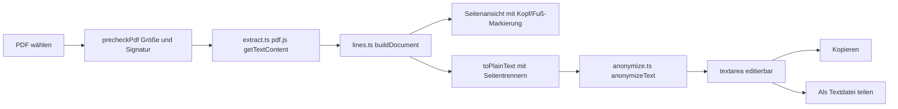

# 05 – PDF-Analysemodus mit anonymisiertem Export (Etappe 1)

> Dieser Plan ist **verbindlich**. Er ergänzt [00-architektur.md](00-architektur.md). Der Code-Mode trifft **keine** eigenen Entscheidungen. Ist etwas unklar, kommt `// PLAN-FRAGE: ...` in den Code und die Frage in den Abschluss-Bericht.
>
> **Etappe 1 importiert KEINE Buchungen.** Sie baut nur ein Analyse-Werkzeug: PDF lokal lesen → Zeilen rekonstruieren → anonymisieren → kopieren oder teilen. Der eigentliche PDF-Parser ist Etappe 2 und wird hier nicht geplant.

## 0. Überblick



Neue bzw. geänderte Dateien:

| Datei | Art | Schritt |
|---|---|---|
| `package.json` | Abhängigkeit `pdfjs-dist`, Scripts `postinstall`/`prebuild` | P1 |
| `scripts/copy-pdfjs.mjs` | neu | P1 |
| `.gitignore` | `public/pdfjs/` | P1 |
| `vite.config.ts` | `globIgnores`, `runtimeCaching` | P1 |
| `src/lib/pdf/errors.ts` (+ `errors.test.ts`) | neu, pure | P1 |
| `src/lib/pdf/lines.ts` (+ `lines.test.ts`) | neu, pure | P1 |
| `src/lib/pdf/anonymize.ts` (+ `anonymize.test.ts`) | neu, pure | P1 |
| `plans/00-architektur.md` | Tech-Stack-Tabelle, Ordnerstruktur, Routen | P1 + P2 |
| `src/lib/pdf/extract.ts` | neu, dünne Hülle um pdf.js, **ohne** Test | P2 |
| `src/routes/PdfAnalyze.svelte` | neu | P2 |
| `src/App.svelte` | Route `/import/pdf-analyse` | P2 |
| `src/routes/Import.svelte` | Link | P2 |
| `src/routes/ImportSettings.svelte` | Link | P2 |

---

## 1. Technische Entscheidungen

### 1.1 Paket und Import-Pfad
- Paket: **`pdfjs-dist`**, Major-Version 5: `npm i pdfjs-dist@^5`. Es kommt in die `dependencies`, weil der Code zur Laufzeit gebündelt wird. Andere PDF-Bibliotheken sind verboten.
- Import-Pfad: **`pdfjs-dist/legacy/build/pdf.mjs`**, Worker: **`pdfjs-dist/legacy/build/pdf.worker.min.mjs`**.
- **Begründung:** Der „moderne“ Build von pdf.js 5 setzt neueste Browser-APIs voraus (z. B. `Promise.withResolvers`, `Uint8Array.fromBase64`, `URL.parse`), die Safari auf iOS 17 und teils iOS 18 nicht hat. Der Legacy-Build enthält Polyfills und läuft auf iOS 17/18. Er ist größer, wird aber nur bei Bedarf geladen. Haupt-Bibliothek und Worker **müssen** aus demselben Build und derselben Version stammen. Weil beide aus demselben `node_modules/pdfjs-dist` kommen, ist das automatisch sichergestellt.
- Das optionale Paket `@napi-rs/canvas`, das pdfjs-dist mitinstalliert, wird nur unter Node gebraucht und landet nicht im Bundle. Nichts dagegen unternehmen.

### 1.2 Benötigte Dateien (Assets unter `public/pdfjs/`)
| Datei/Ordner | Quelle | Nötig? | Begründung |
|---|---|---|---|
| `pdf.worker.min.mjs` | `node_modules/pdfjs-dist/legacy/build/pdf.worker.min.mjs` | **ja** | Das Parsen läuft im Worker. Er wird vom eigenen Host als ESM-Modul-Worker geladen. |
| `cmaps/*.bcmap` | `node_modules/pdfjs-dist/cmaps/` | **ja** | Für Schriften mit vordefinierten CID-CMaps braucht `getTextContent()` die CMaps, sonst fehlen Zeichen. DKB-PDFs nutzen meist `Identity-H`, das ohne CMaps geht, aber die CMaps machen es robust. Sie werden nur bei Bedarf geladen. |
| `standard_fonts/*` | `node_modules/pdfjs-dist/standard_fonts/` | **ja** | Für nicht eingebettete Standardschriften (Helvetica usw.) lädt pdf.js Schriftdaten. Ohne sie gibt es Warnungen und im Einzelfall schlechtere Zeichenzuordnung. Ebenfalls nur bei Bedarf geladen. |
| `wasm/` | – | **nein** | Wird nur zum Dekodieren von Bildern (JPX, JBIG2) und für Farbprofile gebraucht. Wir rendern nicht, und Bilder liefern keinen Text (das DKB-Logo ist irrelevant). |

`getDocument`-Parameter (wörtlich so, siehe §4.1): `cMapUrl`, `cMapPacked: true`, `standardFontDataUrl`, `isEvalSupported: false`, `disableFontFace: true`, `useSystemFonts: false`, `enableXfa: false`, `verbosity: 0`.

### 1.3 Kopier-Skript: zweites Skript statt Umbenennung
- Neu: **`scripts/copy-pdfjs.mjs`**. `scripts/copy-tesseract.mjs` bleibt **unverändert**.
- **Begründung:** Das Tesseract-Skript ist erprobt und wird in `00-architektur.md` und `03-phase3-4-import.md` referenziert. Ein zweites, gleich aufgebautes Skript vermeidet Umbenennungen und Seiteneffekte und liefert getrennte, klare Fehlermeldungen.
- `package.json`:
  ```json
  "postinstall": "node scripts/copy-tesseract.mjs && node scripts/copy-pdfjs.mjs",
  "prebuild": "node scripts/copy-tesseract.mjs && node scripts/copy-pdfjs.mjs",
  ```

### 1.4 CSP: keine Änderung
Die CSP aus §7.5 bleibt **unverändert**. Begründung pro Direktive:
- `worker-src 'self' blob:`: Der Worker wird über die Same-Origin-URL `/money-tracker/pdfjs/pdf.worker.min.mjs` als `new Worker(url, { type: 'module' })` erzeugt. pdf.js verwendet eine Blob-URL nur bei fremden Origins, hier also nicht.
- `script-src 'self' 'wasm-unsafe-eval'`: Der pdf.js-Chunk ist ein eigenes Vite-Asset. Mit `isEvalSupported: false` versucht pdf.js kein `new Function`. Wasm wird nicht genutzt.
- `connect-src 'self'`: CMaps und Standardschriften werden per `fetch` vom eigenen Host geladen.
- Schriften/`font-src` (fällt auf `default-src 'self'` zurück): Mit `disableFontFace: true` legt pdf.js keine `FontFace`-Objekte aus `data:`/`blob:` an.
- Es wird kein Canvas gebraucht. `img-src` ist irrelevant.

### 1.5 Service Worker
In `vite.config.ts` unter `workbox`:
```ts
globIgnores: ['**/tesseract/**', '**/pdfjs/**'],
runtimeCaching: [
  {
    urlPattern: ({ url }) => url.pathname.includes('/tesseract/'),
    handler: 'CacheFirst',
    options: { cacheName: 'tesseract', expiration: { maxEntries: 20 } },
  },
  {
    urlPattern: ({ url }) => url.pathname.includes('/pdfjs/'),
    handler: 'CacheFirst',
    options: { cacheName: 'pdfjs', expiration: { maxEntries: 250 } },
  },
],
```
Kommentar über `globIgnores` anpassen: `// OCR- und PDF-Dateien bleiben aus dem Precache, damit die Installation leicht bleibt.`
`maxEntries: 250` reicht für den Worker, ca. 170 CMaps und ca. 15 Schriftdateien.

Der pdf.js-**Bibliotheks**-Chunk (`assets/pdf-*.js`, durch dynamischen Import entstanden) liegt **nicht** unter `/pdfjs/` und landet wie der Tesseract-Chunk im Precache. Damit ist die Seite offline nutzbar, sobald der Worker einmal geladen wurde.

### 1.6 Dynamischer Import
`extract.ts` lädt pdf.js **nur** per `await import('pdfjs-dist/legacy/build/pdf.mjs')`. Kein anderes Modul importiert `pdfjs-dist`. Kein Unit-Test importiert `extract.ts`.

---

## 2. `src/lib/pdf/errors.ts` (pure, P1)

```ts
export const MAX_PDF_BYTES = 10 * 1024 * 1024;
export const MAX_PDF_PAGES = 20;

export type PdfErrorCode =
  | 'not-pdf' | 'too-large' | 'password' | 'too-many-pages' | 'broken' | 'no-text' | 'load-failed';

export const PDF_ERROR_MESSAGES: Record<PdfErrorCode, string> = {
  'not-pdf': 'Die Datei ist keine PDF-Datei.',
  'too-large': 'Die Datei ist zu groß (maximal 10 MB).',
  password: 'Die PDF ist passwortgeschützt. Bitte eine ungeschützte PDF verwenden.',
  'too-many-pages': 'Die PDF hat zu viele Seiten (maximal 20).',
  broken: 'Die PDF konnte nicht gelesen werden (beschädigt oder nicht unterstützt).',
  'no-text': 'Die PDF enthält keinen Text. Eingescannte Kontoauszüge werden nicht unterstützt.',
  'load-failed': 'Der PDF-Leser konnte nicht geladen werden. Bitte die App einmal mit Internetverbindung öffnen.',
};

export class PdfAnalyzeError extends Error {
  readonly code: PdfErrorCode;
  constructor(code: PdfErrorCode) {
    super(code);
    this.name = 'PdfAnalyzeError';
    this.code = code;
  }
}

/** Prüft vor dem Laden von pdf.js. head = die ersten (bis zu) 1024 Bytes der Datei. */
export function precheckPdf(size: number, head: Uint8Array): PdfErrorCode | null;
```
Algorithmus von `precheckPdf` (in dieser Reihenfolge):
1. `size === 0` ergibt `'not-pdf'`.
2. `size > MAX_PDF_BYTES` ergibt `'too-large'`.
3. Die Bytefolge `%PDF-` (`0x25 0x50 0x44 0x46 0x2D`) muss an irgendeinem Offset `0 … head.length - 5` vorkommen. Kommt sie nicht vor, ist das Ergebnis `'not-pdf'`.
4. Sonst `null`.

Der MIME-Typ `file.type` wird **nicht** geprüft, weil iOS ihn bei Dateien aus der Dateien-App teilweise leer lässt.

**Tests `errors.test.ts`** (Hilfsfunktion `bytes(s: string) => new TextEncoder().encode(s)`):
| # | size | head | Erwartung |
|---|---|---|---|
| E1 | 0 | `bytes('')` | `'not-pdf'` |
| E2 | 10 485 761 | `bytes('%PDF-1.7')` | `'too-large'` |
| E3 | 10 485 760 | `bytes('%PDF-1.7')` | `null` |
| E4 | 500 | `bytes('%PDF-1.4\n')` | `null` |
| E5 | 500 | `bytes('\n\n  %PDF-1.4')` | `null` |
| E6 | 500 | `bytes('PK\u0003\u0004')` | `'not-pdf'` |
| E7 | 500 | `bytes('%PDF')` (ohne Bindestrich) | `'not-pdf'` |
| E8 | – | `new PdfAnalyzeError('password').code === 'password'` und `instanceof Error` | – |
| E9 | – | Jeder Code aus `PdfErrorCode` hat einen nicht-leeren Text in `PDF_ERROR_MESSAGES` | – |

---

## 3. `src/lib/pdf/lines.ts`: Zeilenrekonstruktion (pure, P1)

### 3.1 Typen und Konstanten (wörtlich)
```ts
/** Ein Textstück, bereits in Seitenkoordinaten mit Ursprung OBEN links. y = Grundlinie, Abstand vom oberen Rand. */
export interface RawTextItem { str: string; x: number; y: number; width: number; fontSize: number }
export interface RawPage { pageNo: number; width: number; height: number; items: RawTextItem[] }

export type LineMark = 'top' | 'bottom' | 'repeated' | null;
export interface PdfCell { x: number; text: string }
export interface PdfLine { y: number; text: string; cells: PdfCell[]; mark: LineMark }
export interface PdfPage { pageNo: number; width: number; height: number; hasText: boolean; lines: PdfLine[] }
export interface PdfDocumentText { pages: PdfPage[] }

export const LINE_CONFIG = {
  defaultFontSize: 10,     // falls fontSize <= 0 oder nicht endlich
  yToleranceFactor: 0.5,   // gleiche Zeile, wenn |Δy| <= 0.5 * min(Schriftgrößen)
  spaceGapFactor: 0.15,    // Lücke >= 0.15 * Schriftgröße ergibt ein Leerzeichen
  columnGapFactor: 1.5,    // Lücke >= 1.5 * Schriftgröße ergibt einen Spaltentrenner \t
  headerRatio: 0.18,       // y < 18 % der Seitenhöhe ergibt 'top'
  footerRatio: 0.08,       // y > 92 % der Seitenhöhe ergibt 'bottom'
  repeatTopRatio: 0.3,     // Wiederholungs-Erkennung nur in den obersten 30 % …
  repeatBottomRatio: 0.2,  // … und in den untersten 20 %
} as const;

export const NO_TEXT_HINT = 'Seite enthält keinen Text (eingescannt?)';
export const HEADER_FOOTER_PLACEHOLDER = '[KOPF/FUSS ENTFERNT]';

export function pageSeparator(pageNo: number): string; // `--- Seite ${pageNo} ---`
export function buildPageLines(page: RawPage): PdfLine[];
export function buildDocument(pages: RawPage[]): PdfDocumentText;
export function repeatKey(text: string): string;
export function toPlainText(doc: PdfDocumentText, hideHeaderFooter: boolean): string;
```

### 3.2 Algorithmus `buildPageLines(page)`
1. **Filtern:** Items mit `str.trim() === ''` entfernen. Für jedes Item gilt `fs = Number.isFinite(item.fontSize) && item.fontSize > 0 ? item.fontSize : LINE_CONFIG.defaultFontSize`.
2. **Sortieren:** nach `y` aufsteigend, bei Gleichstand nach `x` aufsteigend.
3. **Gruppieren:** Die Items werden der Reihe nach durchlaufen. `last` ist die zuletzt angelegte Gruppe mit `{ y, fs, items }`, wobei `y` und `fs` vom **ersten** Item der Gruppe stammen und nicht nachgeführt werden.
   - Gilt `last` existiert und `Math.abs(item.y - last.y) <= LINE_CONFIG.yToleranceFactor * Math.min(item.fs, last.fs)`, kommt das Item in `last.items`.
   - Sonst wird eine neue Gruppe `{ y: item.y, fs: item.fs, items: [item] }` angelegt.
4. **Zellen je Gruppe:** Die Items werden nach `x` aufsteigend sortiert. Das erste Item eröffnet die Zelle `cur = { x, text: str, end: x + width, lastFs: fs }`. Für jedes weitere Item `n` gilt:
   - `gap = n.x - cur.end` und `ref = Math.max(cur.lastFs, n.fs)`
   - `gap >= columnGapFactor * ref`: `cur` abschließen und eine neue Zelle mit `n` beginnen
   - sonst `gap >= spaceGapFactor * ref`: `cur.text += ' ' + n.str`
   - sonst (auch bei negativer Lücke): `cur.text += n.str`
   - danach `cur.end = Math.max(cur.end, n.x + n.width)` und `cur.lastFs = n.fs`
5. **Normalisieren:** Zelltext ist `text.replace(/\s+/g, ' ').trim()`. Zellen mit leerem Text entfallen. `cell.x = Math.round(x * 10) / 10`.
6. **Zeile:** `text = cells.map((c) => c.text).join('\t')`, `y = Math.round(group.y * 10) / 10`.
7. **Kopf/Fuß nach Lage** (mit dem gerundeten `y`, strikte Vergleiche):
   - `y < headerRatio * page.height` ergibt `'top'`
   - sonst `y > (1 - footerRatio) * page.height` ergibt `'bottom'`
   - sonst `null`
8. Rückgabe der Zeilen in Gruppenreihenfolge (von oben nach unten).

### 3.3 `repeatKey(text)`
```ts
text.toLowerCase().replace(/\s+/g, ' ').trim().replace(/\d+ ?(?:von|\/|of) ?\d+/g, '#/#')
```
Damit werden „Seite 1 von 3“ und „Seite 2 von 3“ gleich. Andere Ziffern werden **nicht** normalisiert, damit Buchungszeilen mit Datum oder Betrag nie als Wiederholung gelten.

### 3.4 `buildDocument(pages)`
1. `pages.map` ergibt `{ pageNo, width, height, lines: buildPageLines(p), hasText: lines.length > 0 }`.
2. Nur wenn `pages.length >= 2`: Für alle Zeilen mit `y <= repeatTopRatio * height` **oder** `y >= (1 - repeatBottomRatio) * height` wird `key = repeatKey(line.text)` gebildet. Zeilen mit `key.length < 2` werden übersprungen. Es entsteht eine `Map<string, Set<number>>` von key zu pageNo.
3. Alle so erfassten Zeilen mit `mark === null`, deren key auf **≥ 2 verschiedenen Seiten** vorkommt, bekommen `mark = 'repeated'`. Zeilen mit `'top'`/`'bottom'` behalten ihre Markierung.

### 3.5 `toPlainText(doc, hideHeaderFooter)`
Pro Seite wird ein Array `out` gebaut:
1. `out = [pageSeparator(p.pageNo)]`
2. Gilt `!p.hasText`: `out.push('[' + NO_TEXT_HINT + ']')`
3. Für jede Zeile: Gilt `hideHeaderFooter && line.mark !== null`, wird `HEADER_FOOTER_PLACEHOLDER` nur gepusht, wenn `out.at(-1) !== HEADER_FOOTER_PLACEHOLDER` (aufeinanderfolgende Platzhalter werden zusammengefasst). Sonst `out.push(line.text)`.
4. Seitentext ist `out.join('\n')`. Gesamttext ist `seiten.join('\n\n')`, ohne abschließenden Zeilenumbruch.

Spaltentrenner bleiben im Text als echtes `\t`, damit der Entwickler genau die Eingabe sieht, die ein späterer Parser bekommt. Nur die UI zeigt `⇥`.

### 3.6 Tests `lines.test.ts`
Hilfsfunktionen im Test:
```ts
const it_ = (str: string, x: number, y: number, width = str.length * 5, fontSize = 10): RawTextItem => ({ str, x, y, width, fontSize });
const page = (items: RawTextItem[], pageNo = 1): RawPage => ({ pageNo, width: 600, height: 800, items });
```
| # | Eingabe | Erwartung |
|---|---|---|
| L1 | `('Hallo',50,400,25)`, `('Welt',77,400,20)` | eine Zeile, text `'Hallo Welt'` (Lücke 2 ≥ 1,5) |
| L2 | `('Kar',50,400,15)`, `('te',65,400,10)` | `'Karte'` (Lücke 0) |
| L3 | `('12.10.',50,400,30)`, `('Kartenzahlung',100,400,65)`, `('-23,45',400,400,30)` | text `'12.10.\tKartenzahlung\t-23,45'`, cells x `[50,100,400]` |
| L4a | `('A',50,400,5)`, `('B',69.9,400,5)` | `'A B'` (Lücke 14,9 < 15) |
| L4b | `('A',50,400,5)`, `('B',70,400,5)` | `'A\tB'` (Lücke genau 15) |
| L5a | `('A',50,400)`, `('B',100,404)` | eine Zeile (Δy 4 ≤ 5) |
| L5b | `('A',50,400)`, `('B',100,406)` | zwei Zeilen, y `[400, 406]` |
| L6 | Items in umgekehrter x-Reihenfolge übergeben | Zellen trotzdem nach x sortiert |
| L7 | Zeilen bei y 500, 300, 400 übergeben | Reihenfolge der Zeilen y `[300,400,500]` |
| L8 | Seite nur mit `(' ',50,400)` und `('',60,400)` | `lines = []`, in `buildDocument` gilt `hasText = false` |
| L9 | `fontSize: 0`, `('A',50,400,5,0)`, `('B',70,400,5,0)` | Default 10 greift, also `'A\tB'` |
| L10 | Höhe 800: Zeilen bei y 100, 144, 400, 736, 750 | marks `['top', null, null, null, 'bottom']` |
| L11 | 2 Seiten: `'Kontoauszug Girokonto'` bei y 200 auf beiden Seiten; `'Miete'` bei y 400 auf beiden; `'Seite 1 von 2'` (S. 1) bzw. `'Seite 2 von 2'` (S. 2) bei y 700 | Kontoauszug-Zeilen `'repeated'`, Miete `null`, Seite-Zeilen `'repeated'` |
| L12 | 1 Seite, Zeile bei y 200 | mark `null` (keine Wiederholungsprüfung) |
| L13 | `repeatKey('Seite 3 / 12')` | `'seite #/#'` |
| L14 | `('Foo ',50,400,20)`, `(' Bar',72,400,15)` | `'Foo Bar'` (Whitespace normalisiert) |
| L15 | `toPlainText` mit 2 Seiten (S. 1: Zeilen `top` „Kopf“, `null` „A“, `null` „B“, `bottom` „Fuß1“; S. 2 ohne Text), `hide=false` | `'--- Seite 1 ---\nKopf\nA\nB\nFuß1\n\n--- Seite 2 ---\n[Seite enthält keinen Text (eingescannt?)]'` |
| L16 | wie L15, aber S. 1 mit zwei aufeinanderfolgenden markierten Zeilen am Ende, `hide=true` | `'--- Seite 1 ---\n[KOPF/FUSS ENTFERNT]\nA\nB\n[KOPF/FUSS ENTFERNT]\n\n--- Seite 2 ---\n[Seite enthält keinen Text (eingescannt?)]'` |

Für L15/L16 wird `PdfDocumentText` direkt als Literal gebaut, nicht über `buildDocument`.

---

## 4. `src/lib/pdf/anonymize.ts`: Anonymisierung (pure, P1)

### 4.1 Schnittstelle (wörtlich)
```ts
export type AnonCategory =
  | 'IBAN' | 'BIC' | 'KARTE' | 'GLÄUBIGER-ID' | 'REF' | 'EMAIL' | 'TEL'
  | 'NR' | 'ADRESSE' | 'PLZ ORT' | 'EIGENER NAME' | 'ENTFERNT';

/** Anzeige-Reihenfolge der Zählung. */
export const ANON_CATEGORIES: readonly AnonCategory[] = [
  'IBAN', 'BIC', 'KARTE', 'GLÄUBIGER-ID', 'REF', 'EMAIL', 'TEL',
  'NR', 'ADRESSE', 'PLZ ORT', 'EIGENER NAME', 'ENTFERNT',
];

export type AnonCounts = Record<AnonCategory, number>;
export interface AnonymizeOptions { ownNames: readonly string[]; extraTerms: readonly string[] }
export interface AnonymizeResult { text: string; counts: AnonCounts }

export function anonymizeText(text: string, opts: AnonymizeOptions): AnonymizeResult;
/** Kommagetrennte Eingabe: split(','), trim, Länge >= 2, Duplikate (case-insensitive) entfernen, Eingabereihenfolge. */
export function parseExtraTerms(input: string): string[];
/** Volle Namen und Namensbestandteile (>= 3 Zeichen, ohne Stoppwörter), dedupliziert, nach Länge absteigend (stabil). */
export function buildNameTerms(ownNames: readonly string[]): string[];
/** "3× IBAN, 12× NR" in ANON_CATEGORIES-Reihenfolge, Nullen weglassen; alles 0 ergibt "Nichts gefunden". */
export function formatCounts(counts: AnonCounts): string;
```
Der Platzhalter einer Kategorie ist immer `'[' + cat + ']'`, also z. B. `[IBAN]`, `[GLÄUBIGER-ID]`, `[PLZ ORT]`, `[EIGENER NAME]`.

### 4.2 Schutzmechanismus (Sentinels)
Damit spätere Regeln weder Platzhalter noch Strukturzeilen verändern (z. B. „Name“ in `[EIGENER NAME]`), wird jeder Treffer **sofort** durch einen Sentinel aus Unicode-Private-Use-Zeichen ersetzt und erst ganz am Ende zurückverwandelt.
- Vorab: `text = text.replace(/[\uE000-\uF8FF]/g, '')`
- `protect(value: string): string` legt `value` in `store: string[]` ab, Index `i`. Ergebnis: `'\uE000' + [...String(i)].map((d) => String.fromCharCode(0xE010 + Number(d))).join('') + '\uE001'`
- Am Ende: `text.replace(/\uE000([\uE010-\uE019]+)\uE001/g, (_, enc: string) => store[Number([...enc].map((c) => c.charCodeAt(0) - 0xE010).join(''))] ?? '')`
- Sentinel-Zeichen sind weder Buchstaben noch Ziffern noch Whitespace. Sie wirken in allen Regeln als Wortgrenze und werden von keiner Regel erfasst.

Hilfsfunktion (Referenz, so umsetzen):
```ts
type Decide = (m: RegExpExecArray) => { keepBefore: string } | null;
const all: Decide = () => ({ keepBefore: '' });

function mask(text: string, re: RegExp, cat: AnonCategory, decide: Decide = all): string {
  let out = '';
  let last = 0;
  for (const m of text.matchAll(re)) {
    const d = decide(m);
    if (d === null) continue;
    const start = m.index ?? 0;
    out += text.slice(last, start) + d.keepBefore + protect(`[${cat}]`);
    last = start + m[0].length;
    counts[cat]++;
  }
  return out + text.slice(last);
}
```
`protect`, `store` und `counts` sind lokale Variablen in `anonymizeText` (Closure). `mask` ist dort als innere Funktion definiert. Alle Regexe haben das Flag `g`.

**Abkürzungen in diesem Plan** (im Code ausgeschrieben, als Konstanten-Strings mit `new RegExp(...)` erlaubt):
- `WB` = `(?<![A-Za-z0-9ÄÖÜäöüß])` (Wortanfang)
- `WE` = `(?![A-Za-z0-9ÄÖÜäöüß])` (Wortende)
- `WEN` = `(?![A-Za-z0-9ÄÖÜäöüß]|[.,]\d)` (Wortende, das zusätzlich Beträge und Daten schützt: kein `.`/`,` gefolgt von Ziffer)

### 4.3 Regeln in exakt dieser Reihenfolge

| # | Kategorie | Regex | Entscheidung / Ersetzung |
|---|---|---|---|
| R0a | (Schutz) | `/^--- Seite \d+ ---$/gm` | `protect(match)`, nicht gezählt |
| R0b | (Schutz) | `/\[KOPF\/FUSS ENTFERNT\]/g` | `protect(match)`, nicht gezählt |
| R0c | (Schutz) | `/\[Seite enthält keinen Text \(eingescannt\?\)\]/g` | `protect(match)`, nicht gezählt |
| R1 | EMAIL | `/[A-Za-z0-9._%+-]+@[A-Za-z0-9-]+(?:\.[A-Za-z0-9-]+)*\.[A-Za-z]{2,}/g` | ganz |
| R2a | GLÄUBIGER-ID | `WB[A-Z]{2}\d{2}ZZZ[A-Z0-9]{8,28}WE` | ganz |
| R2b | GLÄUBIGER-ID | `WB(Gläubiger-Identifikationsnummer\|Gläubiger-ID\|Gläubiger-Id\|Gläubiger ID)(:?[ ]*)([A-Z]{2}\d{2}[A-Z0-9]{3}[A-Z0-9]{1,28})WE` | `keepBefore = m[1] + m[2]` |
| R3 | IBAN | `WB[A-Z]{2}\d{2}(?:[ ]?[A-Z0-9]{4}){2,7}(?:[ ]?[A-Z0-9]{1,4})?WE` | `const n = m[0].replace(/ /g, '').length;` nur wenn `n >= 15 && n <= 34`, sonst `null` |
| R4a | BIC | `WB(BIC\|Bic\|SWIFT\|Swift)([: ]{1,3})([A-Z]{6}[A-Z0-9]{2}(?:[A-Z0-9]{3})?)WE` | `keepBefore = m[1] + m[2]` |
| R4b | BIC | `WB[A-Z]{4}([A-Z]{2})[A-Z0-9]{2}(?:[A-Z0-9]{3})?WE` | nur wenn `BIC_COUNTRIES.has(m[1])` **und** (`/\d/.test(m[0].slice(6))` **oder** (`m[0].length === 11 && m[0].endsWith('XXX')`)), sonst `null` |
| R5a | KARTE | `WB(?:\d{4}([ -]?)\d{4}\1\d{4}\1\d{4}\|\d{4}[ ]?\d{6}[ ]?\d{5})WEN` | ganz |
| R5b | KARTE | `(?<![A-Za-z0-9ÄÖÜäöüß*•])(?:\d{4,6}[ ]?)?(?:[Xx*•]{2,}[ ]?){1,3}\d{4}WEN` | ganz |
| R6 | REF | `WB(Mandatsreferenz\|Mandatsref\.\|Mandat\|Kundenreferenz\|Kundenref\.\|End-to-End-Referenz\|End-to-End-Ref\.\|EREF\|MREF\|KREF\|CRED)(?![A-Za-zÄÖÜäöüß])([ \t]?[:+][ \t]?\|[ \t])([^ \t\n]+)` Flags **`gi`** | Enthält `m[3]` das Zeichen `'\uE000'`, dann `null` (Wert ist bereits geschützt, z. B. Gläubiger-ID). Sonst `keepBefore = m[1] + m[2]` |
| R7a | TEL | `(?<![A-Za-z0-9ÄÖÜäöüß+])(?:\+\|00)[1-9]\d{0,2}(?:[ ]?\(0\))?(?:[ /-]\d{2,}){1,5}WEN` | ganz |
| R7b | TEL | `(?<![A-Za-z0-9ÄÖÜäöüß.,+])0\d{2,5}(?:[ ]?\/[ ]?\|[ -])\d{3,8}(?:[ -]\d{2,6}){0,3}WEN` | ganz |
| R8 | NR | `/(?<!\d)\d{8,}(?!\d\|[.,]\d)/g` | ganz |
| R9a | ADRESSE | `WB(?:[A-ZÄÖÜ][a-zäöüß]+er[ ])?(?:[A-ZÄÖÜ][a-zäöüß-]*)?(?:[Ss]traße\|[Ss]trasse\|[Ss]tr\.\|[Ww]eg\|[Pp]latz\|[Aa]llee\|[Gg]asse\|[Rr]ing\|[Dd]amm\|[Uu]fer)[ ]?\d{1,4}[a-z]?(?:[ ]?[-\/][ ]?\d{1,4}[a-z]?)?WEN` | ganz |
| R9b | ADRESSE | `WB[A-ZÄÖÜ][A-ZÄÖÜ-]*(?:STRASSE\|STRAßE\|STR\.\|WEG\|PLATZ\|ALLEE\|GASSE\|RING\|DAMM\|UFER)[ ]?\d{1,4}[A-Z]?WEN` | ganz |
| R10 | PLZ ORT | `(?<![A-Za-z0-9ÄÖÜäöüß.,])\d{5}[ ]+([A-ZÄÖÜ][a-zäöüß]+\|[A-ZÄÖÜ]{2,})(?:[ ]am[ ][A-ZÄÖÜ][a-zäöüß]+)?WE` | `null`, wenn `PLZ_EXCLUDE.has(m[1])`, sonst ganz |
| R11 | EIGENER NAME | pro Begriff `t` aus `buildNameTerms(opts.ownNames)`: `new RegExp(WB + termSource(t) + WE, 'gi')` | ganz |
| R12 | ENTFERNT | pro Begriff `t` aus `opts.extraTerms`, nach Länge absteigend sortiert (stabil): `new RegExp(WB + termSource(t) + WE, 'gi')` | ganz |
| R13 | – | Sentinels zurückverwandeln | – |

In der Tabelle steht `\|` nur für die Markdown-Darstellung. Im Code ist es ein normales `|`.

Konstanten:
```ts
const BIC_COUNTRIES = new Set(['DE','AT','CH','NL','BE','LU','FR','IT','ES','PT','IE','GB','PL','CZ','DK','SE','FI','NO','LI']);
const PLZ_EXCLUDE = new Set(['EUR','Euro','USD','CHF','GBP','Stück','Seite']);
const NAME_STOPWORDS = new Set(['von','van','der','den','dem','des','und','zur','vom','del','dos','ten','ter','bin']);
```

**`termSource(t: string): string`** baut die Regex-Quelle zeichenweise:
- Regex-Sonderzeichen `.*+?^${}()|[]\` werden mit `\` maskiert.
- Ein Leerzeichen (nach `t.trim().replace(/\s+/g, ' ')`) wird zu `[ ]+`.
- `ä`/`Ä` wird zu `(?:ä|ae)`, `ö`/`Ö` zu `(?:ö|oe)`, `ü`/`Ü` zu `(?:ü|ue)`, `ß` zu `(?:ß|ss)`.
- Alle anderen Zeichen bleiben unverändert. Mit dem Flag `i` findet „Jürgen“ also auch „JUERGEN“ und „jürgen“.

**`buildNameTerms(ownNames)`:**
1. Für jeden Namen gilt `full = name.trim().replace(/\s+/g, ' ')`. Gilt `full.length >= 3`, wird `full` aufgenommen.
2. Die Bestandteile sind `full.split(/[ ,.\-]+/)`. Aufgenommen werden die mit `length >= 3` und `!NAME_STOPWORDS.has(teil.toLowerCase())`.
3. Duplikate werden case-insensitive entfernt (erstes Vorkommen bleibt).
4. Stabil nach `length` absteigend sortieren.

**Begründung der BIC-Strenge:** Ein reiner Strukturtest mit Länderkennung trifft deutsche Wörter. `LASTSCHRIFT` hat an Position 5–6 „SC“ (Seychellen), `KREDITKARTE` hat „IT“, `BRANDENBURG` hat „DE“. Deshalb gilt ohne das Schlüsselwort `BIC`/`SWIFT` zusätzlich: Länderkennung aus der Whitelist **und** eine Ziffer im Orts- oder Filialteil bzw. die Endung `XXX`. Bekannte Lücke: Ein rein alphabetischer 8-stelliger BIC **ohne** vorangestelltes „BIC“ (z. B. `COBADEFF`) wird nicht erkannt. Das ist im Warnhinweis abgedeckt und als Test dokumentiert.

**Begründung der Reihenfolge:**
- EMAIL läuft zuerst, weil E-Mail-Adressen Ziffern und Namen enthalten.
- GLÄUBIGER-ID läuft vor IBAN, weil `DE98ZZZ09999999999` sonst als IBAN gälte.
- IBAN und BIC laufen vor KARTE und NR.
- REF läuft vor TEL und NR, damit `EREF: 1234567890123` als `[REF]` gezählt wird.
- TEL läuft vor NR.
- NR läuft vor ADRESSE und PLZ ORT. Fünfstellige Zahlen bleiben dabei unberührt.
- Namen und Zusatzbegriffe kommen zuletzt, weil sie nur auf noch ungeschütztem Text greifen sollen.

### 4.4 Tabellen-Tests `anonymize.test.ts`
Aufbau: `it.each(cases)('%s', (input, expected, opts) => expect(anonymizeText(input, opts ?? NONE).text).toBe(expected))` mit `const NONE = { ownNames: [], extraTerms: [] }`. `\t` steht im Test als echtes Tab-Zeichen.

| # | Eingabe | Erwartete Ausgabe | opts |
|---|---|---|---|
| A1 | `DE89 3704 0044 0532 0130 00` | `[IBAN]` | |
| A2 | `DE89370400440532013000` | `[IBAN]` | |
| A3 | `IBAN: DE89 3704 0044 0532 0130 00 BIC: BYLADEM1001` | `IBAN: [IBAN] BIC: [BIC]` | |
| A4 | `GB82 WEST 1234 5698 7654 32` | `[IBAN]` | |
| A5 | `AT611904300234573201` | `[IBAN]` | |
| A6 | `DE12345678` | `DE[NR]` | |
| A7 | `Gläubiger-ID: DE98ZZZ09999999999` | `Gläubiger-ID: [GLÄUBIGER-ID]` | |
| A8 | `CRED+DE98ZZZ09999999999` | `CRED+[GLÄUBIGER-ID]` | |
| A9 | `Mandatsreferenz: MREF-2026-0001` | `Mandatsreferenz: [REF]` | |
| A10 | `Mandat: ABC123XYZ` | `Mandat: [REF]` | |
| A11 | `EREF: 1234567890123` | `EREF: [REF]` | |
| A12 | `KREF+K-998877` | `KREF+[REF]` | |
| A13 | `Kundenreferenz 4711-0815` | `Kundenreferenz [REF]` | |
| A14 | `End-to-End-Ref.: NOTPROVIDED` | `End-to-End-Ref.: [REF]` | |
| A15 | `Karte 4930 **** **** 1234` | `Karte [KARTE]` | |
| A16 | `xxxx 1234` | `[KARTE]` | |
| A17 | `XXXX XXXX XXXX 1234` | `[KARTE]` | |
| A18 | `4930123456781234` | `[KARTE]` | |
| A19 | `4930 1234 5678 1234` | `[KARTE]` | |
| A20 | `Kunden-Nr. 1234567890` | `Kunden-Nr. [NR]` | |
| A21 | `Referenz 123456789012` | `Referenz [NR]` | |
| A22 | `ABC12345678` | `ABC[NR]` | |
| A23 | `12345678` | `[NR]` | |
| A24 | `1234567` | `1234567` | |
| A25 | `1.234,56` | `1.234,56` | |
| A26 | `-3.000,00` | `-3.000,00` | |
| A27 | `12345678,90` | `12345678,90` | |
| A28 | `+1.500,00` | `+1.500,00` | |
| A29 | `12.10.2026` | `12.10.2026` | |
| A30 | `12.10.` | `12.10.` | |
| A31 | `2026-10-12` | `2026-10-12` | |
| A32 | `Kartenzahlung 4,99 EUR 12.10.2026 18:42` | unverändert | |
| A33 | `max.mustermann@example.de` | `[EMAIL]` | |
| A34 | `Tel. +49 30 12345678` | `Tel. [TEL]` | |
| A35 | `Telefon 030 1234567` | `Telefon [TEL]` | |
| A36 | `Hotline 0800/123456` | `Hotline [TEL]` | |
| A37 | `BYLADEM1001` | `[BIC]` | |
| A38 | `GENODEF1M04` | `[BIC]` | |
| A39 | `COBADEFFXXX` | `[BIC]` | |
| A40 | `BIC COBADEFF` | `BIC [BIC]` | |
| A41 | `COBADEFF` | `COBADEFF` (bekannte Lücke ohne „BIC“) | |
| A42 | `LASTSCHRIFT` | unverändert | |
| A43 | `SEPA-LASTSCHRIFT` | unverändert | |
| A44 | `GUTSCHRIFT` | unverändert | |
| A45 | `KREDITKARTE` | unverändert | |
| A46 | `BRANDENBURG` | unverändert | |
| A47 | `DEUTSCHE UMSAETZE ZINSSATZ` | unverändert | |
| A48 | `REWE Markt GmbH` | unverändert | |
| A49 | `DKB VISA SEPA` | unverändert | |
| A50 | `Musterstraße 12` | `[ADRESSE]` | |
| A51 | `Hauptstr. 5a` | `[ADRESSE]` | |
| A52 | `Am Lindenweg 3` | `Am [ADRESSE]` | |
| A53 | `Berliner Allee 5` | `[ADRESSE]` | |
| A54 | `HAUPTSTR. 12` | `[ADRESSE]` | |
| A55 | `10115 Berlin` | `[PLZ ORT]` | |
| A56 | `60311 Frankfurt am Main` | `[PLZ ORT]` | |
| A57 | `12345 EUR` | `12345 EUR` | |
| A58 | `Seite 1 von 2` | unverändert | |
| A59 | `Gutschrift von MAX MUSTERMANN` | `Gutschrift von [EIGENER NAME]` | `{ ownNames: ['Max Mustermann'], extraTerms: [] }` |
| A60 | `Überweisung an Mustermann, Max` | `Überweisung an [EIGENER NAME], [EIGENER NAME]` | wie A59 |
| A61 | `Maximilian` | `Maximilian` | wie A59 |
| A62 | `JUERGEN MUELLER` | `[EIGENER NAME]` | `{ ownNames: ['Jürgen Müller'], extraTerms: [] }` |
| A63 | `Anna von Berg, Seite 1 von 3, Berg` | `[EIGENER NAME], Seite 1 von 3, [EIGENER NAME]` | `{ ownNames: ['Anna von Berg'], extraTerms: [] }` |
| A64 | `Überweisung an Anna Beispiel 12,00` | `Überweisung an [ENTFERNT] 12,00` | `{ ownNames: [], extraTerms: ['Anna Beispiel'] }` |
| A65 | `NETFLIX.COM` | `[ENTFERNT].COM` | `{ ownNames: [], extraTerms: ['Netflix'] }` |
| A66 | `--- Seite 1 ---\n[KOPF/FUSS ENTFERNT]` | unverändert | `{ ownNames: ['Seite'], extraTerms: ['Kopf'] }` |
| A67 | `12.10.\t12.10.\tKartenzahlung REWE Markt 4711\t-23,45` | unverändert | |
| A68 | `01.10.2026\tLastschrift\tEREF: 2026100112345 MREF: M-77 CRED: DE98ZZZ09999999999\t-49,99` | `01.10.2026\tLastschrift\tEREF: [REF] MREF: [REF] CRED: [GLÄUBIGER-ID]\t-49,99` | |
| A69 | `Max Mustermann\tDE89370400440532013000` | `[EIGENER NAME]\t[IBAN]` | wie A59 |
| A70 | `PayPal Europe S.a.r.l. et Cie S.C.A 1043287612345 PP.1234.PP` | `PayPal Europe S.a.r.l. et Cie S.C.A [NR] PP.1234.PP` | |

Weitere Einzeltests:
- **Zählung:** `anonymizeText('DE89370400440532013000 und 12345678 und 87654321', NONE).counts` hat `IBAN: 1`, `NR: 2` und alle anderen Kategorien `0`. `formatCounts(...)` ergibt `'1× IBAN, 2× NR'`.
- **Zählung Namen:** A60 ergibt `counts['EIGENER NAME'] === 2`.
- **formatCounts leer:** Alle Kategorien `0` ergeben `'Nichts gefunden'`.
- **Idempotenz:** `t1 = anonymizeText('IBAN DE89370400440532013000, Tel. 030 1234567, 10115 Berlin', NONE).text` ist `'IBAN [IBAN], Tel. [TEL], [PLZ ORT]'`, und `anonymizeText(t1, NONE).text === t1`.
- **Private-Use-Zeichen in der Eingabe** werden entfernt: `anonymizeText('A\uE000B', NONE).text === 'AB'`.
- **parseExtraTerms:** `' Anna Beispiel, ,Vermieter GmbH ,a, anna beispiel'` ergibt `['Anna Beispiel', 'Vermieter GmbH']`. `''` ergibt `[]`.
- **buildNameTerms:** `['Max Mustermann', 'Anna von Berg']` ergibt `['Max Mustermann', 'Anna von Berg', 'Mustermann', 'Anna', 'Berg', 'Max']`. `['  ', 'Al']` ergibt `[]`.

Schlägt ein Tabellenfall fehl, wird die **Implementierung** an den Plan angepasst und nicht der erwartete Wert. Ist ein Fall mit den Regexen aus §4.3 nachweislich nicht erfüllbar, kommt eine `PLAN-FRAGE` und der Fall wird **nicht** stillschweigend geändert.

---

## 5. `src/lib/pdf/extract.ts`: Hülle um pdf.js (P2, ohne Test)

Eigene minimale Typen, kein `any`, keine Imports von pdf.js-Typen:
```ts
import { MAX_PDF_PAGES, PdfAnalyzeError, precheckPdf, type PdfErrorCode } from './errors';
import type { RawPage, RawTextItem } from './lines';

interface PdfjsTextItem { str: string; transform: number[]; width: number; height: number }
interface PdfjsMarkedContent { type: string }
interface PdfjsTextContent { items: Array<PdfjsTextItem | PdfjsMarkedContent> }
interface PdfjsPage { view: number[]; getTextContent(): Promise<PdfjsTextContent>; cleanup(): unknown }
interface PdfjsDocument { numPages: number; getPage(pageNo: number): Promise<PdfjsPage> }
interface PdfjsLoadingTask { promise: Promise<PdfjsDocument>; destroy(): Promise<void> }
interface PdfjsGetDocumentParams {
  data: Uint8Array; cMapUrl: string; cMapPacked: boolean; standardFontDataUrl: string;
  isEvalSupported: boolean; disableFontFace: boolean; useSystemFonts: boolean; enableXfa: boolean; verbosity: number;
}
interface PdfjsModule { getDocument(params: PdfjsGetDocumentParams): PdfjsLoadingTask; GlobalWorkerOptions: { workerSrc: string } }

export async function extractPdfText(file: File, onProgress: (page: number, total: number) => void): Promise<RawPage[]>;
```

Ablauf (so umsetzen):
1. `const head = new Uint8Array(await file.slice(0, 1024).arrayBuffer());`, dann `const pre = precheckPdf(file.size, head); if (pre !== null) throw new PdfAnalyzeError(pre);`
2. pdf.js laden:
   ```ts
   const base = import.meta.env.BASE_URL + 'pdfjs/';
   let pdfjs: PdfjsModule;
   try {
     pdfjs = (await import('pdfjs-dist/legacy/build/pdf.mjs')) as unknown as PdfjsModule;
   } catch {
     throw new PdfAnalyzeError('load-failed');
   }
   pdfjs.GlobalWorkerOptions.workerSrc = base + 'pdf.worker.min.mjs';
   ```
3. `const data = new Uint8Array(await file.arrayBuffer());`
4. Dokument öffnen:
   ```ts
   const task = pdfjs.getDocument({
     data,
     cMapUrl: base + 'cmaps/',
     cMapPacked: true,
     standardFontDataUrl: base + 'standard_fonts/',
     isEvalSupported: false,
     disableFontFace: true,
     useSystemFonts: false,
     enableXfa: false,
     verbosity: 0,
   });
   ```
   Kein `onPassword`-Callback setzen. pdf.js lehnt dann mit einem Fehler mit `name === 'PasswordException'` ab.
5. Ausführung:
   ```ts
   try {
     let doc: PdfjsDocument;
     try {
       doc = await task.promise;
     } catch (err) {
       throw new PdfAnalyzeError(openErrorCode(err));
     }
     if (doc.numPages > MAX_PDF_PAGES) throw new PdfAnalyzeError('too-many-pages');
     const pages: RawPage[] = [];
     for (let n = 1; n <= doc.numPages; n++) {
       onProgress(n, doc.numPages);
       const page = await doc.getPage(n);
       const content = await page.getTextContent();
       const x0 = page.view[0] ?? 0, y0 = page.view[1] ?? 0, x1 = page.view[2] ?? 0, y1 = page.view[3] ?? 0;
       const items: RawTextItem[] = [];
       for (const it of content.items) {
         if (!('str' in it)) continue;
         const t = it.transform;
         const fontSize = Math.hypot(t[2] ?? 0, t[3] ?? 0) || it.height;
         items.push({ str: it.str, x: (t[4] ?? 0) - x0, y: y1 - (t[5] ?? 0), width: it.width, fontSize });
       }
       pages.push({ pageNo: n, width: x1 - x0, height: y1 - y0, items });
       page.cleanup();
     }
     return pages;
   } catch (err) {
     if (err instanceof PdfAnalyzeError) throw err;
     throw new PdfAnalyzeError('broken');
   } finally {
     await task.destroy().catch(() => undefined);
   }
   ```
6. `function openErrorCode(err: unknown): PdfErrorCode` ergibt `'password'`, wenn `typeof err === 'object' && err !== null && 'name' in err && err.name === 'PasswordException'`. Sonst `'broken'`.
7. **Kein** `console.*` in der ganzen Datei. Fehler werden nie mit Inhalt geloggt.

**TypeScript-Fallback (verbindliche Regel, keine Entscheidung):** Meldet `npm run check` für den Import-Pfad den Fehler TS7016 („Could not find a declaration file“), wird `src/lib/pdf/pdfjs-legacy.d.ts` mit genau diesem Inhalt angelegt:
```ts
declare module 'pdfjs-dist/legacy/build/pdf.mjs' {
  export const GlobalWorkerOptions: unknown;
  export function getDocument(params: unknown): unknown;
}
```
Tritt kein Fehler auf, wird die Datei **nicht** angelegt.

**Build-Regeln:**
- Zeigt `npm run build` die Warnung „Some chunks are larger than 500 kB“ für den pdf-Chunk, wird in `vite.config.ts` auf oberster Ebene `build: { chunkSizeWarningLimit: 1500 },` ergänzt. Sonst nicht.
- Schlägt der Build an einem Node-Import aus `pdfjs-dist` fehl (z. B. `@napi-rs/canvas`, `node:fs`), wird nicht improvisiert: `PLAN-FRAGE` und Abbruch.

---

## 6. UI: `src/routes/PdfAnalyze.svelte` (P2)

### 6.1 Route und Einstiege
- `src/App.svelte`: Import `import PdfAnalyze from './routes/PdfAnalyze.svelte';` (alphabetisch nach `Overview`) und in `routes` direkt nach `/import`: `{ pattern: '/import/pdf-analyse', component: PdfAnalyze, withParams: false },`
- `src/routes/Import.svelte`: direkt **nach** dem `<p class="muted small hint">Beim ersten Mal werden die Texterkennungs-Daten …</p>` (vor `{#if ocrBusy}`) einfügen:
  ```svelte
  <a class="pdf-link" href="#/import/pdf-analyse">📄 PDF analysieren (für Entwickler-Beispiele)</a>
  ```
  Dazu im `<style>`: `.pdf-link { display: block; text-align: center; padding: 12px 0; min-height: 44px; color: var(--primary); font-size: 14px; }`
- `src/routes/ImportSettings.svelte`: am Ende, direkt vor dem schließenden `</div>` der Seite:
  ```svelte
  <h2 class="section-title">PDF-Kontoauszüge</h2>
  <p class="muted hint">Der PDF-Import ist in Vorbereitung. Hier kannst du einen Auszug analysieren und anonymisiert als Beispiel weitergeben.</p>
  <ul class="list">
    <li class="list-item">
      <a class="row-link" href="#/import/pdf-analyse"><span>📄 PDF analysieren (für Entwickler-Beispiele)</span><span class="muted">›</span></a>
    </li>
  </ul>
  ```
  Die `.row-link`-Regel aus dem `<style>`-Block von `Settings.svelte` wird **wörtlich** in den `<style>`-Block von `ImportSettings.svelte` kopiert.

### 6.2 Zustand (alles nur im RAM, nichts in Stores, IndexedDB oder localStorage)
```ts
import { onDestroy } from 'svelte';
import { shareOrDownload } from '../lib/backup/backup';
import { extractPdfText } from '../lib/pdf/extract';
import { PDF_ERROR_MESSAGES, PdfAnalyzeError } from '../lib/pdf/errors';
import { buildDocument, NO_TEXT_HINT, toPlainText, type PdfDocumentText, type PdfLine, type PdfPage } from '../lib/pdf/lines';
import { anonymizeText, formatCounts, parseExtraTerms, type AnonCounts } from '../lib/pdf/anonymize';
import { back } from '../lib/router';
import { settings } from '../lib/state/data';
import { showToast } from '../lib/state/toast';

let busy = $state(false);
let progress = $state({ page: 0, total: 0 });
let errorText = $state('');
let doc = $state.raw<PdfDocumentText | null>(null);
let hideHeaderFooter = $state(true);
let extraTermsInput = $state('');
let anonText = $state('');
let lastGenerated = $state('');
let anonCounts = $state.raw<AnonCounts | null>(null);
let fileInput: HTMLInputElement | undefined = $state();
let runId = 0;
```

Funktionen:
- `resetAll()`: `runId++`. Alle obigen Zustände auf ihren Startwert setzen (`hideHeaderFooter = true`, `extraTermsInput = ''` usw.). `if (fileInput) fileInput.value = ''`.
- `onDestroy(resetAll)`. Das gilt auch beim Sperren, weil `App.svelte` die Route dann aushängt.
- `async function onFileSelected(e: Event)`:
  1. `const input = e.currentTarget as HTMLInputElement; const file = input.files?.[0]; if (!file) return;`
  2. `const myRun = ++runId;` Dann `doc = null; anonText = ''; lastGenerated = ''; anonCounts = null; errorText = ''; progress = { page: 0, total: 0 }; busy = true;` (`hideHeaderFooter` und `extraTermsInput` bleiben erhalten)
  3. `try`: `const raw = await extractPdfText(file, (p, n) => { if (myRun === runId) progress = { page: p, total: n }; });` Dann `if (myRun !== runId) return;` und `const built = buildDocument(raw);`. Gilt `built.pages.every((p) => !p.hasText)`, wird `errorText = PDF_ERROR_MESSAGES['no-text']`, sonst `doc = built`.
  4. `catch (err)`: `if (myRun !== runId) return; errorText = err instanceof PdfAnalyzeError ? PDF_ERROR_MESSAGES[err.code] : PDF_ERROR_MESSAGES.broken;`
  5. `finally`: `if (myRun === runId) busy = false; input.value = '';`
- `function anonymize()`: `if (!doc) return;` Gilt `anonText !== '' && anonText !== lastGenerated && !confirm('Deine Änderungen im Text gehen verloren. Fortfahren?')`, dann `return`. Sonst `const r = anonymizeText(toPlainText(doc, hideHeaderFooter), { ownNames: $settings?.ownNames ?? [], extraTerms: parseExtraTerms(extraTermsInput) });` und `anonText = r.text; lastGenerated = r.text; anonCounts = r.counts;`
- `async function copy()`: `try { await navigator.clipboard.writeText(anonText); showToast('Text kopiert'); } catch { showToast('Kopieren nicht möglich. Bitte den Text markieren und manuell kopieren.', 'error'); }`
- `async function share()`: `try { const res = await shareOrDownload(new File([anonText], 'pdf-beispiel-anonym.txt', { type: 'text/plain' })); if (res === 'downloaded') showToast('Datei gespeichert'); } catch { showToast('Teilen fehlgeschlagen', 'error'); }`
- `function reset()`: `resetAll(); showToast('Alles entfernt');`
- `function visibleLines(p: PdfPage): PdfLine[]`: `return hideHeaderFooter ? p.lines.filter((l) => l.mark === null) : p.lines;`
- Abgeleitet: `const hfCount = $derived(doc ? doc.pages.reduce((s, p) => s + p.lines.filter((l) => l.mark !== null).length, 0) : 0);` und `const lineCount = $derived(doc ? doc.pages.reduce((s, p) => s + p.lines.length, 0) : 0);`

### 6.3 Markup (Reihenfolge und Texte verbindlich)
```svelte
<div class="page">
  <div class="header">
    <button type="button" class="back" onclick={() => back()}>‹ Zurück</button>
    <h1>PDF analysieren</h1>
  </div>

  <p class="card intro">
    Hier kannst du einen Kontoauszug (PDF) analysieren. Die Datei verlässt dein iPhone nicht. Du kannst den Text
    anonymisiert kopieren, um ihn als Beispiel für die Entwicklung weiterzugeben. Prüfe den Text vor dem Weitergeben
    bitte selbst.
  </p>

  <div class="actions">
    <button type="button" class="btn btn-primary" disabled={busy} onclick={() => fileInput?.click()}>📄 PDF auswählen</button>
    <input bind:this={fileInput} class="file-input" type="file" accept="application/pdf" tabindex="-1" aria-hidden="true" onchange={onFileSelected} />
    <p class="muted small">Maximal 20 Seiten und 10 MB. Beim ersten Mal wird der PDF-Leser einmalig vom eigenen Server geladen.</p>
  </div>

  {#if busy}
    <p role="status">{progress.total === 0 ? 'PDF wird geöffnet…' : `Seite ${progress.page} von ${progress.total}`}</p>
  {/if}
  {#if errorText !== ''}
    <p class="error" role="alert">{errorText}</p>
  {/if}

  {#if doc}
    <p class="muted small">{doc.pages.length} Seiten gelesen, {lineCount} Zeilen, davon {hfCount} Kopf/Fuß.</p>
    <label class="toggle"><input type="checkbox" bind:checked={hideHeaderFooter} /> Kopf/Fuß ausblenden</label>

    {#each doc.pages as p (p.pageNo)}
      <section class="card pdf-page">
        <h2>Seite {p.pageNo}</h2>
        {#if !p.hasText}
          <p class="muted">{NO_TEXT_HINT}</p>
        {/if}
        {#each visibleLines(p) as line, i (i)}
          <div class="line" class:hf={line.mark !== null}>
            {#each line.cells as cell, ci (ci)}{#if ci > 0}<span class="tab" aria-label="Spaltentrenner">⇥</span>{/if}<span>{cell.text}</span>{/each}
            {#if line.mark !== null}<span class="badge">Kopf/Fuß</span>{/if}
          </div>
        {/each}
      </section>
    {/each}

    <div class="field">
      <label for="pdf-extra">Weitere zu entfernende Begriffe (kommagetrennt)</label>
      <input id="pdf-extra" type="text" autocomplete="off" autocapitalize="off" spellcheck="false"
        placeholder="z. B. Anna Beispiel, Vermieter GmbH" bind:value={extraTermsInput} />
      <p class="muted small">Deine eigenen Namen aus Einstellungen → Import werden automatisch entfernt.</p>
    </div>
    <button type="button" class="btn btn-primary" onclick={anonymize}>{anonText === '' ? 'Anonymisieren' : 'Erneut anonymisieren'}</button>

    {#if anonCounts}
      <p class="small">Ersetzt: {formatCounts(anonCounts)}</p>
      <p class="warning" role="note">⚠️ Bitte lies den Text vollständig durch. Automatisches Anonymisieren kann Daten übersehen.</p>
      <textarea class="anon" rows="14" aria-label="Anonymisierter Text" bind:value={anonText}></textarea>
      <div class="actions">
        <button type="button" class="btn btn-secondary" disabled={anonText === ''} onclick={() => void copy()}>📋 Kopieren</button>
        <button type="button" class="btn btn-secondary" disabled={anonText === ''} onclick={() => void share()}>📤 Als Textdatei teilen</button>
      </div>
    {/if}
  {/if}

  {#if doc || errorText !== '' || anonText !== ''}
    <button type="button" class="btn btn-danger" onclick={reset}>Zurücksetzen</button>
  {/if}
</div>
```

### 6.4 Styles (`<style>` in `PdfAnalyze.svelte`)
- Die Regeln für `.header`, `.back` und `.file-input` werden **wörtlich** aus dem `<style>`-Block von `Import.svelte` übernommen, sofern sie dort stehen. Stehen sie in `app.css`, wird nichts kopiert.
- `.line { font-family: ui-monospace, Menlo, monospace; font-size: 13px; white-space: pre-wrap; word-break: break-word; padding: 2px 0; border-bottom: 1px solid var(--border); }`
- `.line.hf { color: var(--muted); background: color-mix(in srgb, var(--muted) 12%, transparent); }`
- `.tab { color: var(--primary); padding: 0 4px; }`
- `.badge { margin-left: 6px; font-size: 11px; padding: 1px 6px; border-radius: 6px; border: 1px solid var(--border); color: var(--muted); }`
- `.toggle { display: flex; align-items: center; gap: 8px; min-height: 44px; }`
- `.warning { color: var(--expense); font-weight: 600; }`
- `textarea.anon, #pdf-extra { width: 100%; font-size: 16px; box-sizing: border-box; }`
- `textarea.anon { font-family: ui-monospace, Menlo, monospace; tab-size: 4; }`
- `.intro { line-height: 1.4; }`

### 6.5 Datenschutz (prüfbar)
- Weder PDF-Daten noch Text werden in einen Store, in IndexedDB, in localStorage oder in die URL geschrieben. Es gibt kein `console.*` in `src/lib/pdf/**` und `PdfAnalyze.svelte`.
- Beim „Zurücksetzen“ und beim Verlassen der Route (`onDestroy`) wird alles geleert. Ein laufendes Lesen wird über `runId` verworfen.
- Der Dateiname wird nicht angezeigt (er kann Kontonummern enthalten).

---

## 7. Umsetzungsschritte

### Schritt P1 – Assets, Konfiguration und pure Logik mit Tests
1. `npm i pdfjs-dist@^5`
2. `scripts/copy-pdfjs.mjs` anlegen, gleich aufgebaut wie `copy-tesseract.mjs` (gleiche Hilfsfunktionen `fail`, `copy`, Präfix `[copy-pdfjs]`):
   - `root`, `nm = join(root, 'node_modules')`, `pkgDir = join(nm, 'pdfjs-dist')`, `out = join(root, 'public', 'pdfjs')`
   - `join(pkgDir, 'package.json')` fehlt: `fail('pdfjs-dist nicht gefunden: … (ist pdfjs-dist installiert?)')`. Die Version wird per `JSON.parse(readFileSync(…))` gelesen und am Ende ausgegeben.
   - `workerSrc = join(pkgDir, 'legacy', 'build', 'pdf.worker.min.mjs')`. Fehlt sie: `fail`. Es gibt **keinen** Fallback auf den modernen Build.
   - `cmapsDir = join(pkgDir, 'cmaps')`: Er muss existieren und mindestens eine Datei mit Endung `.bcmap` enthalten, sonst `fail`.
   - `fontsDir = join(pkgDir, 'standard_fonts')`: Er muss existieren und mindestens eine Datei enthalten, sonst `fail`.
   - Erst nach allen Prüfungen: `rmSync(out, { recursive: true, force: true })`, Worker nach `out/pdf.worker.min.mjs` kopieren, alle **Dateien** (nicht rekursiv, `statSync(...).isFile()`) aus `cmaps` nach `out/cmaps/` und aus `standard_fonts` nach `out/standard_fonts/`.
   - Pro Ordner wird **eine** Summenzeile ausgegeben (`[copy-pdfjs] cmaps: 168 Dateien (1520 KB)`), nicht jede Datei. Für den Worker gibt es eine Zeile wie bei Tesseract. Abschluss: `[copy-pdfjs] pdfjs-dist <version>`.
3. `package.json`: `postinstall` und `prebuild` wie in §1.3.
4. `.gitignore`: Unter dem Tesseract-Block ergänzen:
   ```
   # PDF-Leser (wird per postinstall aus node_modules kopiert)
   public/pdfjs/
   ```
5. `vite.config.ts`: `globIgnores` und `runtimeCaching` wie in §1.5.
6. `src/lib/pdf/errors.ts` + `errors.test.ts` (§2)
7. `src/lib/pdf/lines.ts` + `lines.test.ts` (§3)
8. `src/lib/pdf/anonymize.ts` + `anonymize.test.ts` (§4)
9. `plans/00-architektur.md`: In der Tech-Stack-Tabelle eine Zeile `| \`pdfjs-dist\` (v5, Legacy-Build) | PDF-Text lesen (Analysemodus, siehe 05-pdf-analyse.md) | dep |` ergänzen. In der Ordnerstruktur `copy-pdfjs.mjs` und den Ordner `lib/pdf/` (`errors.ts(+test)`, `lines.ts(+test)`, `anonymize.ts(+test)`, `extract.ts`) ergänzen.
10. **Abnahme:** `npm run check`, `npm test` (621 + neue Tests, alle grün) und `npm run build` laufen ohne Fehler und ohne Warnungen. `public/pdfjs/` existiert und ist in `git status` **nicht** sichtbar. `dist/sw.js` enthält keine `pdfjs/`-Einträge im Precache.
11. Commit: `git commit -m "Schritt P1: PDF-Assets und Analyse-Logik"`

### Schritt P2 – Extract, UI und Verdrahtung
1. `src/lib/pdf/extract.ts` (§5), inklusive TS-Fallback-Regel und Build-Regeln
2. `src/routes/PdfAnalyze.svelte` (§6.2–6.5)
3. `src/App.svelte`, `src/routes/Import.svelte`, `src/routes/ImportSettings.svelte` (§6.1)
4. `plans/00-architektur.md`: in der Routen-Tabelle `| \`/settings/import\` | ImportSettings | E |` (nur falls noch nicht vorhanden) und `| \`/import/pdf-analyse\` | PdfAnalyze | PDF-E1 |`. In der Ordnerstruktur `PdfAnalyze.svelte` unter `routes/` ergänzen.
5. Version: `npm version 0.3.0 --no-git-tag-version`
6. **Abnahme automatisch:** `npm run check`, `npm test` und `npm run build` sind grün. `grep -r "https://" src/lib/pdf src/routes/PdfAnalyze.svelte` liefert keine Treffer außerhalb von Kommentaren. `grep -rn "console\." src/lib/pdf src/routes/PdfAnalyze.svelte` liefert keine Treffer. Im Haupt-Chunk (`dist/assets/index-*.js`) kommt `GlobalWorkerOptions` **nicht** vor, weil pdf.js nur dynamisch geladen wird.
7. **Abnahme manuell** (`npm run build && npm run preview`, Desktop-Safari bzw. iPhone im WLAN):
   - [ ] Einstellungen → Import → „PDF analysieren …“ öffnet die Seite. Der Link im Import-Screen funktioniert ebenfalls.
   - [ ] Eine DKB-PDF zeigt „Seite x von n“, danach Seiten mit Zeilen und `⇥` zwischen den Spalten. Kopf/Fuß ist grau und per Schalter ausblendbar.
   - [ ] „Anonymisieren“ zeigt die Zählung, den Warnhinweis und den editierbaren Text. „Kopieren“ und „Als Textdatei teilen“ funktionieren (Datei `pdf-beispiel-anonym.txt`).
   - [ ] Fehler: eine `.txt` mit Endung `.pdf` ergibt „keine PDF-Datei“. Eine passwortgeschützte PDF ergibt den Passwort-Text. Eine PDF mit über 20 Seiten ergibt „zu viele Seiten“. Eine reine Bild-PDF ergibt „enthält keinen Text“.
   - [ ] DevTools: In der Konsole gibt es keine CSP-Verletzung. Der Worker kommt von `/money-tracker/pdfjs/pdf.worker.min.mjs` mit JavaScript-MIME-Typ.
   - [ ] Offline (Flugmodus) nach einmaliger Nutzung: Die Analyse funktioniert weiter (Runtime-Cache `pdfjs`).
   - [ ] Nach „Zurücksetzen“ bzw. Zurück-Navigation und erneutem Öffnen ist alles leer.
8. Commit: `git commit -m "Schritt P2: PDF-Analysemodus (UI)"`. **Kein** `git push`.

---

## 8. Grenzen und Risiken
- **Anonymisierung ist heuristisch.** Namen Dritter, die nicht in `ownNames` oder der Zusatzliste stehen, bleiben stehen (z. B. Empfänger einer Überweisung). Deshalb sind der Warnhinweis und das editierbare Textfeld Pflicht.
- **Bekannte Lücken:** ein rein alphabetischer BIC ohne „BIC“ davor (`COBADEFF`), Telefonnummern ohne führende `0`/`+`, Adressen ohne Hausnummer und kompakte Daten wie `20261012`. Letztere werden fälschlich zu `[NR]`.
- **Überschießende Treffer** sind möglich: Wörter auf `…weg`, `…ring` oder `…platz` mit nachfolgender Zahl werden zu `[ADRESSE]`, „12345 Wort“ wird zu `[PLZ ORT]`. Das ist für Beispieldaten unkritisch.
- **Kopfbereich 18 %:** Er enthält auf Seite 1 meist Bank, Kunde und Zeitraum. Das Adressfeld (DIN 5008) kann tiefer liegen und wird dann über Namen, `[ADRESSE]` und `[PLZ ORT]` abgedeckt. Die Kopfzeilen enthalten aber auch Zeitraum und Kontostand, die für Etappe 2 wichtig sind (siehe Ausblick).
- **Zeilenrekonstruktion:** Die Schwellen (0,5/0,15/1,5 × Schriftgröße) sind Startwerte. Sie liegen in `LINE_CONFIG` und werden in Etappe 2 anhand der Beispiele justiert.
- **Größe:** Der pdf.js-Legacy-Chunk liegt im Precache (mehrere hundert KB). Worker, CMaps und Schriften (zusammen einige MB) werden nur bei Bedarf geladen.
- **MIME-Typ `.mjs`:** GitHub Pages und `vite preview` liefern `.mjs` als JavaScript aus. Ein anderer Host müsste das ebenfalls tun, sonst startet der Modul-Worker nicht.

## 9. Ausblick Etappe 2 (wird hier nicht geplant)
Für den Parser liefert der Nutzer pro Auszugsart (DKB-Girokonto und DKB-Kreditkarte) zwei bis drei anonymisierte Exporte aus verschiedenen Monaten, idealerweise mit Sonderfällen: Fremdwährung, Gutschrift oder Storno, mehrzeiliger Verwendungszweck und ein Seitenumbruch mitten in einer Buchung. Mindestens ein Export pro Art soll **mit ausgeschaltetem** „Kopf/Fuß ausblenden“ erstellt werden, damit Zeitraum, Jahr und Salden-Zeilen sichtbar sind. Zu einem Export notiert er zusätzlich drei bis fünf Buchungen so, wie sie in der App landen sollen (Datum, Betrag, Händler), als Soll-Ergebnis für Tests. Die Exporte werden in Etappe 2 als Fixtures unter `src/lib/import/__fixtures__/` abgelegt.
