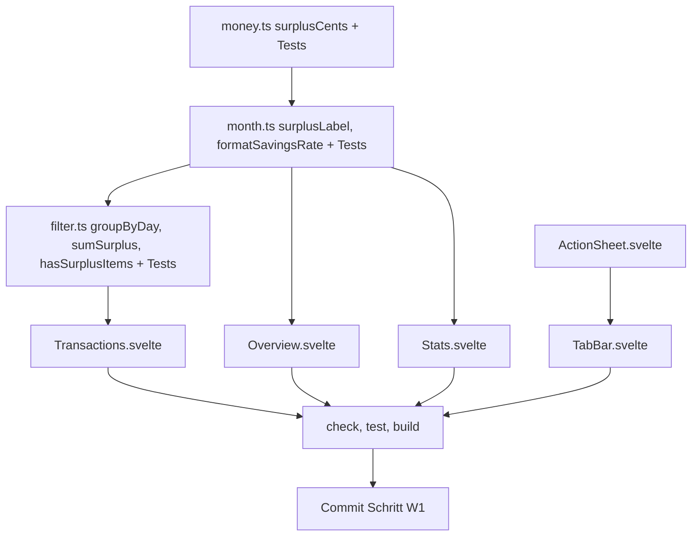

# 06 – Vorgemerkte Wünsche (Schritt W1)

> Verbindlich für den Code-Mode. Es wird **nur** umgesetzt, was hier steht. Bei Unklarheit: `// PLAN-FRAGE: ...` (siehe [README.md](README.md)).
> Umsetzung **vor** der PDF-Etappe aus [05-pdf-analyse.md](05-pdf-analyse.md).
> Konventionen aus [00-architektur.md](00-architektur.md): kein `any`, Svelte 5 Runes (`$props`, `$state`, `$derived`, `$effect`, `onclick`), Geld nur als Integer-Cents, UI-Texte deutsch.

## 1. Analyse des Ist-Zustands

### 1.1 „Saldo“ in der Monatsübersicht
- [`summarizeTransactions()`](../src/lib/stats/month.ts:75) rechnet `balanceCents = income.total - expense.total`. [`totalsByCategory()`](../src/lib/stats/month.ts:59) filtert streng nach `tx.type`. **Umbuchungen (`type: 'transfer'`) fließen also schon heute NICHT ein.** Die Rechnung ist korrekt, die **Beschriftung** ist das Problem.
- [`Overview.svelte`](../src/routes/Overview.svelte:99) beschriftet den Wert mit „Saldo“. Das klingt nach Kontostand. Mitten im Monat (Gehalt kommt erst am Monatsende) steht dort ein großer negativer „Saldo“, obwohl das Konto gedeckt ist.
- Zusätzlich steht in der Kachel „davon angelegt …“ ([`Overview.svelte`](../src/routes/Overview.svelte:104)). Das suggeriert, Anlagen seien ein Teil dieses Werts. Das stimmt nicht: Umbuchungen sind gar nicht enthalten, und der Betrag kann größer als der Wert sein.
- Es gibt **keine** kontobezogene Saldo-Berechnung (keine weitere Stelle mit `balance` in Routen außer `Overview`, `Stats`, `Transactions`).
- **Buchungsliste:** [`groupByDay()`](../src/lib/filter.ts:46) und [`sumBalance()`](../src/lib/filter.ts:62) summieren [`signedCents()`](../src/lib/money.ts:59). `signedCents` gibt für Umbuchungen `out` negativ und `in` positiv zurück. **Hier fließen Umbuchungen heute ein.** Eine Umbuchung von 500 € auf das Tagesgeld lässt den Tag und die Fußzeile in [`Transactions.svelte`](../src/routes/Transactions.svelte:128) um −500 € rutschen. Das ist inkonsistent zur Übersicht.

### 1.2 „Ersparnis“ in der Statistik
- [`Stats.svelte`](../src/routes/Stats.svelte:106) zeigt unter „Ersparnis“ `summary.balanceCents` aus [`summarizeYear()`](../src/lib/stats/year.ts:81). Das ist dieselbe Rechnung wie oben: **Einnahmen − Ausgaben, ohne Umbuchungen.**
- Der Begriff „Ersparnis“ ist falsch. Geld, das nicht ausgegeben wurde, ist nicht automatisch gespart. Darunter steht außerdem „davon angelegt“ ([`Stats.svelte`](../src/routes/Stats.svelte:118)) aus [`transferFlows()`](../src/lib/stats/transfers.ts:17). Zusammen wirkt das so, als würden Umbuchungen als Ersparnis gezählt.
- Die Monatstabelle nennt denselben Wert „Saldo“ ([`Stats.svelte`](../src/routes/Stats.svelte:199)). Das sind also drei Namen für einen Wert.
- Die Sparquote `balanceCents / incomeCents` ist korrekt und bleibt.

### 1.3 ＋ in der TabBar
- [`TabBar.svelte`](../src/components/TabBar.svelte:28) enthält `<a class="add" href="#/add" aria-label="Neue Buchung">＋</a>`. Der Import (`/import`) ist nur über die Buchungsliste oder die leere Übersicht erreichbar, obwohl er der Hauptanwendungsfall ist.

## 2. Entscheidungen

| Thema | Entscheidung |
|---|---|
| Kennzahl | **Ein** Begriff überall: **„Überschuss“** (Wert ≥ 0) bzw. **„Defizit“** (Wert < 0) = Einnahmen − Ausgaben, Umbuchungen nicht enthalten. |
| Rechnung | Die Rechnung in `month.ts`/`year.ts` bleibt unverändert. Das Feld `balanceCents` wird **nicht** umbenannt (es wird nur der Kommentar angepasst), damit Tests und `year.ts` nicht angefasst werden müssen. |
| Buchungsliste | Tagessummen und Fußzeile zählen nur Einnahmen und Ausgaben. Umbuchungen zählen 0. Ein Tag bzw. eine Liste nur mit Umbuchungen zeigt keine Summe. |
| „davon angelegt“ | Diese Zeile wird in Übersicht und Statistik **entfernt**. Die Info steht weiterhin im Block „Rücklagen“ („Gespart & angelegt“). |
| Laufender Monat | Ein Hinweis, dass Einnahmen wie das Gehalt noch fehlen können. Kein „Monat ab Gehaltseingang“, weil das zu komplex wäre. |
| ＋-Button | Reines Action Sheet **ohne** neues Settings-Feld. Damit gibt es keine Schema-Änderung und keine Migration. Begründung: Das Sheet kostet nur einen Tipp mehr, und eine Einstellung würde `validateAppData`, Defaults, Migration und Backup-Validierung berühren. |
| Datenmodell | **Keine Änderung.** `types.ts`, `db/*`, `backup/*`, `migrate.ts` bleiben unangetastet. |
| Version | `package.json`-Version bleibt **0.2.2**. |

## 3. Schritt W1 – Überschuss statt Saldo, Statistik-Benennung, ＋-Auswahl

### 3.1 `src/lib/money.ts` – neue Funktion
Direkt **unter** `signedCents` einfügen:
```ts
/** Beitrag zum Überschuss: income positiv, expense negativ, transfer immer 0 (Umbuchungen sind weder Einnahme noch Ausgabe). */
export function surplusCents(tx: { type: TxType; amountCents: number; direction?: TxDirection | null }): number {
  if (tx.type === 'income') return tx.amountCents;
  if (tx.type === 'expense') return -tx.amountCents;
  return 0;
}
```
`signedCents` bleibt **unverändert**. Es wird weiter von CSV, Duplikaten und Import gebraucht.

**Tests** in `src/lib/money.test.ts` (neuer `describe('surplusCents')`, Import ergänzen):

| Eingabe | Erwartet |
|---|---|
| `{ type: 'income', amountCents: 500 }` | `500` |
| `{ type: 'expense', amountCents: 500 }` | `-500` |
| `{ type: 'transfer', amountCents: 500, direction: 'in' }` | `0` |
| `{ type: 'transfer', amountCents: 500, direction: 'out' }` | `0` |

(Die Parametersignatur entspricht bewusst der von `signedCents`. So können Objektliterale mit `direction` direkt übergeben werden. `TxDirection` ist in `money.ts` bereits importiert, weil `signedCents` es verwendet.)

### 3.2 `src/lib/stats/month.ts` – Kommentar und zwei Helfer
1. Kommentar in `MonthSummary` ändern:
   - `balanceCents: number; // Überschuss = income - expense; Umbuchungen nicht enthalten`
   - `savingsRate: number | null; // Überschuss / income, null wenn income === 0`
2. Am Dateiende ergänzen:
```ts
/** Beschriftung der Kennzahl Einnahmen − Ausgaben. 0 zählt als Überschuss. */
export function surplusLabel(cents: number): 'Überschuss' | 'Defizit' {
  return cents < 0 ? 'Defizit' : 'Überschuss';
}

/** "12,5 %" (de-DE, genau eine Nachkommastelle, Leerzeichen vor %); null -> "–" (U+2013). */
export function formatSavingsRate(rate: number | null): string {
  if (rate === null) return '–';
  return (rate * 100).toLocaleString('de-DE', { minimumFractionDigits: 1, maximumFractionDigits: 1 }) + ' %';
}
```

**Tests** in `src/lib/stats/month.test.ts` (Import ergänzen, zwei neue `describe`-Blöcke):

| Funktion | Eingabe | Erwartet |
|---|---|---|
| `surplusLabel` | `12345` | `'Überschuss'` |
| `surplusLabel` | `0` | `'Überschuss'` |
| `surplusLabel` | `-1` | `'Defizit'` |
| `formatSavingsRate` | `null` | `'–'` |
| `formatSavingsRate` | `0.125` | `'12,5 %'` |
| `formatSavingsRate` | `0` | `'0,0 %'` |
| `formatSavingsRate` | `1` | `'100,0 %'` |
| `formatSavingsRate` | `-0.25` | `'-25,0 %'` |

Ein zusätzlicher Test sichert die bestehende Rechnung ab: `summarizeMonth` mit income 300000 (`2026-10-31`), expense 100000 (`2026-10-05`), transfer `out` 50000 und transfer `in` 20000 (beide Oktober, `categoryId: 'cat-transfer-savings'`), Monat `'2026-10'`. Erwartet werden `balanceCents === 200000`, `savingsRate` ≈ `2/3` (`toBeCloseTo(0.6667, 4)`) und `count === 4`. Die vorhandenen Helfer im Test werden genutzt. Fehlt ein passender Helfer, wird lokal ein vollständiges `Transaction`-Objekt nach dem Muster aus `filter.test.ts` gebaut.

### 3.3 `src/lib/filter.ts` – Tagessummen ohne Umbuchungen
Import ändern: `import { centsToInput, surplusCents } from './money';` (`signedCents` wird hier nicht mehr gebraucht. Wenn `centsToInput` vorher importiert war, bleibt es.)

`DayGroup` und Funktionen **ersetzen**:
```ts
export interface DayGroup {
  date: string;
  items: Transaction[];
  surplusCents: number; // Summe surplusCents (Umbuchungen = 0)
  hasSurplusItems: boolean; // mind. eine Einnahme oder Ausgabe an diesem Tag
}

/** Behält Eingabereihenfolge (Store ist date desc). surplusCents = Einnahmen − Ausgaben des Tages, ohne Umbuchungen. */
export function groupByDay(txs: Transaction[]): DayGroup[] {
  const groups: DayGroup[] = [];
  const byDate = new Map<string, DayGroup>();
  for (const tx of txs) {
    let group = byDate.get(tx.date);
    if (!group) {
      group = { date: tx.date, items: [], surplusCents: 0, hasSurplusItems: false };
      byDate.set(tx.date, group);
      groups.push(group);
    }
    group.items.push(tx);
    group.surplusCents += surplusCents(tx);
    if (tx.type !== 'transfer') group.hasSurplusItems = true;
  }
  return groups;
}

/** Einnahmen − Ausgaben, Umbuchungen nicht enthalten. */
export function sumSurplus(txs: Transaction[]): number {
  return txs.reduce((sum, tx) => sum + surplusCents(tx), 0);
}

export function hasSurplusItems(txs: Transaction[]): boolean {
  return txs.some((tx) => tx.type !== 'transfer');
}
```
`sumBalance` wird **entfernt**. Es gibt nur diese eine Verwendung in `Transactions.svelte` und die Tests.

**Tests** in `src/lib/filter.test.ts`:
- Import: `sumBalance` durch `sumSurplus, hasSurplusItems` ersetzen.
- Im bestehenden `describe('groupByDay / sumBalance')` den Namen auf `'groupByDay / sumSurplus'` ändern. Jede Prüfung auf `.balanceCents` wird zu `.surplusCents`. Vergleicht ein Test ganze `DayGroup`-Objekte mit `toEqual`, kommt `hasSurplusItems: true` dazu. Die erwarteten Zahlen bleiben gleich, weil `all` keine Umbuchungen enthält.
- `sumBalance(...)` wird zu `sumSurplus(...)`. Erwartungen bleiben gleich: `-4215 - 1500 + 250000 - 999` und `0` für `[]`.
- Neue Fixtures **nur lokal im neuen Test** (nicht in `all` aufnehmen, damit andere Filtertests unverändert bleiben):
  - `tOut = tx({ type: 'transfer', direction: 'out', amountCents: 50000, date: '2026-10-21', categoryId: 'cat-transfer-savings' })`
  - `tIn = tx({ type: 'transfer', direction: 'in', amountCents: 20000, date: '2026-10-02', categoryId: 'cat-transfer-savings' })`

| Test | Eingabe | Erwartet |
|---|---|---|
| Umbuchung ändert die Tagessumme nicht | `groupByDay([rewe, kino, tOut])` | 1 Gruppe `2026-10-21`, `surplusCents === -5715`, `hasSurplusItems === true`, `items.length === 3` |
| Tag nur mit Umbuchung | `groupByDay([tIn])` | 1 Gruppe, `surplusCents === 0`, `hasSurplusItems === false` |
| sumSurplus ignoriert Umbuchungen | `sumSurplus([...all, tOut, tIn])` | `-4215 - 1500 + 250000 - 999` |
| hasSurplusItems | `hasSurplusItems([tOut, tIn])` / `([tOut, rewe])` / `([])` | `false` / `true` / `false` |

### 3.4 `src/routes/Transactions.svelte`
- Import: `import { filterTransactions, groupByDay, hasSurplusItems, sumSurplus } from '../lib/filter';`
- Zusätzlich `import { surplusLabel } from '../lib/stats/month';`
- Zeile 55: `const balance = $derived(sumSurplus(filtered));`
- Neu darunter: `const showTotal = $derived(hasSurplusItems(filtered));`
- Tageskopf (Zeile 126–129) ersetzen:
```svelte
<div class="day-header">
  <span class="muted">{dayHeader(group.date)}</span>
  {#if group.hasSurplusItems}
    <AmountText cents={group.surplusCents} type="balance" size="sm" />
  {/if}
</div>
```
- Fußzeile (Zeile 143–146) ersetzen:
```svelte
<p class="footer muted">
  <span>{filtered.length} Buchungen</span>
  {#if showTotal}
    <span> · {surplusLabel(balance)} </span>
    <AmountText cents={balance} type="balance" size="sm" />
  {/if}
</p>
<p class="muted footer-hint">Summen: Einnahmen minus Ausgaben, ohne Umbuchungen.</p>
```
- CSS ergänzen: `.footer-hint { font-size: 13px; text-align: center; margin: 4px 0 0; }`. Wenn `.footer` linksbündig ist, wird `text-align` an `.footer` angeglichen: Der Wert von `.footer` wird übernommen.

### 3.5 `src/routes/Overview.svelte`
- Import ändern: `import { formatSavingsRate, inMonth, summarizeMonth, surplusLabel } from '../lib/stats/month';`
- `savingsText` (Zeile 45–49) ersetzen durch: `const savingsText = $derived(formatSavingsRate(summary.savingsRate));`
- Neu: `const isCurrentMonth = $derived($selectedMonth === currentMonthKey());` (`currentMonthKey` ist schon importiert.) In `planned` wird `$selectedMonth === currentMonthKey()` durch `isCurrentMonth` ersetzt.
- Dritte Kachel (Zeile 98–107) ersetzen:
```svelte
<div class="card tile">
  <span class="muted label">{surplusLabel(summary.balanceCents)}</span>
  <AmountText cents={summary.balanceCents} type="balance" />
  {#if summary.savingsRate !== null}
    <span class="rate" class:expense={summary.savingsRate < 0}>Sparquote {savingsText}</span>
  {/if}
</div>
```
  Die Zeile „davon angelegt …“ entfällt.
- Direkt **nach** dem schließenden `</div>` von `.tiles` einfügen:
```svelte
<p class="muted tiles-hint">
  Überschuss = Einnahmen minus Ausgaben, ohne Umbuchungen.{#if isCurrentMonth} Laufender Monat: Einnahmen wie das Gehalt können noch fehlen.{/if}
</p>
```
- Im Block „Rücklagen“ direkt nach dem schließenden `</div>` der `.card rows` einfügen:
  `<p class="muted hint">Umbuchungen zählen nicht als Einnahmen oder Ausgaben und sind im Überschuss nicht enthalten.</p>`
- CSS:
  - `.tiles` bekommt `margin-bottom: 8px` statt `20px`.
  - Neu: `.tiles-hint { font-size: 13px; margin: 0 4px 20px; }`
  - `.small { font-size: 13px; }` **entfernen**, weil es nicht mehr benutzt wird. Sonst kommt eine svelte-check-Warnung.

### 3.6 `src/routes/Stats.svelte`
- Import ergänzen: `import { formatSavingsRate, surplusLabel } from '../lib/stats/month';`
- `savingsText` (Zeile 57–61) ersetzen durch: `const savingsText = $derived(formatSavingsRate(summary.savingsRate));`
- Kachel „Ersparnis“ (Zeile 105–108) ersetzen:
```svelte
<div class="card tile">
  <span class="muted label">{surplusLabel(summary.balanceCents)}</span>
  <AmountText cents={summary.balanceCents} type="balance" />
</div>
```
- Zeilen 118–120 (`{#if flows.investedNetCents !== 0} … davon angelegt … {/if}`) **ersetzen** durch:
```svelte
<p class="muted small tiles-hint">
  Überschuss = Einnahmen minus Ausgaben, ohne Umbuchungen. Sparquote = Überschuss geteilt durch Einnahmen.
</p>
```
- `.tiles` bekommt `margin-bottom: 8px`. Die CSS-Regel `.davon { … }` wird ersetzt durch `.tiles-hint { margin: 0 4px 20px; }`. `.small` bleibt, weil es weiter benutzt wird.
- Im Block „Rücklagen {year}“ nach der `.card rows` denselben Hinweis wie in der Übersicht einfügen:
  `<p class="muted hint">Umbuchungen zählen nicht als Einnahmen oder Ausgaben und sind im Überschuss nicht enthalten.</p>`
- Monatstabelle: Kopfzelle `<th scope="col" class="num">Saldo</th>` wird zu `<th scope="col" class="num">Überschuss</th>`. Die Werte (`m.balanceCents`, `summary.balanceCents`) bleiben, weil sie identisch berechnet werden.

### 3.7 Neue Komponente `src/components/ActionSheet.svelte`
Der Typ `ActionSheetItem` wird im `<script lang="ts" module>`-Block exportiert, weil das Instanz-Script keine Exporte haben darf. Vollständige Datei, wörtlich so:

```svelte
<script lang="ts" module>
  export interface ActionSheetItem {
    label: string;
    onselect: () => void;
  }
</script>

<script lang="ts">
  interface Props {
    open: boolean;
    title: string;
    items: ActionSheetItem[];
    onclose: () => void;
  }

  let { open, title, items, onclose }: Props = $props();

  let sheetEl = $state<HTMLDivElement | null>(null);

  $effect(() => {
    if (open && sheetEl) {
      sheetEl.querySelector<HTMLButtonElement>('button')?.focus();
    }
  });

  function handleKeydown(e: KeyboardEvent): void {
    if (open && e.key === 'Escape') {
      e.preventDefault();
      onclose();
    }
  }

  function choose(item: ActionSheetItem): void {
    onclose();
    item.onselect();
  }
</script>

<svelte:window onkeydown={handleKeydown} />

{#if open}
  <button type="button" class="backdrop" aria-label="Schließen" tabindex="-1" onclick={onclose}></button>
  <div class="sheet" role="dialog" aria-modal="true" aria-labelledby="action-sheet-title" bind:this={sheetEl}>
    <h2 id="action-sheet-title" class="title">{title}</h2>
    <div class="items">
      {#each items as item (item.label)}
        <button type="button" class="item" onclick={() => choose(item)}>{item.label}</button>
      {/each}
    </div>
    <button type="button" class="cancel" onclick={onclose}>Abbrechen</button>
  </div>
{/if}

<style>
  .backdrop {
    position: fixed;
    inset: 0;
    z-index: 20;
    border: none;
    padding: 0;
    background: rgba(0, 0, 0, 0.4);
  }

  .sheet {
    position: fixed;
    left: 0;
    right: 0;
    bottom: 0;
    z-index: 21;
    max-width: 600px;
    margin: 0 auto;
    display: flex;
    flex-direction: column;
    gap: 8px;
    padding: 12px 12px calc(12px + env(safe-area-inset-bottom));
    background: var(--surface);
    border-radius: 16px 16px 0 0;
    box-shadow: 0 -2px 12px rgba(0, 0, 0, 0.25);
  }

  .title {
    margin: 0 0 4px;
    font-size: 13px;
    font-weight: 600;
    text-align: center;
    color: var(--muted);
  }

  .items {
    display: flex;
    flex-direction: column;
    gap: 8px;
  }

  .item,
  .cancel {
    width: 100%;
    min-height: 48px;
    padding: 0 16px;
    border-radius: var(--radius);
    font: inherit;
    font-size: 17px;
    cursor: pointer;
  }

  .item {
    border: 1px solid var(--border);
    background: var(--surface);
    color: inherit;
    text-align: left;
  }

  .cancel {
    margin-top: 4px;
    border: none;
    background: var(--border);
    color: inherit;
    font-weight: 600;
  }
</style>
```
Die Fokus-Rückgabe nach dem Schließen übernimmt der Aufrufer (TabBar). Eine volle Tab-Fokusfalle wird **nicht** umgesetzt.

**z-index-Begründung:** TabBar 10 < Sheet 20/21 < Toast 30 < UpdateBanner 40.

### 3.8 `src/components/TabBar.svelte`
- Script ergänzen:
```ts
import ActionSheet, { type ActionSheetItem } from './ActionSheet.svelte';
import { navigate, route } from '../lib/router';   // ersetzt den bisherigen route-Import

let sheetOpen = $state(false);
let addButton = $state<HTMLButtonElement | null>(null);

const addItems: ActionSheetItem[] = [
  { label: '✍️ Buchung erfassen', onselect: () => navigate('/add') },
  { label: '📥 Importieren (Text/Screenshot)', onselect: () => navigate('/import') },
];

function closeSheet(): void {
  sheetOpen = false;
  addButton?.focus();
}

// Bei jedem Routenwechsel (z. B. Zurück-Geste) Sheet schließen.
$effect(() => {
  if (current) sheetOpen = false;
});
```
  (`$effect` wird **nach** der Zeile `const current = $derived($route.path);` platziert.)
- Zeile 28 ersetzen:
```svelte
<button
  type="button"
  class="add"
  aria-label="Neu: Buchung erfassen oder importieren"
  aria-haspopup="dialog"
  aria-expanded={sheetOpen}
  bind:this={addButton}
  onclick={() => (sheetOpen = true)}
>＋</button>
```
- **Nach** `</nav>` (zweites Wurzelelement der Komponente) einfügen:
```svelte
<ActionSheet open={sheetOpen} title="Neue Buchung" items={addItems} onclose={closeSheet} />
```
- CSS `.add` ergänzen: `border: none; padding: 0; cursor: pointer; font: inherit;`. `font: inherit` muss **vor** `font-size: 30px; line-height: 1;` stehen, damit die Größe erhalten bleibt. `text-decoration: none` darf bleiben.

Hinweis zum Ablauf: Bei der Auswahl ruft `choose()` zuerst `onclose` auf (→ `closeSheet`, Fokus auf ＋) und dann `navigate`. Danach greift der `$effect` und setzt `sheetOpen = false`. Er hat keine Wirkung mehr und erzeugt keine Schleife, weil `sheetOpen` im Effekt nicht gelesen wird.

### 3.9 Nicht ändern
`types.ts`, `db/*`, `backup/*`, `migrate.ts`, `year.ts`, `transfers.ts`, `App.svelte`, `Import.svelte`, `TransactionForm.svelte`, `Settings.svelte`, `package.json`.

### 3.10 Manuelle Prüfung (iPhone/Safari-Simulation)
1. Übersicht, laufender Monat ohne Gehalt: Die Kachel heißt „Defizit“ mit negativem Betrag. Darunter steht der Hinweis inklusive „Laufender Monat …“.
2. Vormonat mit Gehalt: Die Kachel heißt „Überschuss“, die Sparquote ist sichtbar, und der „Laufender Monat“-Satz fehlt.
3. Buchungen: Eine Umbuchung von 500 € ändert die Tagessumme nicht. Ein Filter auf „Umbuchungen“ zeigt keine Summe, nur „N Buchungen“.
4. Statistik: Die Kacheln zeigen „Überschuss/Defizit“ und „Sparquote“, die Tabellenspalte heißt „Überschuss“. „davon angelegt“ fehlt, der Rücklagen-Block mit Hinweis ist vorhanden.
5. ＋ öffnet das Sheet mit Fokus auf „✍️ Buchung erfassen“. ESC, ein Tipp auf den Hintergrund und „Abbrechen“ schließen das Sheet, danach liegt der Fokus auf ＋. Beide Einträge navigieren korrekt. Die Buttons liegen über der Home-Indikator-Zone.

### 3.11 Abschluss
- `npm run check`, `npm test` und `npm run build` sind grün. Die Testanzahl steigt gegenüber 621.
- `git add -A` und `git commit -m "Schritt W1: Überschuss statt Saldo, Statistik-Benennung, ＋-Auswahl"`
- **Kein Push.**

## 4. Ablauf

