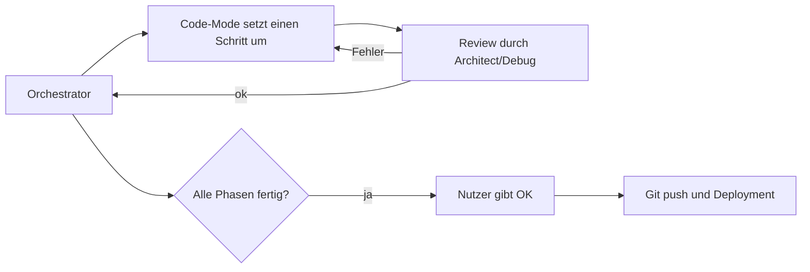

# Umsetzungsplan – Arbeitsweise

## Dokumente (in dieser Reihenfolge lesen)
1. [00-architektur.md](00-architektur.md): verbindliche Architektur, Typen, Krypto und Konventionen
2. [01-phase1-mvp.md](01-phase1-mvp.md): Schritte 1.1–1.14
3. [02-phase2-auswertungen.md](02-phase2-auswertungen.md): Schritte 2.1–2.5
4. [03-phase3-4-import.md](03-phase3-4-import.md): Schritte 3.1–3.6 und 4.1
5. [04-erweiterungen.md](04-erweiterungen.md): Schritte E1–E5 (Unterkategorien, Umbuchungen, Konten, Umbenennungs-Regeln, robuster DKB-Import, unscharfe Duplikate, Migration auf Schema v2)
6. [05-pdf-analyse.md](05-pdf-analyse.md): Schritte P1–P2 (PDF-Etappe 1: PDF-Analysemodus mit pdf.js, Zeilenrekonstruktion, anonymisierter Export, importiert noch keine Buchungen)
7. [06-wuensche.md](06-wuensche.md): Schritt W1 (wird **vor** P1 umgesetzt): „Überschuss/Defizit“ statt „Saldo“ bzw. „Ersparnis“, Tagessummen ohne Umbuchungen, ＋ öffnet ein Action Sheet „Buchung erfassen / Importieren“
8. [konzept.md](konzept.md): Überblick für Menschen

## Vorgemerkte Wünsche
Alle bisher vorgemerkten Wünsche sind in [06-wuensche.md](06-wuensche.md) geplant (Schritt W1):
- ~~**Monatsübersicht:** Saldo irreführend~~ → geplant in W1: Kachel „Überschuss“/„Defizit“ mit Hinweis zum laufenden Monat. Ein „Monat ab Gehaltseingang“ ist bewusst nicht vorgesehen.
- ~~**Statistik „Ersparnis“:** Umbuchungen sind keine Ersparnis~~ → geplant in W1: „Überschuss“/„Defizit“, „davon angelegt“ entfällt. Eine Kategorie bzw. Markierung „zählt als Sparen“ ist bewusst nicht vorgesehen und bei Bedarf später neu vorzumerken.
- ~~**＋-Button:** direkt zum Import~~ → geplant in W1: Action Sheet mit „✍️ Buchung erfassen“ und „📥 Importieren (Text/Screenshot)“, ohne neues Settings-Feld.

## Ablauf

## Regeln für den Code-Mode
- Es wird **nur** umgesetzt, was im Plan steht. Es werden keine zusätzlichen Bibliotheken, Features oder Umbenennungen eingeführt.
- Ist etwas unklar oder widersprüchlich, wird die Stelle **nicht raten**. Stattdessen kommt ein Kommentar `// PLAN-FRAGE: ...` in den Code, und die Frage wird im Abschluss-Bericht genannt.
- Nach jedem Schritt: `npm run check`, `npm test` und `npm run build` müssen ohne Fehler laufen.
- Am Ende jedes Schritts wird ein **lokaler** Commit mit `git commit -m "Schritt X.Y: <Titel>"` erstellt.
- **VERBOTEN ohne ausdrückliches OK des Nutzers:** `git push`, Remote hinzufügen, GitHub-Repo anlegen, Deployment auslösen.

## Review-Checkliste (Architect/Debug nach jedem Schritt bzw. jeder Phase)
- [ ] `check`, `test` und `build` sind grün.
- [ ] Die Signaturen und Dateinamen entsprechen exakt dem Plan.
- [ ] Geld wird nur als Integer-Cents verarbeitet, nirgends mit `parseFloat`/`toFixed`-Arithmetik.
- [ ] Daten verwenden `todayIso()`/`toIsoDate()`, nicht `toISOString().slice(0,10)`.
- [ ] Es gibt kein `any`, kein `as any`, kein `export let`, kein `on:click`.
- [ ] Der DEK wird nur in `session.ts` gehalten und beim Sperren gelöscht. Kein Klartext landet in IndexedDB, localStorage oder der Konsole.
- [ ] Jede Verschlüsselung nutzt eine neue IV.
- [ ] Es gibt keine externen URLs im Code (`grep -r "https://" src`), außer in Kommentaren.
- [ ] Svelte-5-Runes werden korrekt verwendet, und `$effect` erzeugt keine Endlosschleifen.
- [ ] Die UI-Texte sind deutsch, und die Eingabefelder haben mindestens 16px Schriftgröße.
