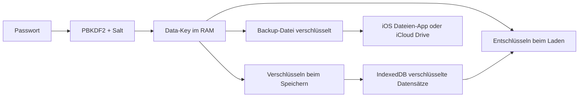
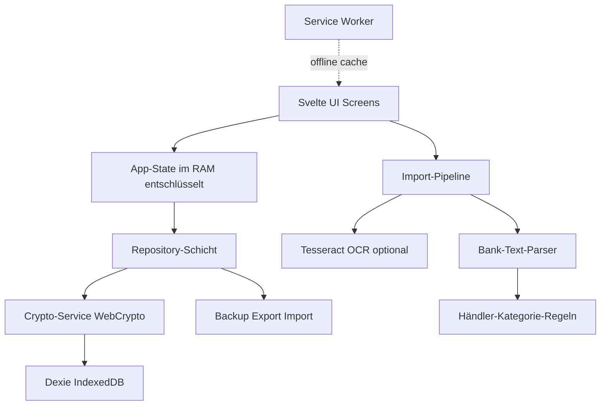

# Money Tracker – Konzept

> Überblick für Menschen. **Verbindlich für die Umsetzung** sind [00-architektur.md](00-architektur.md), [01-phase1-mvp.md](01-phase1-mvp.md), [02-phase2-auswertungen.md](02-phase2-auswertungen.md) und [03-phase3-4-import.md](03-phase3-4-import.md). Bei Widersprüchen gelten diese Dateien.
>
> Gegenüber dem ersten Entwurf geändert: Diagramme werden als eigenes SVG gebaut statt mit Chart.js. Die PBKDF2-Iterationen werden auf den DEK angewendet, und ein Wiederherstellungsschlüssel ist fest eingeplant.

## 1. Ziel
Eine private Haushaltsbuch-App fürs iPhone. Sie erfasst Einnahmen und Ausgaben mit Kategorie, Händler, Datum und Notiz und zeigt Monats- und Jahresübersichten. Alle Daten bleiben auf dem Gerät und sind verschlüsselt. Es gibt einen Backup- und Exportweg, damit keine Daten verloren gehen.

## 2. Plattform: PWA auf dem iPhone
- Die App ist eine statische Web-App aus HTML, CSS und TypeScript. Sie wird einmalig per HTTPS ausgeliefert, z. B. über GitHub Pages, und über **Safari → Teilen → Zum Home-Bildschirm** installiert.
- Danach läuft sie dank Service Worker **komplett offline**. Es gibt **kein Backend**, und keine Daten verlassen das Gerät.
- Der Host liefert nur den Programmcode aus, niemals Daten. Das Repo kann privat bleiben. Wer den Code nicht hosten will, kann ihn auch lokal per `npm run build` bauen und dann einen beliebigen statischen Host nutzen.

### Warum keine einzelne lokale HTML-Datei?
Unter `file://` kann iOS keinen Service Worker registrieren, die Speicherung in IndexedDB ist unzuverlässig, und es gibt keine Installation auf dem Home-Bildschirm. Eine PWA ist dagegen genauso lokal, aber stabil.

## 3. Sicherheitskonzept

| Bedrohung | Maßnahme |
|---|---|
| Jemand nimmt das entsperrte Handy | App-Sperre mit Master-Passwort oder PIN, automatische Sperre nach Inaktivität oder beim Verlassen der App |
| Jemand liest den Browser-Speicher aus | Alle Datensätze liegen **AES-256-GCM-verschlüsselt** in IndexedDB. Der Schlüssel wird mit PBKDF2-SHA256 (≥ 600.000 Iterationen) und Salt aus dem Passwort abgeleitet und **nie gespeichert**. |
| Code schickt Daten ins Netz | Strenge **Content-Security-Policy** (`connect-src 'self'`, keine externen Skripte, CDNs oder Analytics). Alle Bibliotheken werden mitgebündelt, auch die OCR-Sprachdaten. |
| Datenverlust (iOS löscht Speicher, Handy kaputt, App-Update) | Verschlüsseltes Backup als Datei (siehe Abschnitt 5), regelmäßige Backup-Erinnerung, Anfrage nach dauerhaftem Speicher per `navigator.storage.persist()` |
| Passwort vergessen | Ohne Passwort gibt es **keinen Zugriff** auf die Daten, das ist so gewollt. Optional wird ein Wiederherstellungsschlüssel zum Ausdrucken oder Aufschreiben erzeugt. |

- Kryptographie läuft nur über die eingebaute **WebCrypto API**, also ohne eigene Krypto-Implementierung.
- Optional, in einer späteren Phase: Entsperren per **Face ID** über WebAuthn/Passkey mit PRF-Erweiterung (ab iOS 18). Das Passwort bleibt als Fallback bestehen.



## 4. Datenmodell
- **Transaktion:** id, typ (einnahme/ausgabe), betrag (in Cent, Integer), datum, kategorieId, händler, beschreibung/name, notiz, quelle (manuell/text/ocr), erstelltAm, geändertAm
- **Kategorie:** id, name, typ, icon, farbe, archiviert, optional ein Monatsbudget
- **Händler-Regel:** Muster (z. B. "REWE") → kategorieId. Die Regeln werden aus manuellen Korrekturen gelernt.
- **Einstellungen:** Währung EUR, Sperrzeit, Datum der letzten Sicherung, Schema-Version

Standardkategorien für Ausgaben sind Lebensmittel, Restaurant, Café, Kleidung, Urlaub/Reisen, Wohnen/Miete, Mobilität, Freizeit, Gesundheit, Abos, Geschenke und Sonstiges. Für Einnahmen gibt es Gehalt, Erstattung, Verkauf, Geschenk und Sonstiges. Alle Kategorien lassen sich bearbeiten.

## 5. Backup, Export und Import
- **Verschlüsseltes Backup:** eine `.mtbackup`-Datei mit JSON-Inhalt, verschlüsselt mit AES-GCM. Sie wird über das iOS-Teilen-Menü (Web Share API) in der Dateien-App oder in iCloud Drive gespeichert. Die Datei enthält eine Schema-Version, damit neue App-Versionen alte Backups migrieren können.
- **Wiederherstellung:** Datei auswählen, Passwort eingeben und dann wählen, ob die Daten ersetzt oder zusammengeführt werden. Beim Zusammenführen werden Duplikate über die id erkannt.
- **CSV-Export:** unverschlüsselt und nur mit deutlicher Warnung, z. B. für Excel.
- **Backup-Erinnerung:** ein Hinweis, wenn die letzte Sicherung älter als X Tage ist.

App-Updates verändern die Daten nicht. Sie bleiben in IndexedDB, und Schema-Migrationen laufen automatisch. Export und Import dienen als Sicherheitsnetz und für den Wechsel auf ein neues Handy.

## 6. Funktionen nach Phasen

### Phase 1 – MVP
- Ersteinrichtung mit Passwort, Sperrbildschirm und automatischer Sperre
- Schnellerfassung mit großem Betragsfeld, Einnahme/Ausgabe-Schalter, Kategorie-Chips, Händler (mit Autovervollständigung), Datum (Standard: heute) und Notiz
- Transaktionsliste mit Monatsfilter, Suche, Bearbeiten und Löschen
- Kategorieverwaltung
- Monatsübersicht mit Einnahmen, Ausgaben, Saldo bzw. Sparquote und einem Donut-Diagramm nach Kategorie
- Verschlüsseltes Backup und Wiederherstellung

### Phase 2 – Auswertungen
- Jahresübersicht mit Balken pro Monat für Einnahmen und Ausgaben, Summen je Kategorie, Gesamtersparnis und Sparquote
- Drilldown von Kategorie zu Transaktionen
- Vergleich mit dem Vormonat bzw. Vorjahr und Top-Händler
- Optionale Budgets pro Kategorie mit Fortschrittsbalken
- Wiederkehrende Buchungen (Gehalt, Miete, Abos) als Vorlagen oder automatisch angelegt

### Phase 3 – Text-Import
- Die iOS-Funktion **Live Text** erlaubt es, Text direkt aus einem Screenshot zu kopieren.
- Diesen Text fügt man in die App ein. Ein Parser erkennt Zeilen mit Datum, Händler und Betrag.
- Es folgt eine **Vorschau mit Bestätigung**: Kategorien werden über Händler-Regeln vorgeschlagen, Duplikate werden erkannt (gleiches Datum, gleicher Betrag, gleicher Händler), und jede Zeile lässt sich abwählen oder korrigieren.
- Der Parser ist bankspezifisch erweiterbar. Für das Zielinstitut sind Beispieltexte nötig.

### Phase 4 – Screenshot-OCR
- Screenshot auswählen. **Tesseract.js** wertet ihn lokal im Browser aus, mit deutschen Sprachdaten, die selbst gehostet und offline gecacht werden.
- Das Ergebnis läuft durch denselben Parser und dieselbe Vorschau wie in Phase 3.
- Bilder werden nicht gespeichert, sondern nach der Auswertung verworfen.

### Phase 5 – Komfort (optional)
- Entsperren per Face ID (WebAuthn PRF)
- Dark Mode, Haptik-Feedback und Aufteilen einer Buchung auf mehrere Kategorien

## 7. Tech-Stack
- **Vite + TypeScript + Svelte**: klein, schnell und ohne Laufzeit-Overhead
- **vite-plugin-pwa** (Workbox) für Manifest und Offline-Cache
- **Dexie.js** als Hülle für IndexedDB
- **WebCrypto** (nativ) für die Verschlüsselung
- **Chart.js** für die Diagramme, mitgebündelt
- **Tesseract.js** für OCR (erst ab Phase 4, per Lazy Loading)
- **Vitest** für Tests, besonders für Krypto, Parser und Aggregationen
- Hosting über **GitHub Pages** bzw. jeden statischen HTTPS-Host

## 8. Architektur



Ordnerstruktur (Vorschlag):
```
src/
  lib/crypto/      Schlüsselableitung, Ver- und Entschlüsselung
  lib/db/          Dexie-Schema, Migrationen, Repositories
  lib/backup/      Backup-Format, Export, Import, CSV
  lib/import/      Parser, Regeln, Duplikaterkennung, OCR
  lib/stats/       Monats- und Jahresaggregationen
  routes/          Lock, Setup, Übersicht, Liste, Erfassen, Statistik, Einstellungen
  components/      UI-Bausteine
public/            Manifest, Icons, Tesseract-Sprachdaten
```
